# 知识图谱导览（Library KG）

> 适用仓库：`tap-ai-backend`（分支 `feature/tap-10366`）＋ 入库 SDK `fwd-tap-ingest`（分支 `feature/tap-10366-kg`）
> 描述口径：**按改造完成后的目标状态描述**（K1a / K2b / K3a / T1 / T2 / K4c / K5 完成之后）。和当前代码不一致的地方用 🔧 **改造项** 标注。
> 读者：团队内的后端、前端、测试、运维同学。
> 姊妹文档：《知识库管理导览》（文档上传、入库任务、Azure 写入）。

---

## 目录

- [0. 一页看懂](#0-一页看懂)
- [1. 总体介绍](#1-总体介绍)
- [2. 快速使用](#2-快速使用)
- [3. 架构与代码地图](#3-架构与代码地图)
- [4. 图模型](#4-图模型)
- [5. 类型体系 kg_schema](#5-类型体系-kg_schema)
- [6. 写入链路：抽取 → 写图 → 向量](#6-写入链路抽取--写图--向量)
- [7. 增量更新与撤销](#7-增量更新与撤销)
- [8. 问答侧读取：图谱增强检索](#8-问答侧读取图谱增强检索)
- [9. 图谱浏览接口（前端用）](#9-图谱浏览接口前端用)
- [10. 前端对接指南](#10-前端对接指南)
- [11. jp-poc 导入（T1）](#11-jp-poc-导入t1)
- [12. jp-poc 切片编号对齐（K5）](#12-jp-poc-切片编号对齐k5)
- [13. hk 图谱的演进](#13-hk-图谱的演进)
- [14. Scope 隔离与安全](#14-scope-隔离与安全)
- [15. 配置项](#15-配置项)
- [16. 测试与验收](#16-测试与验收)
- [17. 常用 Cypher](#17-常用-cypher)
- [18. 常见问题 FAQ](#18-常见问题-faq)
- [19. 已知隐患与后续计划](#19-已知隐患与后续计划)
- [附录 A：文件 / 函数速查表](#附录-a文件--函数速查表)
- [附录 B：术语表](#附录-b术语表)

---

## 0. 一页看懂

| 问题 | 一句话回答 |
| --- | --- |
| 它是什么 | 把文档里的「流程、角色、系统、材料……」抽成实体和关系，存进 Neo4j。问答用它找相关切片，前端用它画图。 |
| 数据从哪来 | **hk**：文档上传后，入库流程自动抽取写入，随上传持续增长。**jp-poc**：旧 POC 的 `kg.db` 一次性导入。 |
| 存在哪 | 一个共享的 Neo4j（2026.10.1 社区版），用节点上的 `scope` 属性区分 hk 和 jp-poc。 |
| 谁在读 | ① 问答（`knowledge` 插件，查实体 → 子图 → 切片）② 前端图谱页（`/tap/ai/library/kg/*` 7 个只读接口）。 |
| 类型定义在哪 | SDK 的 `tap_ingest_sdk/kg_schema.py`，**唯一来源**，后端只引用。 |
| 怎么切换图谱 | 前端调 `kg/scopes/list` 拿到可用 scope，之后每个接口都带上 `scope`。 |
| 安全底线 | 所有读写都带 `scope` 条件；hk 数据暂不改动；jp-poc 只能由导入脚本写入。 |

---

## 1. 总体介绍

### 1.1 为什么要有知识图谱

纯向量检索擅长「找相似的段落」，但不擅长回答这类问题：

- 「理赔审核的**下一步**是什么？」（流程顺序）
- 「核保这一步**由谁负责**？」（角色归属）
- 「开户**需要哪些材料**？」（依赖关系）

这些答案往往分散在不同切片里，靠关系才能串起来。知识图谱把它们显式存成 `NEXT`、`HANDLED_BY`、`REQUIRES` 等关系。问答时先在图上走一两步，找到相关实体，再回 Azure 取对应切片的原文，答案更完整，引用也更准确。

### 1.2 两个图谱：hk 与 jp-poc

| 对比 | hk | jp-poc |
| --- | --- | --- |
| 定位 | 正式数据，持续增长 | POC 演示数据，用完可删 |
| 来源 | 知识库上传 → SDK 自动抽取 | POC 的 `kg.db` → T1 脚本导入 |
| 对应 Azure 索引 | hk 的索引（可写） | `jp-poc`（**只读**） |
| 关系来源 | 规则抽取 + 大模型抽取 | POC 原有关系，按对照表映射 |
| 时间字段 | 改造后新写入的才有 | 导入时统一写入 |
| 现阶段能否改动 | **暂不改动**（Neo4j 与同事共享） | 可以清空重建（只限 `scope='jp-poc'`） |

两者是**并列**关系，前端可以随时切换。

### 1.3 设计目标

1. **一套模型，多份数据**：hk 和 jp-poc 用同一套节点、关系和属性，前端和问答不用区分来源。
2. **类型集中定义、可扩展**：实体类型、关系类型、中文名、别名都只在 SDK `kg_schema.py` 定义。关系类型不在白名单的也不丢弃，存成 `RELATED_TO`。
3. **自动增长、可撤销**：每次上传或重传都能增量更新。删除一个文档只撤销它的贡献，不影响其他文档支撑的知识。
4. **和检索对齐**：图里的 `Chunk.chunk_id` 与 Azure 切片主键一致，能从图跳回原文。
5. **只读接口给前端**：浏览接口全部只读，带 scope 校验，不能拼接 Cypher。
6. **少开关**：浏览接口不加开关。配了 Neo4j 就能用，没配就返回「图谱未配置」。

### 1.4 总体流程图

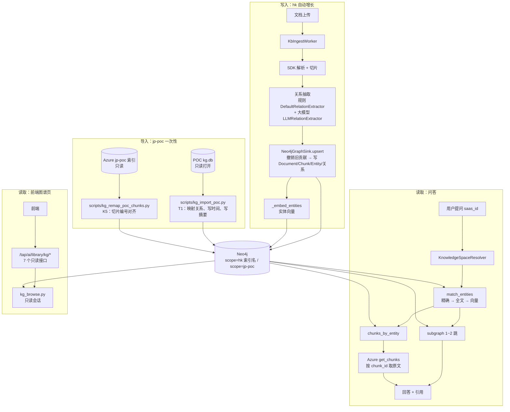

一句话：**hk 随上传自动写入，jp-poc 用脚本导入，二者在同一个 Neo4j 里用 scope 隔开；问答和前端通过两条只读链路使用它。**

---

## 2. 快速使用

### 2.1 连接 Neo4j

后端所有用到图谱的地方（问答、入库、导入脚本、浏览接口）读**同一组**配置，只需要配一次：

| 环境变量 | 默认 | 说明 |
| --- | --- | --- |
| `TAP_AI_KB_NEO4J_URI` | 空 | **为空就不连 Neo4j**。填 `neo4j://<主机>:7687` 或 `bolt://<主机>:7687` |
| `TAP_AI_KB_NEO4J_USER` | `neo4j` | 用户名 |
| `TAP_AI_KB_NEO4J_PASSWORD` | 空 | 密码，不要提交、不要打印 |
| `TAP_AI_KB_NEO4J_DATABASE` | `neo4j` | 社区版只有这一个库 |
| `TAP_AI_KB_NEO4J_TIMEOUT_S` | `3.0` | 查询超时 |
| `TAP_AI_LIBRARY_KB_GRAPH_ENABLED` | `true` | 入库时是否写图。**本地设 `false`**，避免改到共享库里的 hk 数据 |

> `http://...:7474` 是 Neo4j Browser 网页地址，后端用不了。要改成 `neo4j://...:7687`。

**测试连接**（只连接，不读写，不打印密码）：

```powershell
uv run python -c "from neo4j import GraphDatabase; from tap_ai.plugins.extensions.knowledge.settings import KnowledgeSettings as K; k=K(); print('uri =', k.neo4j_uri or '(空)'); d=GraphDatabase.driver(k.neo4j_uri, auth=(k.neo4j_user, k.neo4j_password.get_secret_value())); d.verify_connectivity(); print('连接成功'); d.close()"
```

| 输出 | 意思 |
| --- | --- |
| `连接成功` | 配好了 |
| `uri = (空)` | 没读到 `.env`：检查文件名、位置、运行目录 |
| `Unauthorized` | 用户名或密码不对 |
| `Unable to retrieve routing information` | 把 `neo4j://` 换成 `bolt://` |
| `Couldn't connect` / `timed out` | 地址、端口或网络不通 |

### 2.2 前端最小调用

```http
POST /tap/ai/library/kg/scopes/list
{}
```

```json
{"items": [
  {"scope": "jp-poc", "entity_count": 1234, "relation_count": 2345, "chunk_count": 800, "document_count": 40, "last_updated": 1761984000000},
  {"scope": "<hk 索引名>", "entity_count": 120, "relation_count": 150, "chunk_count": 90, "document_count": 6, "last_updated": null}
]}
```

```http
POST /tap/ai/library/kg/subgraph
{"scope": "jp-poc", "depth": 1, "limit": 300}
```

返回 `nodes` / `edges` / `truncated`，可以直接交给前端图组件渲染。

### 2.3 在问答里验证

```http
POST /tap/ai/conversations/chat
{"message_content": "理赔审核之后的下一步是什么？", "saas_id": "jp"}
```

回答里应该带 jp-poc 的引用。前提是 K5 已完成，图中的切片编号能在 Azure 里找到。

### 2.4 一次完整的使用旅程

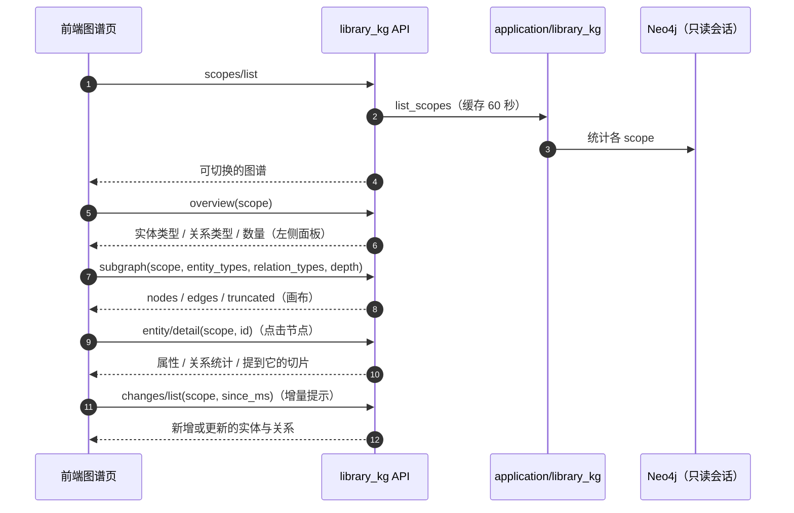

---

## 3. 架构与代码地图

### 3.1 三条链路，一个库

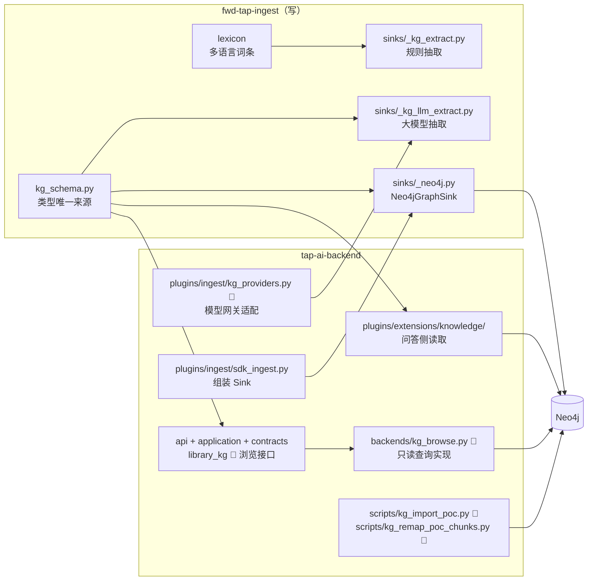

### 3.2 分层（浏览接口）

| 层 | 文件 | 职责 |
| --- | --- | --- |
| api | `api/library_kg.py` | 路由、请求校验、组装响应 |
| application | `application/library_kg.py` | scope 校验、类型校验、分页、显示名处理 |
| contracts | `contracts/library_kg.py` | 浏览接口的 Protocol 和数据结构；中文名从 SDK 导入 |
| plugins | `plugins/extensions/knowledge/backends/kg_browse.py` | Neo4j 只读查询（固定 Cypher） |
| 组装 | `bootstrap.build_app` | 创建服务、挂载路由 |

规则：api 只调 application；application 只依赖 contracts；Neo4j 细节只在 `kg_browse.py`。


---

## 4. 图模型

### 4.1 节点与关系

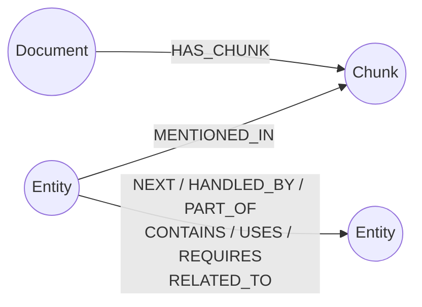

- **结构关系**：`HAS_CHUNK`（文档包含切片）和 `MENTIONED_IN`（实体出现在切片里）。它们负责溯源，不参与业务遍历。
- **业务关系**：实体之间的 7 种关系，见 §5。

### 4.2 节点属性

| 节点 | 属性 | 说明 |
| --- | --- | --- |
| `Entity` | `scope`、`id` | 唯一键，例如 `System:SFDC` |
| | `type`、`label` | 实体类型（英文）、显示名 |
| | `label_norm` | `normalize_label(label)` 的结果，用于精确匹配和关键词筛选 |
| | `doc_ids` | 支撑它的文档列表，用于撤销 |
| | `embedding` | 实体向量（`_embed_entities` 写入，浏览接口不返回） |
| | `created_at`、`updated_at` 🔧 | 毫秒时间戳（K1a），用于增量 |
| | `origin` | jp-poc 导入的为 `poc_import` |
| `Chunk` | `scope`、`chunk_id` | 唯一键，**与 Azure 切片主键一致** |
| | `document_id`、`source_file`、`page_or_sheet` 🔧 | 溯源和定位原文页 |
| | `preview` 🔧 | 正文前 200 个字符，用于详情面板 |
| | `ingested_at` 🔧 | 写入时间 |
| | `poc_chunk_id`、`remapped_at`、`remap_status` | 仅 jp-poc，K5 对齐时写入 |
| `Document` | `scope`、`document_id` | 唯一键 |
| | `source_file` / `filename`、`doc_type` | 文件信息 |
| | `ingested_at` 🔧 | 写入时间 |

### 4.3 业务关系属性

| 属性 | 说明 |
| --- | --- |
| `doc_ids` | 哪些文档支撑这条关系 |
| `chunk_ids` | 出自哪些切片 |
| `weight` | `= size(doc_ids)`，被多少文档支撑；为 0 时删除 |
| `raw_types` 🔧 | 原始说法（大模型或 POC 给的中文关系名），`RELATED_TO` 靠它显示 |
| `source` | `flowchart` / `rule` / `llm` / `poc` |
| `created_at`、`updated_at` 🔧 | 毫秒时间戳 |

### 4.4 约束与索引（由 Neo4jGraphSink 建立）

| 名称 | 类型 | 作用 |
| --- | --- | --- |
| `Entity(scope, id)` | 唯一约束 | 同一 scope 内实体不重复 |
| `Chunk(scope, chunk_id)` | 唯一约束 | 同一 scope 内切片不重复 |
| `document_key`：`Document(scope, document_id)` | 唯一约束 | 同一 scope 内文档不重复 |
| `entity_norm` | 普通索引 | 按 `label_norm` 精确匹配 |
| `entity_label_ft` | 全文索引（cjk 分词） | 中日文模糊匹配 |
| `entity_embedding` | 向量索引（cosine） | 语义匹配实体；只在配置了向量模型时创建 |

> 约束和索引只能由 SDK 建立。导入脚本和浏览接口**禁止**创建或删除任何约束、索引。

---

## 5. 类型体系 kg_schema

### 5.1 唯一来源

🔧 **改造项（K1a）**：新建 `tap_ingest_sdk/kg_schema.py`，文件开头注明「实体类型和关系类型的唯一定义处。新增或修改类型只改这个文件，SDK 和后端都从这里读取」。

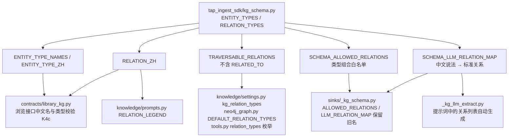

**以后新增一种关系**：只改 `kg_schema.py` 里的 `RELATION_TYPES`。问答的遍历白名单、工具枚举、提示词说明、前端中文名会自动跟着变。改造前要手动同步 `settings.py`、`tools.py`、`prompts.py`、`neo4j_graph.py` 四处。

### 5.2 数据结构

| 类 | 字段 | 说明 |
| --- | --- | --- |
| `EntityTypeDef` | `name`、`zh`、`description` | 实体类型定义 |
| `RelationAlias` | `text`、`reverse` | 一个中文说法；`reverse=True` 表示要交换起点和终点 |
| `RelationTypeDef` | `name`、`zh`、`aliases`、`pairs`、`description`、`traversable` | 关系类型定义；`pairs` 为空表示不限制端点类型 |

### 5.3 实体类型（11 种）

| 英文 | 中文 | 典型例子 |
| --- | --- | --- |
| Concept | 概念 | 业务概念、保险术语（大模型给出未知类型时也归到这里） |
| Product | 产品 | 保险产品 |
| System | 系统 | IT 系统、平台，如 SFDC |
| Process | 流程 | 业务流程 |
| Data | 数据 | 数据实体、字段 |
| Document | 文档 | 表单、材料 |
| Role | 角色 | 担当、岗位 |
| Channel | 渠道 | 销售或服务渠道 |
| Stage | 阶段 | 流程阶段（规则抽取） |
| Step | 步骤 | 流程图节点（规则抽取） |
| Action | 动作 | 具体操作（规则抽取） |

> 大模型抽取只使用前 8 种（`LLM_ENTITY_TYPES`）。Stage / Step / Action 来自规则抽取和词条库。

### 5.4 关系类型（7 种）

| 英文 | 中文 | 大模型的中文说法 | 允许的端点（概括） | 问答可遍历 |
| --- | --- | --- | --- | --- |
| NEXT | 下一步 | 前置步骤 | 流程 / 步骤 / 动作 → 流程 / 步骤 / 动作 | ✅ |
| HANDLED_BY | 负责 | 执行（起点终点交换） | 流程 / 步骤 / 动作 → 角色 | ✅ |
| PART_OF | 属于 | 属于 | 各类实体 → 阶段 / 流程 / 系统 / 产品 | ✅ |
| CONTAINS | 包含 | 包含 | 阶段 / 流程 / 系统 / 产品 / 文档 / 数据 / 概念 → 各类实体 | ✅ |
| USES | 使用 | 使用 | 角色 / 流程 / 步骤 / 动作 / 系统 / 产品 / 渠道 → 系统 / 数据 / 文档 / 渠道 / 产品 | ✅ |
| REQUIRES | 需要 | 依赖 | 流程 / 步骤 / 动作 / 产品 / 系统 / 文档 → 数据 / 文档 / 系统 / 流程 / 概念 | ✅ |
| RELATED_TO 🔧 | 相关 | （兜底） | 不限制 | ❌ |

> 端点组合以 `SCHEMA_ALLOWED_RELATIONS` 为准，上表为概括。

### 5.5 RELATED_TO：不丢弃，也不乱走

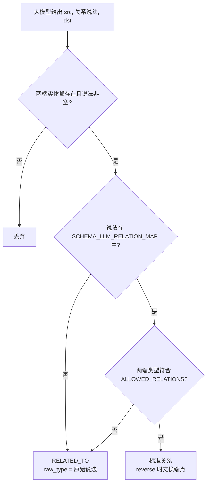

- **为什么不丢**：改造前白名单外的关系直接丢弃，大量有用信息没进图。现在先存下来，原始说法放在 `raw_types`。以后扩充白名单时，可以按 `raw_types` 统计出现最多的说法，决定把哪些升级成标准关系。浏览接口 `overview` 的 `related_raw_types` 就是这个统计。
- **为什么不遍历**：`RELATED_TO` 语义模糊，问答多跳时走它容易把无关内容带进答案，所以它不在 `TRAVERSABLE_RELATIONS` 中。前端画图照常显示。

---

## 6. 写入链路：抽取 → 写图 → 向量

### 6.1 触发

文档进入知识库后，`KbIngestWorker` 调用 `SdkIngestAdapter.ingest_file`。当 `library_kb_graph_enabled=true` 且 `neo4j_uri` 非空时，`_sinks_factory` 会额外构造 `Neo4jGraphSink`：

| 参数 | 值 |
| --- | --- |
| `scope` | 租户对应的索引名（与 Azure 一致） |
| `relation_extractor` | `combine_extractors(DefaultRelationExtractor, LLMRelationExtractor)` 🔧 默认两者都开 |
| `embedding_provider` | 🔧 `LiteLLMEmbeddingProvider`（默认开启实体向量） |
| `allowed_relations` | `SCHEMA_ALLOWED_RELATIONS` |
| `ensure_schema` | 首次连接时建立约束和索引 |

### 6.2 抽取器

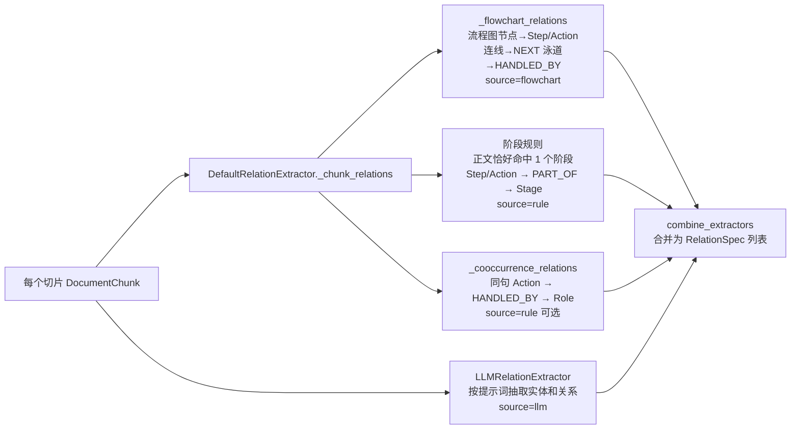

| 抽取器 | 依赖 | 特点 |
| --- | --- | --- |
| 规则 `DefaultRelationExtractor` | `tap_ingest_sdk.lexicon` 多语言词条 | 无外部依赖，稳定。同一概念的中、日、英说法归并为同一实体 |
| 大模型 `LLMRelationExtractor` | `LLMProvider.complete`（同步） | 覆盖面广。**失败时返回 `[]`，不阻断入库** |

产出统一为 `RelationSpec(src, type, dst, chunk_id, source, raw_type)`。🔧 `raw_type` 由 K1a 新增，有默认值，旧调用不受影响。

### 6.3 大模型调用怎么走（K3a）

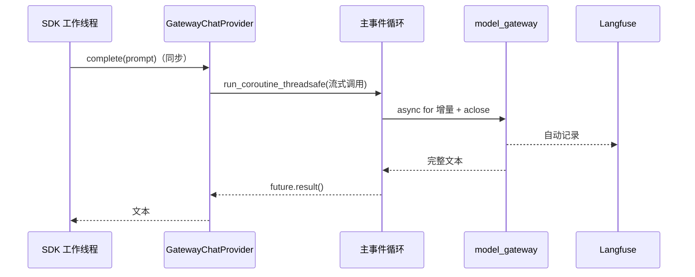

直接调 litellm 不会被 Langfuse 记录，所以统一走模型网关。`bind_loop` 在启动时绑定主循环，工作线程把协程投递回去执行。

### 6.4 提示词自动生成

🔧 `_kg_llm_extract.py` 的 `_SYSTEM_PROMPT` 中，关系那一行由 `kg_schema` 生成：

> 关系类型优先使用: 包含、属于、使用、依赖、前置步骤、执行（A 执行 B 表示角色 A 负责动作 B）。都不合适时，用一个简短的中文短语描述关系。

后半句允许大模型给出白名单外的说法，这些说法会进入 `RELATED_TO`。

### 6.5 写图顺序

`Neo4jGraphSink.upsert(document)`：

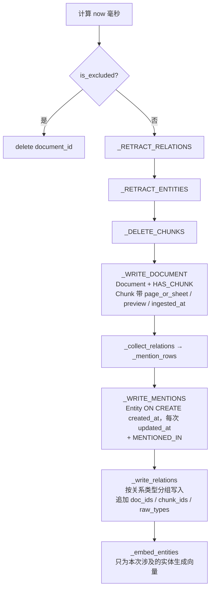

- 关系类型不能用参数传进 Cypher。`_write_relations` 按类型分组，把类型名放进语句模板。🔧 写入前校验类型名必须在 `RELATION_ZH` 的键里，不在就跳过并打 warning，防止注入。
- 所有语句都带 `scope` 条件。

---

## 7. 增量更新与撤销

### 7.1 文档级增量

| 操作 | 图上发生什么 |
| --- | --- |
| 新文件上传 | 新增 Document、Chunk、实体和关系；已有实体只追加 `doc_ids` 并刷新 `updated_at` |
| 同名文件重传 | `document_key` 不变 → 先撤销旧贡献，再按新内容写入 |
| 删除文件 🔧（K3b） | `delete(document_id)`：撤销关系 → 撤销实体 → 删 Chunk → 删 Document |
| 重新处理 🔧（K3b） | 等同于重传，用于规则或类型升级后重跑 |

### 7.2 撤销的含义

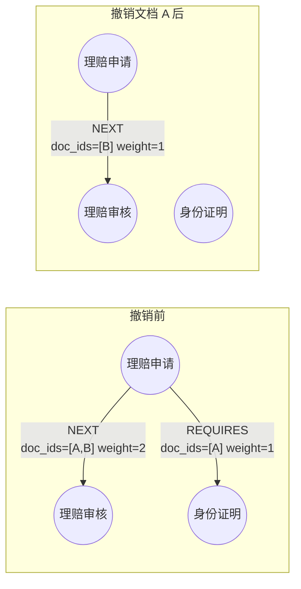

- 关系：`doc_ids` 去掉该文档，`weight` 重算，变成 0 的删除。
- 实体：只去掉 `doc_ids` 中的该文档，**实体节点保留**（可能是孤立节点）。
- 结果：文档 B 支撑的 `NEXT` 仍在，只有文档 A 独有的 `REQUIRES` 被删除。

### 7.3 时间字段与增量接口

🔧 K1a 之后，每次写入都会刷新 `updated_at`。浏览接口 `changes/list` 按 `updated_at > since_ms` 返回变化。

| scope | 有没有增量数据 |
| --- | --- |
| jp-poc | 有。导入脚本统一写了时间 |
| hk 旧数据 | 没有。旧数据没写时间，等重新处理后才有 |
| hk 新上传 | 有 |

> 删除的数据不会出现在增量里，因为节点已经不存在。前端需要知道删除时，可以对比 `scopes/list` 的数量变化，或者以后再加删除日志。

---

## 8. 问答侧读取：图谱增强检索

代码：`src/tap_ai/plugins/extensions/knowledge/`

### 8.1 调用链

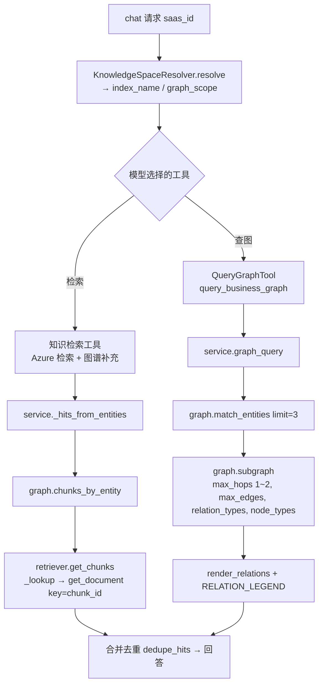

### 8.2 实体匹配三段式

| 顺序 | 查询 | 怎么匹配 | 何时用 |
| --- | --- | --- | --- |
| 1 | `_Q_EXACT` | `e.label_norm = normalize_label(词)` | 名字完全一致 |
| 2 | `_Q_FULLTEXT` | 全文索引 `entity_label_ft`（cjk 分词） | 部分匹配、写法不同 |
| 3 | `_Q_VECTOR` | 向量索引 `entity_embedding`，`score >= min` | 语义相近（如「赔付」和「理赔」） |

- `normalize_label` 在 SDK（写入）和后端（查询）中实现完全相同，保证写进去的名字能查出来。
- 🔧 K2b 删除 `kg_entity_vector` 开关，问答**始终尝试**向量匹配。库里没有向量索引时打印警告，只按名字匹配，不报错。

### 8.3 子图查询

```cypher
CYPHER 25 MATCH (s:Entity {scope: $scope}) WHERE s.id IN $ids
MATCH p = (s)-[*1..{hops}]-(n:Entity {scope: $scope})
WHERE ALL(r IN relationships(p) WHERE type(r) IN $business_types
      AND ($rel_types IS NULL OR type(r) IN $rel_types))
  AND ($node_types IS NULL OR n.type IN $node_types)
WITH p LIMIT $max_paths
UNWIND relationships(p) AS r WITH DISTINCT r
ORDER BY coalesce(r.weight, 1) DESC LIMIT $max_edges
RETURN startNode(r).id AS source, startNode(r).label AS source_label,
       type(r) AS type, endNode(r).id AS target, endNode(r).label AS target_label
```

- `$business_types` 即可遍历关系白名单（🔧 默认 `TRAVERSABLE_RELATIONS`），所以结构关系 `MENTIONED_IN`、`HAS_CHUNK` 和 `RELATED_TO` 都不会被走到。
- `{hops}` 由代码限定为 1 或 2 后格式化进语句，不来自用户输入。
- 按 `weight` 降序截取：被更多文档支撑的关系优先。

### 8.4 从图回到原文

```cypher
CYPHER 25 MATCH (:Entity {scope: $scope, id: $id})-[:MENTIONED_IN]->(c:Chunk {scope: $scope})
RETURN c.chunk_id AS chunk_id LIMIT $limit
```

拿到 `chunk_id` 后调用 Azure `get_document(key=chunk_id)`，按**主键**直取，不依赖 filter 字段。所以图里的 `chunk_id` 必须等于 Azure 主键，这就是 jp-poc 需要 K5 对齐的原因。

### 8.5 工具与提示词

| 位置 | 内容 | 🔧 改造后 |
| --- | --- | --- |
| `tools.py` | `QueryGraphTool` 参数：`entity`、`hops`（1–2）、`relation_types`（枚举）、`node_types` | 枚举 = `list(TRAVERSABLE_RELATIONS)` |
| `prompts.py` | `RELATION_LEGEND`：「(关系说明: NEXT=流程下一步，HANDLED_BY=由该角色负责，……)」 | 由 `RELATION_ZH` 生成，只列可遍历关系 |
| `settings.py` | `kg_relation_types` | 默认 `tuple(TRAVERSABLE_RELATIONS)`，仍可用环境变量覆盖 |
| `neo4j_graph.py` | `DEFAULT_RELATION_TYPES` | 同上 |

---

## 9. 图谱浏览接口（前端用）

🔧 **改造项（T2，K4c 收尾）**。统一前缀 `/tap/ai/library/kg`，**全部 POST、全部只读**。除第 1 个外，请求体都带 `scope`。错误统一 HTTP 200 + `{code, message}`，分页统一 `items / total / page / page_size`，写法照抄 `api/library_kb.py`。

### 9.1 接口一览

| # | 路径 | 用途（前端位置） | 主要请求参数 | 主要返回 |
| --- | --- | --- | --- | --- |
| 1 | `/scopes/list` | 顶部图谱切换 | 无 | `scope`、`entity_count`、`relation_count`、`chunk_count`、`document_count`、`last_updated` |
| 2 | `/overview` | 左侧面板 | `scope` | `entity_types[type, zh, count]`、`relation_types[type, zh, count]`、`related_raw_types`（前 20）、`document_count` |
| 3 | `/documents/list` | 左侧「按文档」列表 | `scope`、`keyword`、`page`、`page_size`（1–100，默认 20） | `document_id`、`filename`、`chunk_count`、`entity_count` |
| 4 | `/entities/list` | 左侧搜索与筛选结果 | `scope`、`types`、`keyword`、`document_id`、分页 | `id`、`type`、`type_zh`、`label`、`degree`、`updated_at` |
| 5 | `/subgraph` | 中间画布 | `scope`；起点三选一：`entity_ids`（1–20）/ `document_id` / 都不传；`depth`（1/2）、`relation_types`、`entity_types`、`limit`（1–500，默认 300） | `nodes[id, type, type_zh, label]`、`edges[id, source, target, type, label]`、`truncated` |
| 6 | `/entity/detail` | 右侧详情 | `scope`、`id` | 全部属性（不含向量）、按关系类型统计、最多 20 个提到它的切片（`chunk_id`、`source_file`、`page_or_sheet`、`preview`） |
| 7 | `/changes/list` | 增量提示 / 更新记录 | `scope`、`since_ms`（必填）、分页 | `kind`（entity / relation）、`id`、`label`、`type`、`updated_at`，按时间倒序 |

### 9.2 请求处理流程

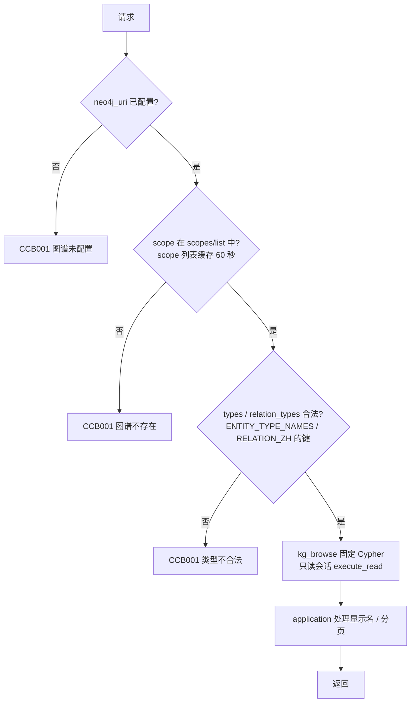

### 9.3 关键规则

| 规则 | 说明 |
| --- | --- |
| 只读 | Cypher 只能用读操作（MATCH / WITH / WHERE / RETURN / ORDER BY / SKIP / LIMIT / UNWIND / count / collect）。用只读会话执行。测试会扫描源码，断言不出现 CREATE、MERGE、SET、DELETE、REMOVE、DROP |
| 带 scope | 除 `scopes/list` 外每条 Cypher 都带 `$scope`（测试断言） |
| 不拼接 | 类型筛选用参数 `e.type IN $types`、`type(r) IN $relation_types`。`depth=1` 和 `depth=2` 各写一条固定语句 |
| scope 来源 | 取 Neo4j 中实际存在的 `Entity.scope`，**不需要配置**。所以 jp 不用加进索引映射，也不会触发入库侧的禁写检查 |
| 显示名 | `edges.label`：`raw_types` 第一个不为空就用它，否则用中文名。所以 `RELATED_TO` 会显示具体的中文说法，没有时显示「相关」 |
| 中文名 | 🔧 K4c：`ENTITY_TYPE_ZH`、`RELATION_ZH` 从 SDK `kg_schema` 导入（与 SDK 是同一个对象），查不到时用英文原名 |
| subgraph 起点 | `entity_ids` 和 `document_id` 同时传 → CCB001；都不传 → 取关系最多的前 50 个实体作为起点 |
| 截断 | 边数超过 `limit` 时 `truncated=true`，前端应提示「结果已截断，请缩小范围」 |
| 无开关 | 没配 Neo4j 时路由照常挂载，只是返回「图谱未配置」 |

### 9.4 关键词匹配

`entities/list` 的 `keyword` 先用 SDK 的 `normalize_label` 处理，再与 `label_norm` 做**包含**匹配。写法上的细微差异（具体归一规则以 SDK 的 `normalize_label` 为准）不影响结果，和问答侧的精确匹配规则一致。


---

## 10. 前端对接指南

### 10.1 页面布局与接口对应

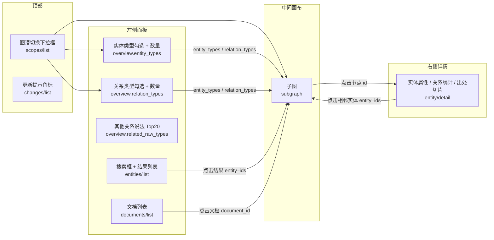

### 10.2 典型交互

| 用户操作 | 前端调用 |
| --- | --- |
| 打开页面 | `scopes/list` → 默认选第一个 → `overview` + `subgraph`（不传起点） |
| 切换图谱 | 清空状态 → 用新 scope 重新调 `overview` + `subgraph` |
| 勾选实体或关系类型 | `subgraph`，带上 `entity_types` / `relation_types` |
| 搜索「理赔」 | `entities/list` 带 `keyword`，点击某个结果 → `subgraph` 带 `entity_ids=[id]` |
| 只看某个文档 | `documents/list` → 点击 → `subgraph` 带 `document_id` |
| 展开一层 | `subgraph` 带 `entity_ids=[当前节点]`、`depth=2` |
| 点击节点 | `entity/detail` |
| 「有新内容」提示 | 记住上次打开时间，用它调 `changes/list` 的 `since_ms` |

### 10.3 前端注意事项

1. **类型显示用 `type_zh`，筛选传 `type`（英文）**，不要传中文。
2. **`RELATED_TO` 的边要弱化显示**（例如虚线、灰色），它的 `label` 已经是具体说法。
3. `truncated=true` 时要提示用户缩小范围，不要静默截断。
4. 所有错误都是 HTTP 200，要判断 `code`。
5. hk 的 `changes/list` 暂时可能为空，这是正常的（见 §7.3）。
6. 现有 8 个前端接口要和这 7 个对齐，避免重复，待前端清单确认。

---

## 11. jp-poc 导入（T1）

脚本：`scripts/kg_import_poc.py`，测试：`tests/unit/test_kg_import_poc.py`。**由人手动运行**，默认只预演。

### 11.1 数据来源

| 来源 | 内容 | 打开方式 |
| --- | --- | --- |
| `kg_api/data/kg.db` 的 `kg_nodes` | `node_id`、`type`、`label`、`metadata_json`（Chunk 的 `source_file` / `page_or_sheet` / `cell_range`） | `sqlite3.connect("file:...?mode=ro", uri=True)` |
| `kg.db` 的 `kg_edges` | `source_id`、`target_id`、`type`、`provenance_inferred` | 同上 |
| `chunk_content.csv` | 切片编号 → 正文（用于摘要） | 只读；不存在也不报错，只是没有摘要 |

### 11.2 导入流程

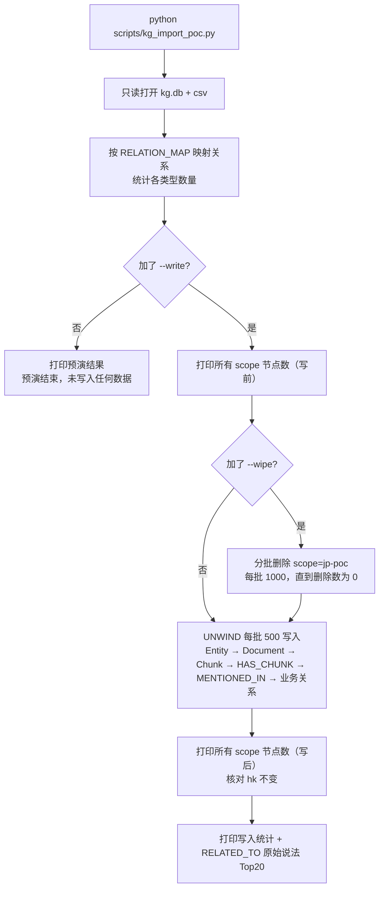

### 11.3 映射规则

| POC 原始关系 | 标准关系 | 备注 |
| --- | --- | --- |
| 包含 | CONTAINS | |
| 属于 | PART_OF | |
| 使用 | USES | |
| 依赖 | REQUIRES | |
| 前置步骤 | NEXT | |
| 执行 | HANDLED_BY | **交换起点和终点** |
| 已是 6 种标准名 | 保持不变 | |
| 其他 | RELATED_TO | `raw_types=[原始名]` |
| `mentioned_in` | MENTIONED_IN | 结构关系 |

对照表写在文件顶部的常量 `RELATION_MAP`，以后调整只改这里。

### 11.4 写入的属性

| 节点 / 关系 | 写入 |
| --- | --- |
| Entity | `id`（原编号）、`type`、`label`、`label_norm`（SDK `normalize_label`）、`origin="poc_import"`、`created_at`、`updated_at` |
| Document | `document_id = "doc::" + sha256(来源文件名)[:16]`（POC 中有的 document_id 是字符串 `"None"`，不可用）、`filename`、`origin`、时间 |
| Chunk | `chunk_id`（POC 编号，K5 再对齐）、`document_id`、`source_file`、`page_or_sheet`、`preview`（前 200 字）、`origin`、时间 |
| 业务关系 | `raw_types`、`source="poc"`、`weight=1`、时间 |

### 11.5 安全设计

| 措施 | 实现 |
| --- | --- |
| scope 写死 | 常量 `SCOPE = "jp-poc"`，不提供参数修改 |
| 统一执行函数 | 所有 Cypher 都经过同一个函数，开头检查 `scope == "jp-poc"`，否则抛异常 |
| 不碰结构 | 不创建、不删除任何约束和索引 |
| 关系类型不拼接 | 7 条固定语句，分别对应 6 种标准关系和 RELATED_TO |
| 唯一的全局语句 | 写前写后统计所有 scope 的节点数。只读，单独成函数，有注释说明 |
| 凭据 | 从 `KnowledgeSettings` 读取，不写死、不打印 |

### 11.6 运行步骤

```powershell
# 1. 记录现状（Neo4j Browser）
MATCH (n) RETURN n.scope AS scope, labels(n) AS labels, count(*) AS cnt ORDER BY scope, cnt DESC

# 2. 预演，把数字发给负责人确认
uv run python scripts/kg_import_poc.py

# 3. 正式写入
uv run python scripts/kg_import_poc.py --write --wipe

# 4. 再跑第 1 步，hk 各行数字必须完全一样
```

---

## 12. jp-poc 切片编号对齐（K5）

脚本：`scripts/kg_remap_poc_chunks.py`。

### 12.1 为什么要对齐

| 来源 | 切片编号算法 |
| --- | --- |
| POC 图谱（kg.db） | `sha256(content)[:12]` |
| Azure jp-poc 索引 | `sha1(f"{source_file}:{locator}:{part}")[:12]` |

两边算法不同，所以问答时拿图里的 `chunk_id` 去 Azure 取原文会**取不到**。K5 用正文内容做桥梁：对 Azure 中每个切片的正文算 `sha256[:12]`，就能和图中的编号对上。

### 12.2 对齐流程

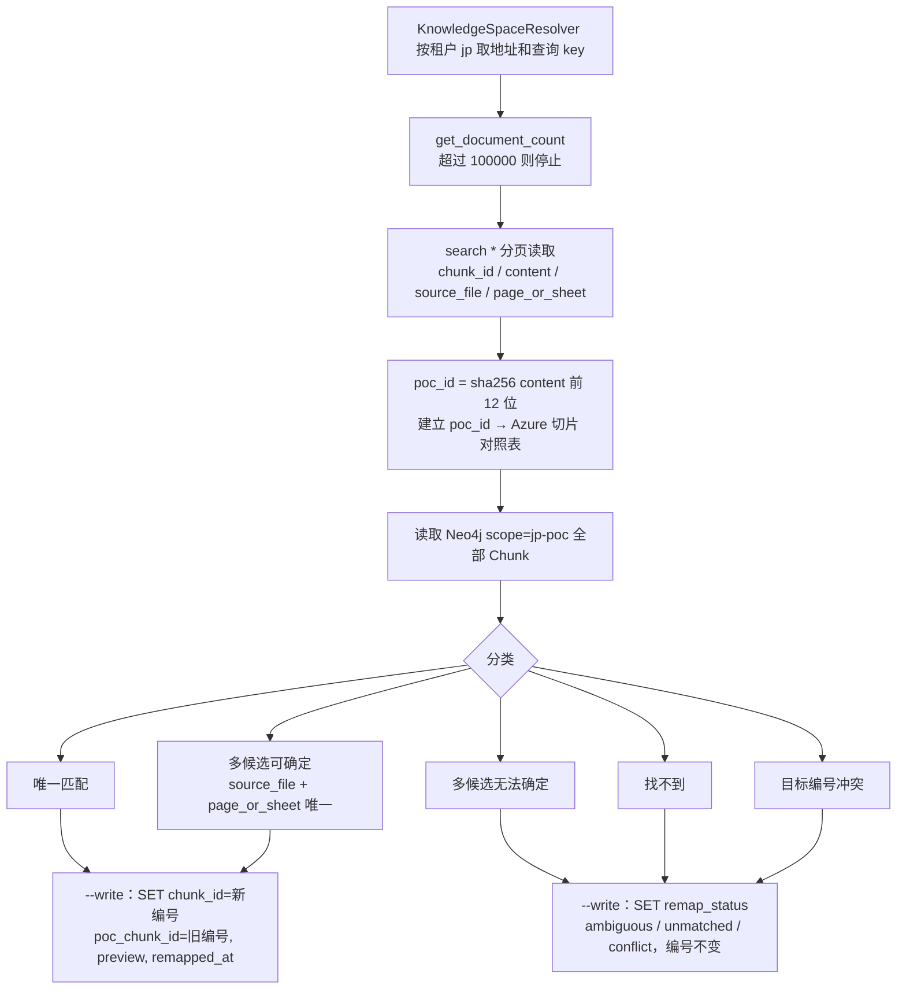

### 12.3 安全设计

- Azure **只读**：只允许 `search` 和 `get_document_count`。源码中不得出现 `upload_documents`、`merge_documents`、`merge_or_upload_documents`、`delete_documents`、`SearchIndexClient`（测试读源码断言）。
- Neo4j 写入复用 T1 的 scope 检查函数和全局计数函数。
- **可重复运行**：已有 `poc_chunk_id` 的 Chunk 跳过。

---

## 13. hk 图谱的演进

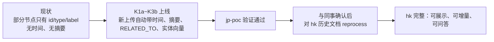

| 阶段 | 对 hk 的影响 |
| --- | --- |
| 现在 | **不删、不改**。本地关闭写图开关 |
| 改造上线后 | 只有新上传或重传的文档会按新模型写入 |
| 验证后 | 通过「重新处理」接口逐个或批量重跑历史文档，补齐时间、摘要、中文名、关系 |

---

## 14. Scope 隔离与安全

### 14.1 scope 从哪来

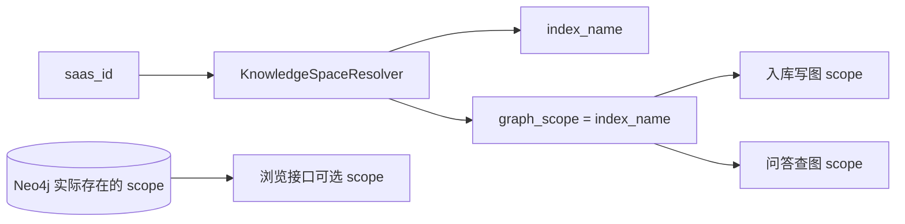

- 入库和问答：scope 由租户映射决定，二者一致。
- 浏览接口：scope 来自 Neo4j 实际数据，并校验请求中的 scope 必须存在。

### 14.2 安全红线

1. **每条 Cypher 都带 scope**。唯一例外是只读的全局计数和 `scopes/list`。
2. **hk 暂不改动**：Neo4j 与同事共享，本地 `TAP_AI_LIBRARY_KB_GRAPH_ENABLED=false`。导入前后核对 hk 计数。
3. **jp-poc 只能由 T1 / K5 脚本写入**。入库链路按 `TAP_AI_KB_WRITE_FORBIDDEN_INDEXES`（默认含 `jp-poc`）拒绝。
4. **Azure jp-poc 只读**：只配查询 key。
5. **浏览接口只读**：只读会话 + 源码关键字断言。
6. **不拼接用户输入进 Cypher**：类型用参数；关系类型名先校验再放进模板；深度用固定语句。
7. **凭据不入库、不打印**。
8. 旧 POC 项目 `jap-cycle-poc` 只读，`kg.db` 只读打开。

---

## 15. 配置项

| 环境变量 | 默认 | 作用 |
| --- | --- | --- |
| `TAP_AI_KB_NEO4J_URI / USER / PASSWORD / DATABASE / TIMEOUT_S` | 空 / neo4j / 空 / neo4j / 3.0 | 连接 |
| `TAP_AI_LIBRARY_KB_GRAPH_ENABLED` | `true` | 入库是否写图（本地 false） |
| `TAP_AI_KB_KG_RELATION_TYPES` | 🔧 `TRAVERSABLE_RELATIONS` | 问答可遍历关系，JSON 数组可覆盖 |
| `TAP_AI_KB_KG_MAX_EDGES` | 见 settings | 问答子图最大边数 |
| `TAP_AI_KB_EMBEDDING_MODEL / DIMENSIONS` | `text-embedding-3-large` / 3072 | 实体向量模型 |
| `TAP_AI_KB_INDEXES` | `{}` | 租户 → 索引 / scope |
| `TAP_AI_KB_WRITE_FORBIDDEN_INDEXES` 🔧 | `["jp-poc"]` | 禁写名单 |
| `TAP_AI_KB_SEARCH_OVERRIDES` 🔧 | `{}` | 按租户覆盖 Azure 地址和 key（jp 用查询 key） |

**删除的配置**：`kg_entity_vector`（实体向量默认开）、`KB_KG_LLM_ENABLED`（大模型抽取默认开）、`KB_COPILOT_PROVIDER_*` / `KB_KG_LLM_MODEL`（统一走模型网关）、`TAP_AI_KB_ENABLED`（配置了索引映射即启用）。

---

## 16. 测试与验收

### 16.1 测试文件

| 测试 | 覆盖 |
| --- | --- |
| SDK `tests/test_kg_schema.py` 🔧 | 新旧白名单逐项相等；`TRAVERSABLE_RELATIONS` 不含 RELATED_TO；`_to_specs` 四种情况；写入参数带 `now` / `preview` / `raw_type`；提示词含全部中文说法 |
| `tests/unit/test_library_kg_service.py` 🔧 | 7 个接口的正常用例；scope 不存在 / 类型不合法 / 实体不存在 / 未配置；subgraph 三种起点及冲突 |
| `tests/api/test_library_kg_api.py` 🔧 | 路由、返回结构、错误码 |
| `kg_browse` 源码断言 🔧 | 无写关键字；除 scopes 外都含 `$scope` |
| `tests/unit/test_kg_import_poc.py` 🔧 | 关系对照、执行交换、scope 检查、无 DDL、预演零写入、document_id 稳定 |
| `tests/unit/test_kg_remap_poc_chunks.py` 🔧 | 哈希一致（含中日文、空串）、五种分类、只读 Azure、重复运行 |
| `tests/unit/test_react_graph.py` 等 | 问答侧关系枚举与说明一致 |

全部使用假 driver 和假 SearchClient，不连真实 Neo4j 或 Azure。

### 16.2 端到端验收

| # | 检查 | 操作 | 期望 |
| --- | --- | --- | --- |
| 1 | 图谱切换 | `scopes/list` | 同时看到 `jp-poc` 和 hk 的 scope |
| 2 | jp-poc 展示 | `overview`、`subgraph`（scope=jp-poc） | 节点有名字和中文类型，关系有中文名 |
| 3 | hk 展示 | 同上，换 hk scope | 显示 hk 数据 |
| 4 | 筛选 | `entities/list`，`types=["System"]` | 只返回系统类实体 |
| 5 | 详情 | `entity/detail` | 有出处切片和摘要 |
| 6 | 增量 | `changes/list`，jp-poc，`since_ms=0` | 有数据（hk 为空正常） |
| 7 | jp 问答 | `saas_id: "jp"` 提问 | 回答带 jp-poc 引用 |
| 8 | hk 未变 | 重跑 scope 计数 | hk 各行与导入前一致 |
| 9 | 自动增长 🔧 | 测试索引上传一个文件 | 新文档的 Chunk 数 = `chunk_count`；实体带时间；`changes/list` 能看到 |

---

## 17. 常用 Cypher

> 只读查询。在 Neo4j Browser 中执行，**务必带 scope**。

```cypher
// 各 scope 数量（导入前后核对）
MATCH (n) RETURN n.scope AS scope, labels(n) AS labels, count(*) AS cnt ORDER BY scope, cnt DESC;

// 某 scope 实体类型分布
MATCH (e:Entity {scope: $scope}) RETURN e.type, count(*) ORDER BY count(*) DESC;

// 某 scope 关系类型分布
MATCH (:Entity {scope: $scope})-[r]->(:Entity {scope: $scope}) RETURN type(r), count(*) ORDER BY count(*) DESC;

// RELATED_TO 中最常见的原始说法
MATCH (:Entity {scope: $scope})-[r:RELATED_TO]->() UNWIND r.raw_types AS t
RETURN t, count(*) AS c ORDER BY c DESC LIMIT 20;

// 某文档的切片数（对比知识库 chunk_count）
MATCH (c:Chunk {scope: $scope, document_id: $document_id}) RETURN count(c);

// 只有 id 没有内容的问题节点
MATCH (c:Chunk {scope: $scope}) WHERE c.preview IS NULL RETURN count(c);

// K5 对齐结果
MATCH (c:Chunk {scope: 'jp-poc'}) RETURN c.remap_status, count(*);

// 孤立实体（撤销后可能出现）
MATCH (e:Entity {scope: $scope}) WHERE NOT (e)--() RETURN count(e);
```

---

## 18. 常见问题 FAQ

**Q1：前端图谱里节点只显示 id，没有名字或类型？**
早期数据缺字段。jp-poc 用 T1 重建即可修复；hk 要等 jp-poc 验证后重新处理。浏览接口返回 `type_zh`，前端不要自己翻译。

**Q2：问答查到了实体，但没有引用原文？**
图中 `chunk_id` 在 Azure 中不存在。jp-poc 需要先跑 K5；hk 检查该文档是否 Azure 写入成功、Neo4j 写入失败（任务表只有总状态，可重新处理）。

**Q3：大模型抽出来的关系在图里看不到？**
① 抽取失败会返回空列表，不报错，去 Langfuse 查；② 关系可能变成了 `RELATED_TO`，前端看边的 `label`；③ 本地关闭了写图开关。

**Q4：想加一种新关系（如「审批」）怎么办？**
在 SDK `kg_schema.py` 的 `RELATION_TYPES` 中加一项（name、zh、aliases、pairs、traversable），跑 SDK 测试。后端问答、工具枚举、提示词说明、浏览接口中文名会自动更新。已入库的文档要重新处理才会生效；之前存成 `RELATED_TO` 的可以通过 `raw_types` 找到。

**Q5：同一个实体在中文和日文文档里会变成两个节点吗？**
规则抽取通过 `lexicon` 把同一概念的多语言说法归并为同一实体。大模型抽取的实体按 `normalize_label` 归一，不同语言的写法仍可能是不同节点，问答时靠向量匹配兜底。

**Q6：scopes/list 里为什么没有 jp，只有 jp-poc？**
scope 是索引名，不是租户名。租户 jp 对应的索引和 scope 都叫 `jp-poc`。

**Q7：changes/list 能看到删除吗？**
不能。被删除的节点已经不存在。需要的话以后再加删除日志。

---

## 19. 已知隐患与后续计划

| 隐患 | 影响 | 计划 |
| --- | --- | --- |
| Neo4j 与同事共享，未确认是否有备份、dit 是否在用 | 误操作影响面大 | 先与同事确认；所有写入限定 scope |
| hk 历史数据不完整 | 展示缺内容、无增量 | jp-poc 验证后重新处理 |
| 删除不进增量 | 前端无法感知删除 | 视需要增加删除日志 |
| 撤销后实体节点保留，可能出现孤立实体 | 图中出现无连线节点 | 定期统计；必要时加清理（限 scope） |
| 任务表只有总状态 | Neo4j 单独失败不易察觉 | 依赖幂等重试；后续按 Sink 区分错误码 |
| 大模型抽取失败静默返回空 | 图谱稀疏不易发现 | 用 Langfuse 观察；统计每文档关系数 |
| 跨语言实体合并依赖词条库 | 大模型实体可能重复 | 扩充 lexicon；向量匹配兜底 |
| `PART_OF` 白名单那一行的括号曾在转录中对不上 | 端点组合可能有误 | K1a 开工前逐字核对原文 |
| 前端现有 8 个接口与新 7 个未对齐 | 可能重复建设 | 收到清单后对齐 |

---

## 附录 A：文件 / 函数速查表

| 文件 | 关键内容 | 作用 |
| --- | --- | --- |
| SDK `kg_schema.py` 🔧 | `EntityTypeDef`、`RelationTypeDef`、`RelationAlias`、`ENTITY_TYPES`、`RELATION_TYPES`、`ENTITY_TYPE_NAMES`、`ENTITY_TYPE_ZH`、`RELATION_ZH`、`TRAVERSABLE_RELATIONS`、`SCHEMA_ALLOWED_RELATIONS`、`SCHEMA_LLM_RELATION_MAP` | 类型唯一来源 |
| SDK `sinks/_kg_schema.py` | 实体类型常量、`ALLOWED_RELATIONS`、`LLM_RELATION_MAP`、`LLM_ENTITY_TYPES`、`RelationSpec` | 兼容旧名 |
| SDK `sinks/_kg_extract.py` | `DefaultRelationExtractor`、`_chunk_relations`、`_flowchart_relations`、`_cooccurrence_relations`、`combine_extractors` | 规则抽取 |
| SDK `sinks/_kg_llm_extract.py` | `LLMRelationExtractor`、`_SYSTEM_PROMPT`、`_to_specs`、`parse_response` | 大模型抽取 |
| SDK `sinks/_neo4j.py` | `Neo4jGraphSink.upsert` / `delete` / `_collect_relations` / `_mention_rows` / `_write_relations` / `_embed_entities`；`_RETRACT_*`、`_DELETE_*`、`_WRITE_*` | 写图 |
| SDK `lexicon` | `normalize_label`、`concepts_in` | 词条与归一 |
| SDK `protocols.py` | `LLMProvider.complete`、`EmbeddingProvider.embed / dimension` | 模型接口 |
| `plugins/ingest/sdk_ingest.py` | `_sinks_factory` | 组装 Neo4jGraphSink |
| `plugins/ingest/kg_providers.py` 🔧 | `GatewayChatProvider`、`LiteLLMEmbeddingProvider`、`bind_loop` | 模型适配 |
| `knowledge/spaces.py` | `KnowledgeSpaceResolver`、`KnowledgeSpace` | 租户 → 索引 / scope |
| `knowledge/backends/neo4j_graph.py` | `Neo4jKnowledgeGraph`、`match_entities`、`subgraph`、`chunks_by_entity`、`_Q_EXACT / _Q_FULLTEXT / _Q_VECTOR / _Q_SUBGRAPH / _Q_CHUNKS`、`DEFAULT_RELATION_TYPES` | 问答查图 |
| `knowledge/backends/azure_search.py` | `get_chunks`、`_lookup` | 按 chunk_id 取原文 |
| `knowledge/service.py` | `graph_query`、`_hits_from_entities` | 问答编排 |
| `knowledge/tools.py` | `QueryGraphTool`（`query_business_graph`） | 模型可调用的查图工具 |
| `knowledge/prompts.py` | `RELATION_LEGEND`、`render_relations` | 关系说明 |
| `knowledge/settings.py` | `KnowledgeSettings`（`TAP_AI_KB_*`） | 配置 |
| `contracts/library_kg.py` 🔧 | 浏览接口 Protocol、数据结构、中文名（从 SDK 导入） | 接口定义 |
| `knowledge/backends/kg_browse.py` 🔧 | 7 组只读 Cypher | 浏览实现 |
| `application/library_kg.py` 🔧 | scope 缓存与校验、类型校验、显示名、分页 | 浏览服务 |
| `api/library_kg.py` 🔧 | 7 个 POST 路由 | 浏览接口 |
| `scripts/kg_import_poc.py` 🔧 | `SCOPE`、`RELATION_MAP`、scope 检查执行函数、全局计数函数 | jp-poc 导入 |
| `scripts/kg_remap_poc_chunks.py` 🔧 | `SCOPE`、`INDEX`、五类分类 | jp-poc 编号对齐 |

## 附录 B：术语表

| 术语 | 含义 |
| --- | --- |
| scope | Neo4j 中隔离数据的属性，等于 Azure 索引名 |
| Entity / 实体 | 图中的业务对象：流程、角色、系统、材料等 |
| Chunk / 切片 | 与 Azure 切片一一对应的节点，用于溯源 |
| 结构关系 | `HAS_CHUNK`、`MENTIONED_IN`，只用于溯源 |
| 业务关系 | 实体之间的 7 种关系 |
| 可遍历关系 | 问答多跳时允许走的关系，即 `TRAVERSABLE_RELATIONS` |
| RELATED_TO | 白名单外关系的兜底类型，原始说法存在 `raw_types` |
| raw_types | 关系的原始说法列表，用于显示和日后扩充白名单 |
| weight | 支撑某关系的文档数 |
| 撤销（retract） | 从实体或关系上去掉某文档的贡献 |
| label_norm | `normalize_label` 归一后的名字 |
| 增量 | 按 `updated_at` 查询某时间点之后的变化 |
| 预演（dry-run） | 脚本不加 `--write` 时只统计不写入 |
