# 知识库管理导览（Library KB）

> 适用仓库：`tap-ai-backend`（分支 `feature/tap-10366` 及其后续）＋ 入库 SDK `fwd-tap-ingest`
> 描述口径：**按改造完成后的目标状态描述**（K1–K5 / T1–T2 完成之后）。凡是与当前代码不一致的地方，都用 🔧 **改造项** 标注，方便对照。
> 读者：团队内的后端、前端、测试、运维同学。

---

## 目录

- [0. 一页看懂](#0-一页看懂)
- [1. 总体介绍](#1-总体介绍)
- [2. 快速使用](#2-快速使用)
- [3. 总体架构与分层](#3-总体架构与分层)
- [4. 接口层：API 一览](#4-接口层api-一览)
- [5. 上传与判重](#5-上传与判重)
- [6. 任务队列与后台 Worker](#6-任务队列与后台-worker)
- [7. 入库插件 sdk_ingest](#7-入库插件-sdk_ingest)
- [8. SDK 入库流水线：解析 → 切片 → 写入](#8-sdk-入库流水线解析--切片--写入)
- [9. Azure AI Search 写入](#9-azure-ai-search-写入)
- [10. Neo4j 图谱同步](#10-neo4j-图谱同步)
- [11. 删除与重新处理](#11-删除与重新处理)
- [12. 同步（sync）与统计（stats）](#12-同步sync与统计stats)
- [13. 多租户与索引空间](#13-多租户与索引空间)
- [14. 数据表](#14-数据表)
- [15. 状态机](#15-状态机)
- [16. 配置项](#16-配置项)
- [17. 错误码与返回约定](#17-错误码与返回约定)
- [18. 可观测性与日志](#18-可观测性与日志)
- [19. 测试与验收](#19-测试与验收)
- [20. 安全红线](#20-安全红线)
- [21. 常见问题 FAQ](#21-常见问题-faq)
- [22. 已知隐患与后续计划](#22-已知隐患与后续计划)
- [附录 A：文件 / 函数速查表](#附录-a文件--函数速查表)
- [附录 B：术语表](#附录-b术语表)

---

## 0. 一页看懂

| 问题 | 一句话回答 |
| --- | --- |
| 它是什么 | 后端里的「知识库管理」模块：上传文档 → 后台解析切片 → 写入 Azure AI Search（向量检索）和 Neo4j（知识图谱），供问答和图谱页面使用。 |
| 入口在哪 | HTTP 路由前缀 `/tap/ai/library/kb`，代码在 `src/tap_ai/api/library_kb.py`。 |
| 谁干活 | 接口只负责「收文件、记账、入队」；真正的解析和写入由后台 `KbIngestWorker` 异步完成。 |
| 解析靠什么 | 公司内部 SDK `fwd-tap-ingest`（`tap_ingest_sdk`），后端通过插件 `plugins/ingest/sdk_ingest.py` 调用。 |
| 写到哪里 | 每个租户（`saas_id`）对应一个 Azure 索引名；Neo4j 中用同名 `scope` 隔离。 |
| 怎么开关 | 改造后只剩 **1 个开关**：`TAP_AI_LIBRARY_KB_GRAPH_ENABLED`（是否同步写 Neo4j，默认开）。 |
| 只读租户 | `jp-poc` 是只读的演示数据，**禁止任何写入**，代码里有硬拦截。 |

---

## 1. 总体介绍

### 1.1 模块定位

Library 是 TAP AI 后端里面向「知识运营」的一组功能，共 4 个模块：

| 编号 | 模块 | 作用 | 主要代码 |
| --- | --- | --- | --- |
| ① | **知识库管理（本文）** | 文档上传、入库、重试、删除、同步、统计 | `api/library_kb.py`、`application/library_kb*.py` |
| ② | 切片工作室（Chunk Studio） | 查看/编辑切片草稿并发布 | `api/library_chunks.py`、`application/library_chunks.py` |
| ③ | RAG 评估 | 金标问题集、批量评估、LLM 分析 | `api/library_eval.py`、`application/library_eval.py` |
| ④ | 知识图谱 | 图谱浏览、实体/关系查询 | `api/library_kg.py`（T2）＋ `plugins/extensions/knowledge/` |

知识库管理是**数据的源头**：② 读它产出的切片，③ 用它的索引做检索评估，④ 展示它写入 Neo4j 的实体关系，问答（`/tap/ai/conversations/chat`）通过知识插件检索它写进去的内容。

### 1.2 设计目标

1. **上传要快、处理可以慢**：接口同步返回「已入队」，耗时的解析/向量化/抽取放后台。
2. **不重复、不丢失**：同名文件复用同一条文档记录和同一个 `document_key`，重新上传就是「覆盖更新」；任务有心跳、超时、重试，进程挂了也能被别的实例接手。
3. **多实例安全**：多个后端 Pod 同时跑 Worker 时，一个任务只会被一个实例抢到（数据库条件更新 + 行数校验）。
4. **一次写两处**：同一份切片同时写 Azure（检索）和 Neo4j（图谱），保证两边 `chunk_id` 一致，问答引用和图谱溯源能对上。
5. **少开关、默认开**：运维反馈开关太多，改造后只保留图谱开关。
6. **只读保护**：`jp-poc` 索引和 scope 只能读，写入在构建期和每次写入时双重拦截。

### 1.3 总体流程图

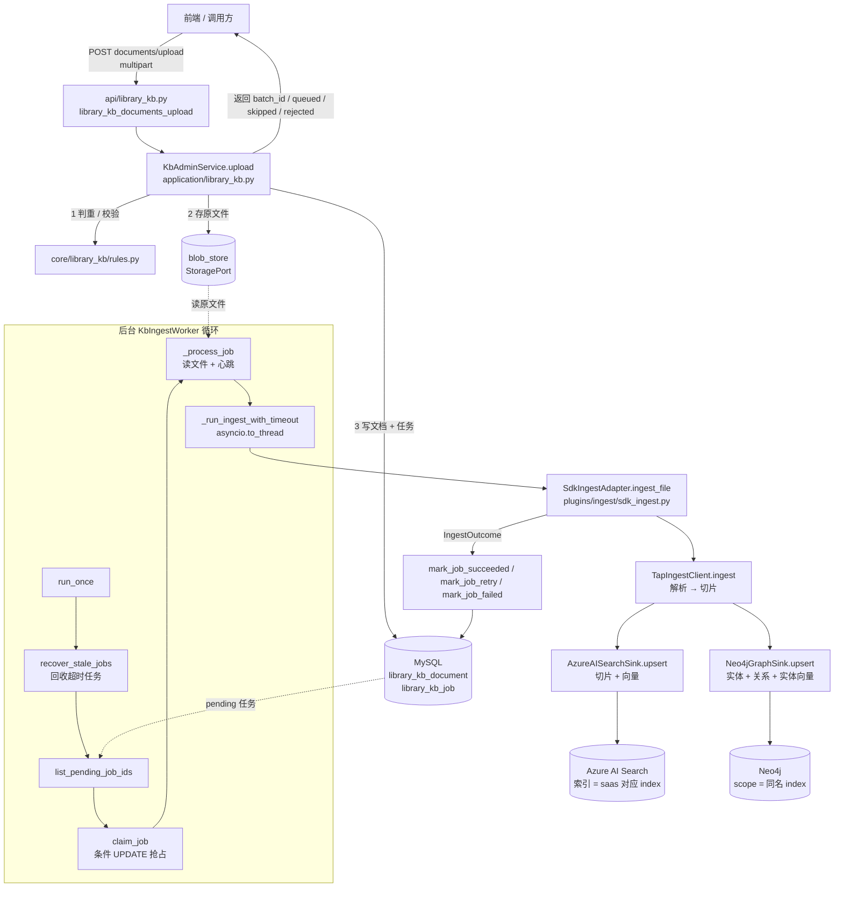

一句话：**接口记账入队，Worker 抢任务执行，SDK 解析切片，两个 Sink 分别写检索索引和图谱，最后回写状态。**

---

## 2. 快速使用

### 2.1 本地启动前的准备

| 步骤 | 做什么 | 说明 |
| --- | --- | --- |
| 1 | 复制 `.env.example` 为 `.env` | 注意 `.env.example` 是 UTF-16 编码，复制后另存为 UTF-8 |
| 2 | 填 MySQL / Redis / Blob 存储配置 | 本地用自己的开发库，**不要提交真实密码** |
| 3 | 填 Azure Search：`TAP_AI_KB_AZURE_SEARCH_ENDPOINT`、`TAP_AI_KB_AZURE_SEARCH_KEY`、`TAP_AI_KB_INDEXES` | `INDEXES` 是 JSON：`{"hk":"<hk索引名>","jp":"jp-poc"}` |
| 4 | 填 Neo4j：`TAP_AI_KB_NEO4J_URI`、`TAP_AI_KB_NEO4J_USER`、`TAP_AI_KB_NEO4J_PASSWORD` | `NEO4J_URI` 为空 = 不连图谱 |
| 5 | **本地设置** `TAP_AI_LIBRARY_KB_GRAPH_ENABLED=false` | Neo4j 是和同事共享的，本地默认不写图 |
| 6 | 执行建表 `sql/003_create_library_kb_tables.sql` | 开发库只需执行一次 |
| 7 | `uv run` 启动服务 | 所有命令统一用 `uv run` |

> 🔧 **改造项（K1）**：现状下还需要打开 `library_enabled`、`library_kb_enabled`、`library_kb_worker_enabled` 等多个开关才会挂路由和启动 Worker；改造后这些开关全部删除，模块默认启用。

### 2.2 最小调用示例

**① 上传文档**

```http
POST /tap/ai/library/kb/documents/upload
Content-Type: multipart/form-data

saas_id=hk
user_id=u001
files=@流程手册.docx
files=@表单说明.xlsx
```

返回（HTTP 200）：

```json
{
  "batch_id": "9f1c...",
  "queued": 2,
  "skipped": 0,
  "rejected": 0,
  "items": [
    {"file_name": "流程手册.docx", "result": "queued", "document_id": "..."},
    {"file_name": "表单说明.xlsx", "result": "queued", "document_id": "..."}
  ]
}
```

**② 查询列表（看处理进度）**

```http
POST /tap/ai/library/kb/documents/list
{"saas_id": "hk", "page": 1, "page_size": 20}
```

**③ 查看单个文档详情**

```http
GET /tap/ai/library/kb/documents/{document_id}
```

**④ 失败的重试**

```http
POST /tap/ai/library/kb/documents/retry
{"document_ids": ["..."]}
```

**⑤ 在问答里验证是否入库成功**

```http
POST /tap/ai/conversations/chat
{"message_content": "报销流程第一步是什么？", "saas_id": "hk"}
```

### 2.3 一次完整的使用旅程

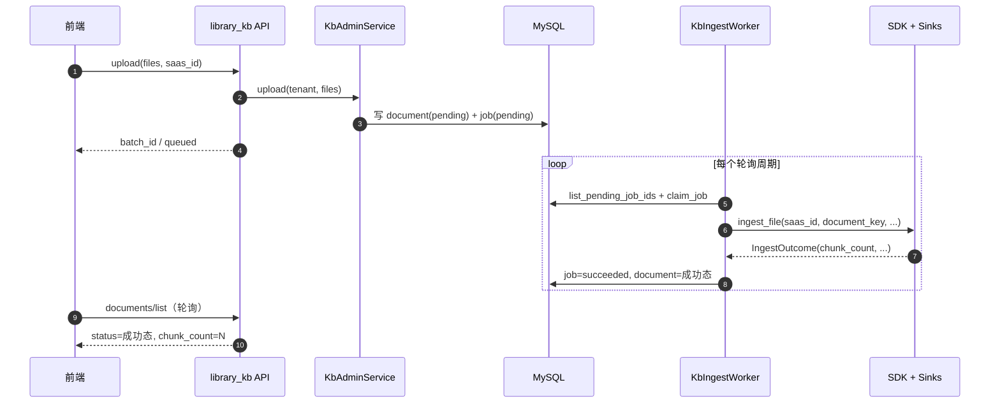

---

## 3. 总体架构与分层

### 3.1 分层原则

后端统一采用 **api → application → core → contracts** 四层，外部能力通过 **plugins** 实现 contracts 中的接口（插座），由 `bootstrap.build_app` 作为唯一的「组装根」把它们拼起来。

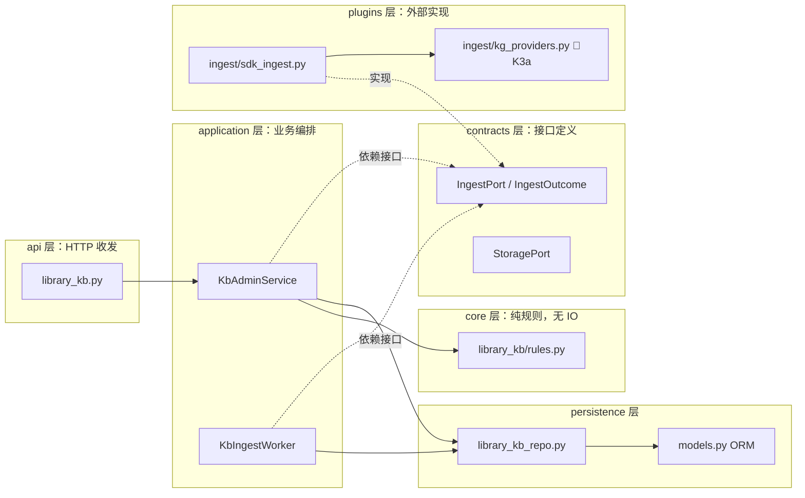

| 层 | 能做什么 | 不能做什么 |
| --- | --- | --- |
| api | 解析请求、调用 service、组装响应 DTO | 写业务判断、直接访问数据库 |
| application | 事务、编排、调用仓储和插座 | 直接 import SDK 或 Azure 客户端 |
| core | 纯函数规则（判重、文件名规范化、类型白名单） | 任何 IO |
| contracts | Protocol / 数据类 | 具体实现 |
| plugins | 对接 SDK、Azure、Neo4j、模型 | 被 application 直接 import（只能经 bootstrap 注入） |

### 3.2 组装（bootstrap）

改造后 `build_app` 中知识库相关的装配逻辑：

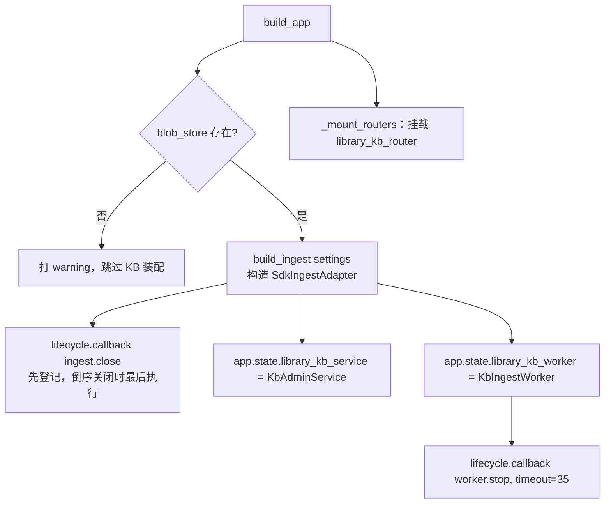

要点：

- **关闭顺序**：先登记 `ingest.close`、后登记 `worker.stop`；生命周期按倒序执行，所以先停 Worker、再关共享的 Neo4j driver，避免 Worker 正在写图时 driver 被关。
- 🔧 **改造项（K1）**：去掉 `library_enabled` / `library_kb_enabled` / `library_kb_worker_enabled` / `library_kb_ingest_sink` 的条件判断，路由和 Worker 无条件装配。
- 🔧 **改造项（K3a）**：`build_ingest` 时把模型网关（`model_gateway`）和主事件循环注入到 `GatewayChatProvider`，使 SDK 内的 LLM 抽取调用经过网关，能被 Langfuse 记录。

---

## 4. 接口层：API 一览

所有接口挂在 `/tap/ai/library/kb` 下，只使用 GET / POST；业务错误统一 **HTTP 200 + `{code, message}`**；分页统一返回 `items / total / page / page_size`。

| # | 方法 | 路径 | 处理函数 | Service 方法 | 作用 |
| --- | --- | --- | --- | --- | --- |
| 1 | POST | `/stats` | `library_kb_stats` | `stats` | 文档总数、各状态数量、切片总数 |
| 2 | POST | `/documents/list` | `library_kb_documents_list` | `list_documents` | 分页 + 条件筛选文档 |
| 3 | GET | `/documents/{document_id:path}` | `library_kb_document_detail` | `get_document` | 单文档详情（含最近任务、错误信息） |
| 4 | POST | `/documents/upload` | `library_kb_documents_upload` | `upload` | multipart 上传，判重并入队 |
| 5 | POST | `/documents/retry` | `library_kb_documents_retry` | `retry` | 仅对失败文档重新入队 |
| 6 | POST | `/documents/sync` | `library_kb_documents_sync` | `sync` | 从索引侧同步已有文档到管理表 |
| 7 🔧 | POST | `/documents/delete` | `library_kb_documents_delete` | `delete_documents` | 删除文档：Azure + Neo4j + 存储 + 软删（K3b） |
| 8 🔧 | POST | `/documents/reprocess` | `library_kb_documents_reprocess` | `reprocess` | 对任意状态文档强制重新处理（K3b） |

> `{document_id:path}` 用 `:path` 是因为 ID 中可能含 `/`、`::` 等字符。

### 4.1 接口内部的统一模式

```python
@router.post("/documents/list", response_model=KbDocumentListData)
async def library_kb_documents_list(body: KbDocumentListRequest, request: Request):
    result = await _service(request).list_documents(body)   # ① 取 service
    return KbDocumentListData(                               # ② 组装 DTO
        items=[KbDocumentData.model_validate(i) for i in result["items"]],
        total=result["total"], page=result["page"], page_size=result["page_size"],
    )
```

- `_service(request)`：从 `request.app.state.library_kb_service` 取实例；不存在时抛 `BusinessError`，而不是 500。
- 请求 / 响应 DTO 都定义在 `api/dto.py`（`KbStatsRequest`、`KbDocumentListRequest`、`KbUploadData`、`KbRetryData`、`KbSyncData` 等）。

### 4.2 上传接口的前置校验

| 校验 | 失败返回 |
| --- | --- |
| 没有文件 | `CCB001` 未选择文件 |
| 文件数 > `library_kb_max_files_per_upload` | `CCB001` 上传文件数量超过上限 |
| 单文件类型/大小/文件名非法 | 不整体失败，该文件进入 `rejected`，附 `reason` |

上传接口不会一次性把文件读进内存再传给 service，而是传 `(filename, content_type, upload.read)` 三元组，由 service 按需读取，便于做大小限制。


---

## 5. 上传与判重

### 5.1 设计思路

- **按「租户 + 规范化文件名」判重**：同一个租户下，同名文件视为同一份文档的新版本，复用原文档记录和原 `document_key`，这样下游 Azure / Neo4j 会**覆盖**而不是新增一份。
- **按内容哈希判断是否需要处理**：文件名相同且 `content_sha256` 也相同、并且上次已成功 → 直接 `skipped`，不重复消耗解析和模型调用。
- **并发保护**：两个请求同时上传同一文件时，靠「带期望状态的条件更新」保证只有一个成功，另一个返回 `rejected：该文件正在被其他请求上传`。

### 5.2 上传流程

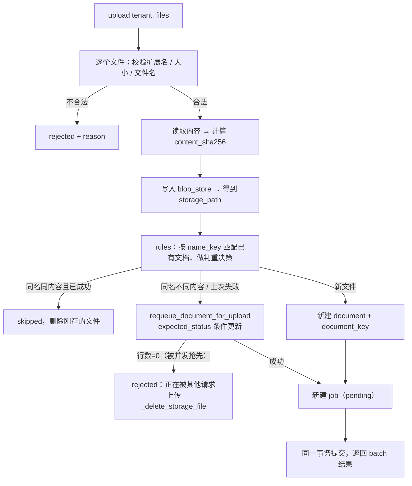

### 5.3 关键函数

| 函数 | 位置 | 作用 |
| --- | --- | --- |
| `KbAdminService.upload` | `application/library_kb.py` | 上传主流程，产出 `batch_id / queued / skipped / rejected / items` |
| 判重规则（`decision.existing_document_id`、`decision.name_key`） | `core/library_kb/rules.py` | 纯函数：规范化文件名、比对已有记录、给出「新建 / 复用 / 跳过 / 拒绝」决策 |
| `requeue_document_for_upload` | `persistence/library_kb_repo.py` | 带 `expected_status` 的条件更新，复用原记录，更新文件名 / 哈希 / 大小 |
| `_delete_storage_file` | `application/library_kb.py` | 失败或跳过时清理刚刚落盘的文件，避免孤儿文件 |
| `StoragePort.upload_stream / read / delete / exists` | contracts + 存储插件 | 原始文件存取 |

### 5.4 document_id 与 document_key 的区别

| 字段 | 谁生成 | 用在哪 | 是否会变 |
| --- | --- | --- | --- |
| `document_id` | 后端（UUID hex，32 位） | MySQL 主键、接口参数 | 不变 |
| `document_key` | 后端首次建档时生成 | 传给 SDK 作为 `idempotency_key`，决定 Azure 文档 ID / Neo4j `Document.document_id` | **同名重新上传时也不变**，这正是「覆盖更新」的关键 |
| `chunk_id` | SDK 切片时生成 | Azure 文档主键、Neo4j `Chunk.chunk_id` | 内容或位置变化时会变 |

---

## 6. 任务队列与后台 Worker

### 6.1 为什么不用消息队列

- 部署环境不额外引入 MQ；MySQL 本身就能用「条件更新 + 行数校验」实现可靠的抢占。
- 任务量是「运营上传文档」级别，不是高并发流量，数据库轮询足够。

### 6.2 Worker 主循环

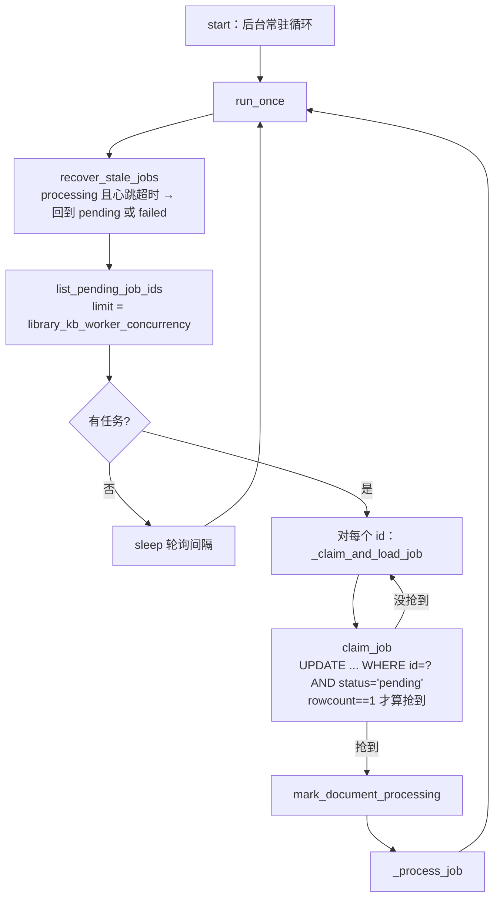

### 6.3 单个任务的执行

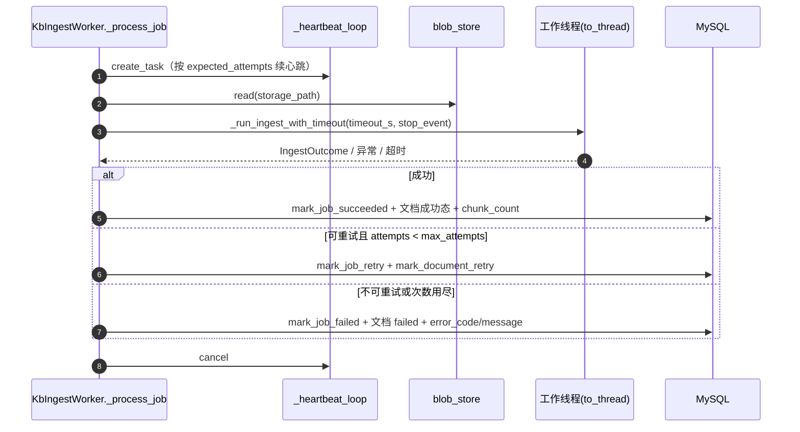

### 6.4 关键机制说明

| 机制 | 实现 | 解决的问题 |
| --- | --- | --- |
| 抢占 | `claim_job`：条件 UPDATE `status='pending'`，检查 `rowcount` | 多实例下一个任务只被处理一次 |
| 心跳 | `_heartbeat_loop` → `heartbeat(job_id, expected_attempts)` 定期刷新 `heartbeat_time` | 区分「还在跑」和「进程已死」 |
| 回收 | `recover_stale_jobs`：`processing` 且心跳超时的任务 | Pod 重启、OOM 后任务不会永远卡住 |
| attempts 守卫 | 心跳、回写都带 `expected_attempts` | 旧实例「复活」后不能覆盖新实例的结果 |
| 超时 | `_run_ingest_with_timeout`：`asyncio.wait_for` + `stop_event` | 单个大文件不会无限占用 Worker |
| 线程隔离 | `asyncio.to_thread(_run)` | SDK 是同步代码，不能阻塞事件循环 |
| 异常透传 | 线程内用 `loop.call_soon_threadsafe(result_fut.set_exception, ...)` | 线程里的错误能回到主协程统一处理 |
| 优雅停止 | `worker.stop`（超时 35s） | 发布时正在处理的任务能收尾 |

### 6.5 相关配置

| 配置 | 作用 |
| --- | --- |
| `library_kb_worker_concurrency` | 每轮最多领取的任务数 |
| `library_kb_max_attempts` | 最大尝试次数，超过即 failed |
| 任务超时（`_job_timeout_s`） | 单任务最长执行时间 |
| 心跳间隔 / 心跳过期阈值 | 见 `settings.py` 中 `library_kb_*` 字段 |

> 🔧 **改造项（K1）**：删除 `library_kb_worker_enabled`，Worker 默认随服务启动。

---

## 7. 入库插件 sdk_ingest

文件：`src/tap_ai/plugins/ingest/sdk_ingest.py`，核心类 `SdkIngestAdapter`，实现 `contracts/library_kb.py` 中的 `IngestPort`。

### 7.1 职责

1. 把 `saas_id` 解析成目标索引名（复用知识插件的 `KnowledgeSpaceResolver`，与问答检索用同一套映射）。
2. 检查是否命中**禁写索引**（`jp-poc`）。
3. 构造 SDK 的 `TapIngestClient`（解析器、切片器、Sinks）。
4. 调用 `client.ingest([source])`，把 SDK 报告转换成后端的 `IngestOutcome`。
5. 🔧（K3b）提供 `delete_document(saas_id, document_key)`，供删除接口调用。

### 7.2 调用流程

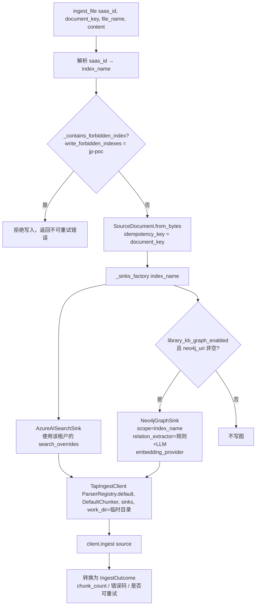

### 7.3 禁写保护（双重拦截）

| 时机 | 位置 | 行为 |
| --- | --- | --- |
| 构建期 | `build_ingest` 时检查配置 | 若某个可写租户映射到 `jp-poc`，直接 raise，服务起不来，第一时间暴露配置错误 |
| 每次写入 | `ingest_file` / `delete_document` 内 `_contains_forbidden_index` | 即使配置被改，也绝不会写进去 |

### 7.4 改造后的配置统一（K2）

| 现状 | 改造后 |
| --- | --- |
| 单一 `azure_search_key`，所有索引共用 | 增加 `search_overrides`：按租户覆盖 endpoint / key（例如 jp-poc 只配**查询 key**） |
| SDK 读 `KB_COPILOT_PROVIDER_*`、`KB_KG_LLM_MODEL` 等 POC 遗留命名 | 后端统一用 `TAP_AI_*` 命名，由插件把值**显式传给** SDK，不再依赖 SDK 自动读 `.env` |
| `KB_KG_LLM_ENABLED`、`kg_entity_vector` 两个开关 | 删除；LLM 抽取和实体向量**默认开启**，在代码里配置 |
| 关系类型写在多个地方（SDK、`tools.py`、`prompts.py`、settings） | SDK `_kg_schema.py` 成为**唯一来源**，后端只引用 |

### 7.5 模型调用的走向（K3a）

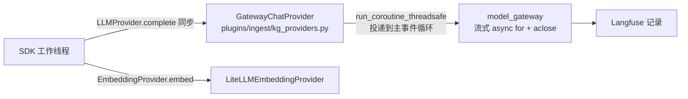

- SDK 的 `LLMProvider.complete` 是**同步**接口，而后端模型网关是**异步流式**的，所以用 `run_coroutine_threadsafe` 把调用投递回启动时绑定的主循环（`bind_loop`），在工作线程里等待结果。
- 好处：所有 LLM 调用都经过统一网关，计费、限流、Langfuse 追踪都能复用。直接调 litellm 不会被 Langfuse 自动记录。

---

## 8. SDK 入库流水线：解析 → 切片 → 写入

SDK 仓库：`fwd-tap-common/fwd-tap-ingest`，包名 `tap_ingest_sdk`，后端以本地路径依赖引入（改了 SDK 立即生效）。

### 8.1 流水线

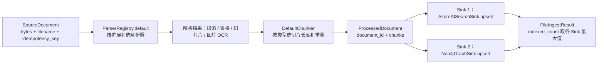

`TapIngestClient._ingest_one` 逐个 Sink 调用 `upsert`；**任意一个 Sink 失败都会抛 `SinkError`**，整个文件判定失败，由 Worker 走重试。

### 8.2 切片参数

| 参数 | 默认 | 适用 |
| --- | --- | --- |
| `KB_CHUNK_SIZE` | 520 | 通用文本 |
| `KB_CHUNK_OVERLAP` | 80 | 相邻切片重叠 |
| `KB_PPT_CHUNK_SIZE` | 900 | PPT |
| `KB_PDF_CHUNK_SIZE` | 420 | PDF |
| `KB_OCR_CHUNK_SIZE` | 260 | 图片 OCR 文本 |

### 8.3 切片数据模型

| 对象 | 关键字段 | 说明 |
| --- | --- | --- |
| `DocumentChunk` | `content`、`metadata` | 一个切片 |
| `ChunkMetadata` | `chunk_id`、`chunk_index`、`page_or_sheet` 等 | 位置和身份信息；`page_or_sheet` 用于前端定位原文页 / Sheet |
| `ProcessedDocument` | `document_id`、`filename`、`content_type`、`chunks` | 一个文件的完整处理结果 |

---

## 9. Azure AI Search 写入

### 9.1 写入内容

`AzureAISearchSink.upsert` 对每个切片写一条 Azure 文档：

| 字段 | 来源 |
| --- | --- |
| 主键 | `chunk_id` |
| 正文 | `chunk.content` |
| 向量 `content_vector` | `text-embedding-3-large`，3072 维 |
| 元数据 | `document_id`、文件名、`page_or_sheet`、`chunk_index` 等 |

覆盖更新：同一 `document_id` 重新入库时，先清掉旧切片再写新切片，避免文件缩短后残留旧内容。

### 9.2 与问答的衔接

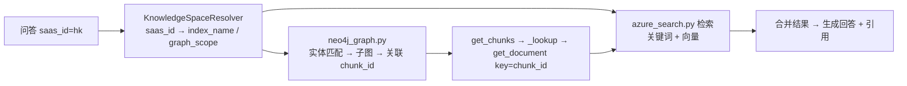

图谱查到的是 `chunk_id`，再回 Azure 用 `get_document(key=chunk_id)` 取正文。所以**两边 chunk_id 必须一致**，这也是同一次入库同时写两个 Sink 的原因。

---

## 10. Neo4j 图谱同步

### 10.1 图模型

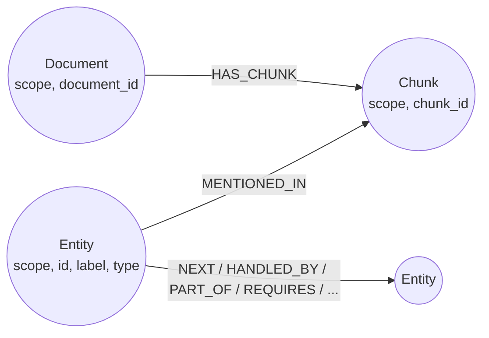

| 节点 / 关系 | 唯一约束 / 索引 | 说明 |
| --- | --- | --- |
| `Entity` | `(scope, id)` 唯一；`entity_norm` 索引；`entity_label_ft` 全文索引（cjk 分词）；`entity_embedding` 向量索引（cosine） | 业务实体：流程步骤、角色、系统、表单…… |
| `Chunk` | `(scope, chunk_id)` 唯一 | 与 Azure 切片一一对应 |
| `Document` | `(scope, document_id)` 唯一 | 一个上传文件 |
| 实体间关系 | 属性 `doc_ids`、`chunk_ids`、`weight = size(doc_ids)` | 记录被哪些文档支撑，用于增量撤销 |

### 10.2 upsert 顺序（增量更新的核心）

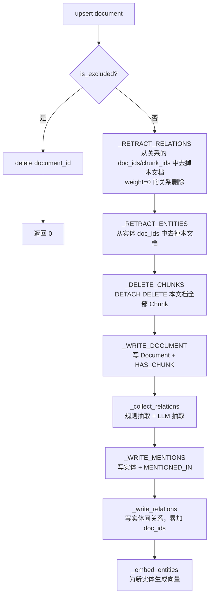

**为什么先撤销再写**：同一个实体或关系可能被多个文档共同支撑。撤销只去掉「本文档的贡献」，其他文档支撑的关系保留；只有 `weight` 降为 0 的关系才真正删除。这样**重新上传一个文件不会误删别的文件贡献的知识**。

### 10.3 关系抽取

| 抽取器 | 位置 | 产出 |
| --- | --- | --- |
| `DefaultRelationExtractor` | `sinks/_kg_extract.py` | `_flowchart_relations`（流程图 NEXT / HANDLED_BY）、阶段 PART_OF、`_cooccurrence_relations`（共现） |
| `LLMRelationExtractor` | `sinks/_kg_llm_extract.py` | 大模型按 `LLM_RELATION_MAP`（包含 / 属于 / 使用 / 依赖 / 前置步骤 / 执行）抽取；失败时返回 `[]`，不阻断入库 |
| `combine_extractors` | `sinks/_kg_extract.py` | 合并多个抽取器的结果 |

产出统一为 `RelationSpec(src, type, dst, chunk_id, source)`。

🔧 **改造项（K2）关系白名单可扩展**：

- 类型定义集中在 SDK `_kg_schema.py`（实体类型 `LLM_ENTITY_TYPES` + 关系类型 `ALLOWED_RELATIONS`）。
- 不在白名单内的关系**不丢弃**，统一写成 `RELATED_TO`，原始类型存在 `raw_types` 属性里，便于后续扩充白名单时回补。
- 问答检索的多跳遍历只走 `TRAVERSABLE_RELATIONS`（不含 `RELATED_TO`），避免弱关系把答案带偏。

### 10.4 实体规范化

`normalize_label` 在 SDK（写入）和后端 `neo4j_graph.py`（查询）中**实现完全一致**：写入时按它生成 `norm`，查询时同样处理用户问题里的词再精确匹配，保证「写进去的能查出来」。

### 10.5 图谱开关

| 条件 | 行为 |
| --- | --- |
| `TAP_AI_LIBRARY_KB_GRAPH_ENABLED=true`（默认）且 `TAP_AI_KB_NEO4J_URI` 非空 | 同步写 Neo4j |
| 任一不满足 | 只写 Azure |
| 本地开发 | **设为 false**（Neo4j 共享，避免污染 hk 数据） |


---

## 11. 删除与重新处理

> 🔧 **改造项（K3b）**：现状后端**没有**删除已入库文档的接口；SDK 的 `Neo4jGraphSink.delete` 已经存在，但后端没接上。K3b 补齐这条链路，并在 `IngestPort` 上新增 `delete_document`。

### 11.1 删除流程

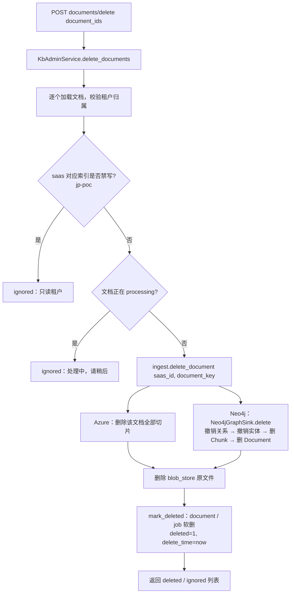

- **先删外部、后软删本地**：外部删除失败时本地记录仍在，用户可以再次点删除（幂等）；反过来就会留下「本地看不到、索引里还在」的脏数据。
- Neo4j 的 `delete` 与 `upsert` 前半段使用同一组撤销语句，所以删除同样**只撤销本文档贡献的知识**。

### 11.2 重新处理（reprocess） vs 重试（retry）

| 对比 | retry | reprocess 🔧 |
| --- | --- | --- |
| 适用状态 | 仅 `failed` | 任意非处理中状态（包括已成功） |
| 典型场景 | 网络抖动、模型超时导致失败 | 切片参数、抽取规则、关系白名单升级后，想让旧文档按新规则重跑 |
| 实现 | `mark_document_retry` + 新建 pending job | 新建 pending job，复用原 `storage_path` 和 `document_key` |
| 下游效果 | 覆盖写入 | 覆盖写入（Neo4j 先撤销再写） |

---

## 12. 同步（sync）与统计（stats）

### 12.1 sync：把索引里已有的文档「认领」进管理表

**场景**：有些文档是早期用 SDK CLI 直接灌进 Azure 的，管理表里没有记录，前端列表看不到。

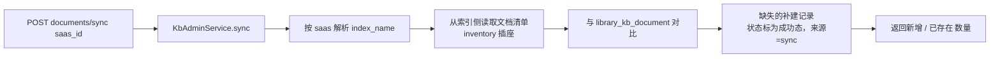

> 现状 bootstrap 中 `inventory=None`，sync 的索引清单来源仍待接入；接入时注意 jp-poc 只能用查询 key 读取。

### 12.2 stats：首页统计卡片

返回文档总数、各状态数量、切片总数等，数据来自 `library_kb_document` / `library_kb_job` 的聚合，不访问 Azure，不受外部服务可用性影响。

---

## 13. 多租户与索引空间

### 13.1 映射关系

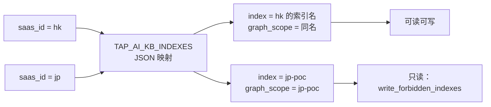

- `KnowledgeSpaceResolver.resolve(saas_id)` → `KnowledgeSpace(index_name=index, graph_scope=index)`。问答检索和入库**共用**这一套解析，保证「写到哪里就从哪里查」。
- Neo4j 中所有节点都带 `scope` 属性，所有 Cypher 都带 `scope` 条件；hk 和 jp-poc 共用一个库但互不可见。
- hk 与 jp-poc 是**并列**关系：jp-poc 是一次性导入的 POC 图谱（T1 脚本 `scripts/kg_import_poc.py`），hk 是持续增长的正式数据。

### 13.2 jp-poc 的特殊处理

| 项 | 说明 |
| --- | --- |
| 数据来源 | 旧 POC 的 `kg.db`（只读打开 `file:...?mode=ro`）+ `chunk_content.csv` |
| 导入方式 | T1 脚本，默认 dry-run；`--write` 才写；`--wipe` 只清 `scope='jp-poc'` |
| chunk_id 对齐 | POC 图谱 Chunk 用 `sha256(content)[:12]`，jp-poc 索引用 `sha1(source_file:locator:part)[:12]`，二者不同；由 K5 脚本 `scripts/kg_remap_poc_chunks.py` 按内容重映射 |
| document_id | POC 中部分为字符串 `"None"`，导入时统一改用 `doc::sha256(filename)[:16]` |
| 写入保护 | 后端入库/删除链路一律拒绝 jp-poc |

---

## 14. 数据表

建表脚本：`sql/003_create_library_kb_tables.sql`；ORM：`persistence/models.py`。所有时间字段均为 **Unix 毫秒时间戳（BIGINT）**，软删除用 `deleted + delete_time`。

### 14.1 library_kb_document（知识库文档）

| 字段 | 说明 |
| --- | --- |
| `id` | 文档 ID（UUID hex） |
| `saas_id / workspace_id / project_id / user_id` | 租户与归属 |
| `document_key` | 传给 SDK 的幂等键，决定外部存储中的文档身份 |
| `file_name` / 规范化名 | 展示名和判重用的名字 |
| `content_sha256 / size_bytes / storage_path` | 当前版本的内容哈希、大小、存储位置 |
| `status` | 文档状态，见 §15 |
| `chunk_count` | 最近一次成功处理的切片数 |
| `error_code / error_message` | 最近一次失败原因 |
| `create_time / update_time / deleted / delete_time` | 通用字段 |

> 具体字段名以 `models.py` 中 `LibraryKbDocument` 为准。

### 14.2 library_kb_job（处理任务）

| 字段 | 说明 |
| --- | --- |
| `id` | 任务 ID |
| `document_id` | 关联文档 |
| `batch_id` | 同一次上传的批次 |
| `file_name / content_sha256 / size_bytes / storage_path` | 任务快照，处理时以此为准 |
| `status` | `pending / processing / succeeded / failed` |
| `attempts / max_attempts` | 已尝试 / 最大尝试次数 |
| `error_code / error_message` | 失败原因 |
| `chunk_count` | 本次切片数 |
| `heartbeat_time / started_time / finished_time` | 心跳与耗时 |
| 索引 | `(status, create_time)` 供领取；`(status, heartbeat_time)` 供回收；`document_id`、`saas_id` 等 |

> ⚠️ 任务表只有一个总 `status`，无法表达「Azure 成功、Neo4j 失败」。当前策略是**任一 Sink 失败即整体失败并重试**，依赖两个 Sink 都是幂等覆盖写来保证重试安全。

---

## 15. 状态机

### 15.1 任务状态

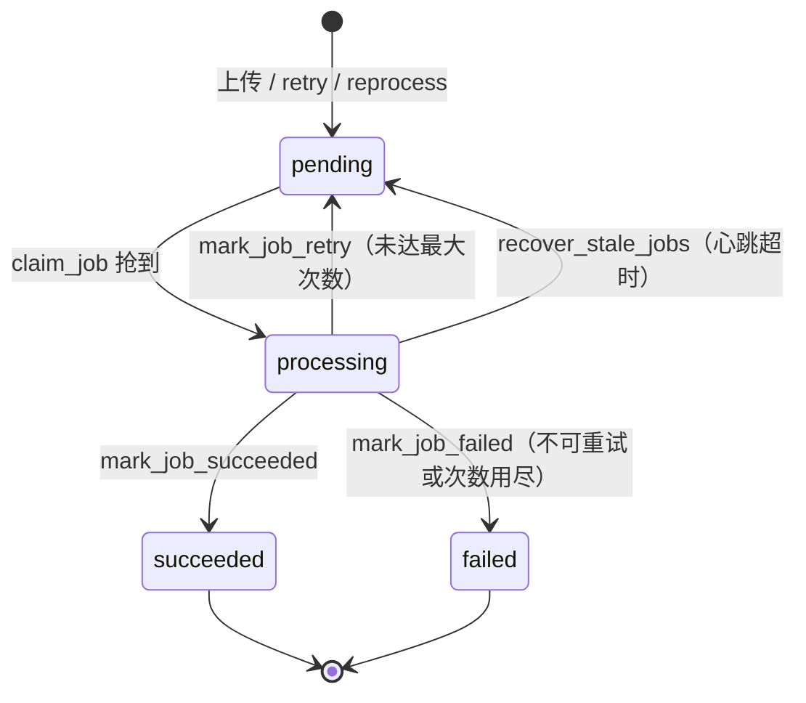

### 15.2 文档状态

文档状态跟随最新任务：`pending → processing → 成功态 / failed`。

- 同名重新上传：任意终态 → `pending`（`requeue_document_for_upload`，带 `expected_status` 防并发）。
- 删除：任意非 processing 状态 → 软删（`deleted=1`）。
- 状态常量以 `core/library_kb/rules.py` 为准，前端不要硬编码中文文案。

---

## 16. 配置项

### 16.1 改造后保留的配置

| 环境变量 | 默认 | 作用 |
| --- | --- | --- |
| `TAP_AI_LIBRARY_KB_GRAPH_ENABLED` | `true` | **唯一开关**：是否同步写 Neo4j；本地设 `false` |
| `TAP_AI_LIBRARY_KB_MAX_FILES_PER_UPLOAD` | 见 settings | 单次上传文件数上限 |
| `TAP_AI_LIBRARY_KB_WORKER_CONCURRENCY` | 见 settings | 每轮领取任务数 |
| `TAP_AI_LIBRARY_KB_MAX_ATTEMPTS` | 见 settings | 最大尝试次数 |
| `TAP_AI_KB_INDEXES` | `{}` | `saas_id → index` 的 JSON 映射 |
| `TAP_AI_KB_AZURE_SEARCH_ENDPOINT / KEY` | — | 默认 Azure 连接 |
| `TAP_AI_KB_SEARCH_OVERRIDES` 🔧 | `{}` | 按租户覆盖 endpoint / key |
| `TAP_AI_KB_VECTOR_FIELD` | `content_vector` | 向量字段名 |
| `TAP_AI_KB_EMBEDDING_MODEL / DIMENSIONS` | `text-embedding-3-large` / `3072` | 向量模型 |
| `TAP_AI_KB_NEO4J_URI` | 空 | 为空即不连图谱 |
| `TAP_AI_KB_NEO4J_USER / PASSWORD / DATABASE` | `neo4j` / — / `neo4j` | Neo4j 认证 |
| `TAP_AI_KB_NEO4J_TIMEOUT_S` | `3.0` | 查询超时 |

### 16.2 改造中删除的配置（K1 / K2）

| 删除项 | 原作用 | 删除理由 |
| --- | --- | --- |
| `library_enabled` | Library 总开关 | 模块已正式上线 |
| `library_kb_enabled` | KB 路由开关 | 同上 |
| `library_kb_worker_enabled` | Worker 开关 | Worker 是 KB 的必要部分 |
| `library_chunk_publish_enabled` | 切片发布开关 | 默认启用 |
| `library_eval_llm_analysis_enabled` | 评估 LLM 分析开关 | 默认启用 |
| `TAP_AI_KB_ENABLED` | 知识插件开关 | 由 `INDEXES` 是否配置决定 |
| `kg_entity_vector` / `KB_KG_LLM_ENABLED` | 实体向量 / LLM 抽取 | 默认开启，写在代码里 |
| `KB_COPILOT_PROVIDER_*` | SDK 的 POC 遗留命名 | 统一走后端模型网关 |

### 16.3 测试环境

- 测试**不读取 `.env`**：通过 `env_file_path()` 辅助函数控制，`tests/conftest.py` 注入假环境变量。
- 测试中一律使用 fake（假的存储、假的 ingest、假的 Neo4j driver），不连真实 MySQL / Redis / Azure / LLM。

---

## 17. 错误码与返回约定

| 场景 | 返回 |
| --- | --- |
| 业务错误 | HTTP 200 + `{"code": "CCB001", "message": "..."}` |
| 未捕获异常 | `CCB500` |
| 上传中单个文件失败 | 不影响整体，进入 `rejected`，`reason` 说明原因 |
| retry / delete 中不符合条件的文档 | 进入 `ignored`，附原因 |
| 任务失败 | `job.error_code / error_message` 记录，详情接口可见 |

---

## 18. 可观测性与日志

| 位置 | 内容 |
| --- | --- |
| bootstrap | 缺少 `blob_store` 时 warning 并跳过装配 |
| Worker | 领取、成功、重试、失败、回收超时任务都有日志，含 `job_id / document_id / attempts` |
| SDK | `sink upsert failed filename=...`（`logger.exception`） |
| LLM 抽取 | 走模型网关后自动进入 Langfuse，可按文档追踪抽取的 prompt 和输出 |
| 审计 | 上传 / 删除等管理操作通过 `AuditRepo` 记录 |

---

## 19. 测试与验收

### 19.1 测试文件

| 测试 | 覆盖内容 |
| --- | --- |
| `tests/api/test_library_kb_api.py` | 6（+2）个接口的请求校验、返回结构、错误码 |
| `tests/unit/test_library_kb_service.py` | 上传判重、并发冲突、retry、sync |
| `tests/unit/test_library_kb_worker.py` | 抢占、心跳、超时、重试、回收 |
| `tests/unit/test_library_kb_repo.py` | 条件更新、分页、软删 |
| `tests/unit/test_library_kb_rules.py` | 文件名规范化、判重决策 |
| `tests/unit/test_library_kb_ingest_plugin.py` | Sink 组装、jp-poc 禁写、图谱开关 |
| `tests/unit/test_library_kb_skeleton.py` | 配置默认值、装配骨架 |

### 19.2 常用命令

```powershell
uv run pytest tests/unit/test_library_kb_service.py -v
uv run pytest tests/api/test_library_kb_api.py -v
uv run ruff check src tests
uv run mypy src
```

### 19.3 端到端验收清单

| # | 步骤 | 预期 |
| --- | --- | --- |
| 1 | 上传 1 个新文件 | `queued=1`，列表中状态从 pending → processing → 成功 |
| 2 | 再次上传同名同内容 | `skipped=1` |
| 3 | 上传同名不同内容 | `queued=1`，`document_id` 不变，切片数更新 |
| 4 | 问答提问该文件内容 | 回答带该文件引用 |
| 5 | （图谱开启时）查 Neo4j 该 `document_id` 的 Chunk 数 | 等于 `chunk_count` |
| 6 | 制造失败（如断开 Azure）后 retry | 恢复后成功 |
| 7 | 用 `saas_id=jp` 上传 | 被拒绝，jp-poc 索引无变化 |
| 8 | 删除测试文件 🔧 | Azure 与 Neo4j 中该文档切片均为 0，列表不再显示 |
| 9 | 全程记录 hk scope 节点数前后对比 | 除测试文档外无变化 |

---

## 20. 安全红线

1. **jp-poc 只读**：Azure 只配查询 key；后端入库、删除链路一律拒绝；Neo4j 写入只允许 T1 脚本且限定 `scope='jp-poc'`。
2. **hk 数据保护**：Neo4j 与同事共享，本地 `TAP_AI_LIBRARY_KB_GRAPH_ENABLED=false`；不要在本地对 hk 文档调用删除接口（hk Azure 索引也是共享的）。
3. **密钥不入库**：`.env`、Neo4j 密码、数据库连接串、模型 API key 不提交、不贴到聊天或文档中；`.env.example` 只放占位符。
4. **测试不连真实服务**。
5. **编码统一 UTF-8（无 BOM）**，标识符只用 ASCII。

---

## 21. 常见问题 FAQ

**Q1：上传成功了但一直是 pending？**
Worker 没启动或没领到任务。检查：启动日志里是否有「未找到 blob_store」；改造前还要检查 `library_kb_worker_enabled`。

**Q2：一直 processing 不结束？**
看 `heartbeat_time` 是否还在更新。不更新说明进程已死，等 `recover_stale_jobs` 回收；一直更新说明文件很大或模型慢，检查任务超时配置。

**Q3：问答查不到刚上传的内容？**
确认问答请求里的 `saas_id` 与上传时一致，且 `TAP_AI_KB_INDEXES` 中有该映射；Azure 索引写入后有短暂延迟。

**Q4：图谱里没有新文档的实体？**
检查图谱开关和 `NEO4J_URI`；LLM 抽取失败时会返回空列表但不报错，可在 Langfuse 中查看抽取调用。

**Q5：重新上传同一个文件，图谱里会不会多出一份？**
不会。`document_key` 不变，Neo4j 先撤销本文档旧贡献再写入。

**Q6：Neo4j 里节点只有 id 没有内容？**
这是早期导入的数据缺字段（缺 `source_file / document_id / content_hash` 等），由 T1 / K5 脚本对 jp-poc 重建修复；hk 待 jp-poc 验证通过后再通过 reprocess 修复。

**Q7：后端怎么连 Neo4j？**
只要配置 `TAP_AI_KB_NEO4J_URI / USER / PASSWORD`（同事提供的地址），启动时就会创建 driver；没有 `.env` 或 URI 为空时完全不连接。

---

## 22. 已知隐患与后续计划

| 隐患 | 影响 | 计划 |
| --- | --- | --- |
| 任务表只有一个总状态 | 无法区分 Azure / Neo4j 哪边失败 | 依赖幂等重试；后续可在 `error_code` 中区分 Sink |
| `sync` 的 inventory 未接入 | 历史文档无法认领 | 接入索引清单读取 |
| SDK CLI 维度解析 bug：`int(os.getenv("KB_EMBEDDING_DIMENSIONS")) or 3072` | 未设置变量时直接报错 | SDK 修复为先判空再转 int |
| SDK `__init__` 自动加载 `.env` | 测试和后端行为受本机文件影响 | 改为由后端显式传参（K2） |
| `settings.py` 默认模型大小写与测试不一致 | 测试失败 | 统一为一种写法 |
| hk 历史图谱数据不完整 | 前端展示缺内容 | jp-poc 成功后对 hk 执行 reprocess |

---

## 附录 A：文件 / 函数速查表

| 文件 | 关键类 / 函数 | 作用 |
| --- | --- | --- |
| `api/library_kb.py` | `library_kb_stats` / `_documents_list` / `_document_detail` / `_documents_upload` / `_documents_retry` / `_documents_sync`（+ delete / reprocess 🔧） | HTTP 路由 |
| `api/dto.py` | `Kb*Request` / `Kb*Data` | 请求响应模型 |
| `application/library_kb.py` | `KbAdminService`：`stats`、`list_documents`、`get_document`、`upload`、`retry`、`sync`、`_delete_storage_file` | 管理侧业务编排 |
| `application/library_kb_worker.py` | `KbIngestWorker`：`run_once`、`_claim_and_load_job`、`_process_job`、`_heartbeat_loop`、`_run_ingest_with_timeout`、`stop` | 后台处理 |
| `persistence/library_kb_repo.py` | `list_pending_job_ids`、`claim_job`、`heartbeat`、`recover_stale_jobs`、`mark_job_*`、`mark_document_*`、`requeue_document_for_upload` | 数据访问 |
| `persistence/models.py` | `LibraryKbDocument`、`LibraryKbJob` | ORM |
| `core/library_kb/rules.py` | 判重、文件名规范化、状态常量 | 纯规则 |
| `contracts/library_kb.py` | `IngestPort.ingest_file`（+ `delete_document` 🔧）、`IngestOutcome` | 插座定义 |
| `plugins/ingest/sdk_ingest.py` | `SdkIngestAdapter`、`build_ingest`、`_sinks_factory`、`_contains_forbidden_index` | 对接 SDK |
| `plugins/ingest/kg_providers.py` 🔧 | `GatewayChatProvider`、`LiteLLMEmbeddingProvider`、`bind_loop` | SDK 用的模型适配 |
| `plugins/extensions/knowledge/spaces.py` | `KnowledgeSpaceResolver` | saas → 索引 / scope |
| `plugins/extensions/knowledge/backends/neo4j_graph.py` | `_Q_EXACT` / `_Q_FULLTEXT` / `_Q_VECTOR` / `_Q_SUBGRAPH` / `_Q_CHUNKS`、`normalize_label` | 问答侧图谱查询 |
| `plugins/extensions/knowledge/backends/azure_search.py` | `get_chunks`、`_lookup` | 问答侧按 chunk_id 取正文 |
| SDK `client.py` | `TapIngestClient.ingest` / `_ingest_one` | 流水线 |
| SDK `sinks/_neo4j.py` | `Neo4jGraphSink.upsert` / `delete` / `_write_relations` / `_embed_entities` | 图谱写入 |
| SDK `sinks/_kg_schema.py` | `ALLOWED_RELATIONS`、`LLM_RELATION_MAP`、`LLM_ENTITY_TYPES`、`RelationSpec` | 类型唯一来源 |
| SDK `sinks/_kg_extract.py` / `_kg_llm_extract.py` | `DefaultRelationExtractor`、`LLMRelationExtractor`、`combine_extractors` | 关系抽取 |
| `scripts/kg_import_poc.py` 🔧 | T1 | jp-poc 图谱导入 |
| `scripts/kg_remap_poc_chunks.py` 🔧 | K5 | jp-poc chunk_id 对齐 |

## 附录 B：术语表

| 术语 | 含义 |
| --- | --- |
| saas_id | 租户标识，如 `hk`、`jp` |
| index / scope | Azure 索引名 / Neo4j 中隔离数据用的属性，二者同名 |
| document_key | 文档在外部存储中的稳定身份，同名重传不变 |
| chunk / 切片 | 文档切分后的最小检索单位 |
| Sink | SDK 中的「写入目的地」，如 Azure Sink、Neo4j Sink |
| 抢占（claim） | Worker 用条件更新把任务从 pending 改成 processing，成功者获得处理权 |
| 心跳 | 处理中任务定期刷新时间戳，证明进程还活着 |
| 撤销（retract） | 从实体 / 关系上去掉某文档的贡献，而不是整条删除 |
| RELATED_TO | 不在白名单内的关系的统一类型，原始类型存于 `raw_types` |
