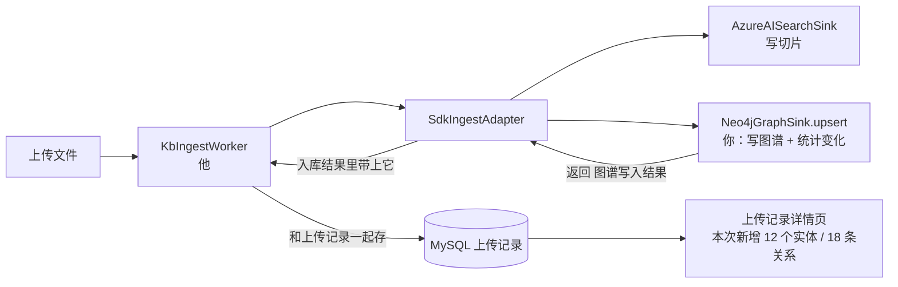

图谱的变化不单独做一套逻辑，而是作为文件上传记录的一部分，跟着那条记录一起存下来。 打开某个文件的上传记录，就能看到这次上传新增和更新了哪些节点、关系。

按这个思路，你这边要交出去的是一份「图谱写入结果」：这次写了什么、新增了多少、失败没有。他把这份结果和上传记录存在一起，并负责展示。

一、为什么只能由写图谱的那一步来报告结果 

到底哪些节点是这次新建的、哪些原本就存在，只有写入那一刻才能准确知道。Neo4j 的 ‎`MERGE` 在执行时就能区分「新建」和「已存在」，驱动也会返回本次新建了多少节点、多少关系。

如果写完以后再回头查，就只能靠时间去推断。两个文件同时入库、多个文件共用同一个实体时，都可能算错。

所以分工是这样的：


|环节                                 |谁          |做什么                        |

|-----------------------------------|-----------|---------------------------|

|SDK 的图谱写入端 `Neo4jGraphSink.upsert` |**你**      |写图谱时顺便统计本次的变化，作为返回值交出去     |

|入库适配器 `SdkIngestAdapter`，调用各个写入端的地方|你和他商量着改（几行）|收下这份结果，放进入库结果里             |

|入库工人 `KbIngestWorker`，以及 MySQL 上传记录|**他**      |把结果存进上传记录，例如一个 JSON 字段；页面展示|



二、你交给他的东西：一份固定格式的结果 

```json
{
  "status": "written",
  "scope": "hk",
  "document_id": "doc::1a2b3c4d",
  "chunks_written": 25,
  "entities_created": 12,
  "entities_matched": 30,
  "relations_created": 18,
  "entity_vectors": {"embedded": 12, "failed": 0},
  "new_entities": [
    {"id": "entity::xxx", "label": "QlikSense", "type": "System", "type_zh": "系统"}
  ],
  "new_relations": [
    {"source": "entity::xxx", "target": "entity::yyy", "type": "USES", "type_zh": "使用"}
  ],
  "truncated": false,
  "error": null
}

```


|字段                                     |含义                                            |

|---------------------------------------|----------------------------------------------|

|`status`                               |`written` 已写入、`skipped` 图谱未启用、`failed` 写入失败   |

|`entities_created` / `entities_matched`|这次新建的实体数 / 原本就存在、这次又被提到的实体数                   |

|`relations_created`                    |这次新建的关系数                                      |

|`new_entities` / `new_relations`       |新建的节点和关系明细，**最多各 200 条**；超过时 `truncated: true`|

|`entity_vectors`                       |实体向量生成了多少、失败多少（失败不影响入库）                       |

|`error`                                |失败原因；图谱写入失败时，Azure 已经写入成功的部分不受影响              |

明细设上限，是为了防止一个大文件把上传记录撑得很大。要看完整的子图，直接跳到图谱页面，用 ‎`document_id` 过滤就行，这个过滤条件「KG 接口调整」里已经有了。

三、你这边要改的代码（SDK 写入端） 

1. 写入时区分新建和已存在：在实体和关系的 MERGE 语句里，用 ‎`ON CREATE SET` 记下创建标记，再把「本次新建的 id」返回出来。另一种做法是读取驱动返回的 ‎`counters.nodes_created` 和 ‎`counters.relationships_created`。

2. upsert 返回结果：返回上面那份结构。不能改 Azure 写入端；只要 Neo4j 写入端返回结果就行，其他写入端仍然返回 ‎`None`。

3. 失败也要有结果：图谱写入抛异常时，返回 ‎`status: failed` 和错误信息，不要让整个入库失败（这条要和他确认，见第五节）。

4. 结构定义放在 SDK 里：在 SDK 里定义 ‎`GraphWriteSummary`，后端只引用它。这样字段名只有一份。

四、动手前先核实三件事（只读） 

1. 谁在调用 ‎`sink.upsert`？返回值有没有被丢掉？ 在后端目录运行：

```powershell
git grep -n -E "\.upsert\(" -- src/tap_ai

```

如果调用在 ‎`SdkIngestAdapter` 里，只需要在那里收下返回值。如果是在 SDK 的 ‎`TapIngestClient` 内部调用的，就要改 SDK 把结果传出来，改动大一些。

2. 现在的写图谱语句能不能区分新建和已存在？ 在 SDK 目录运行：

```powershell
git grep -n -E "MERGE|ON CREATE SET|ON MATCH SET|def upsert|def _run" -- fwd-tap-ingest/src/tap_ingest_sdk/sinks/_neo4j.py

```

3. 同一个文件重新上传时，旧的切片和关系会不会先删掉？ 第 2 条命令的输出里看有没有 ‎`DELETE` 或 ‎`DETACH`。如果会删，结果里还要加上 ‎`entities_removed` 和 ‎`relations_removed`，否则「这次更新了什么」只显示一半。

五、要和他确认的三件事 

你好，关于图谱更新跟着文件上传记录一起记录的事，我这边的方案是：

图谱写入端在写入时，顺便统计本次的变化，作为返回值交出来。内容包括：状态（已写入 / 未启用 / 失败）、新建实体数、已有实体数、新建关系数、写入的切片数、实体向量结果，以及新建节点和关系的明细（各最多 200 条，超出会标记 truncated）。

你那边只需要：
1. 在 SdkIngestAdapter 调用 sink.upsert 的地方收下返回值，放进入库结果里（这几行我可以一起改）
2. 把它存进上传记录，比如加一个 JSON 字段 graph_summary
3. 在上传记录详情页展示；想看完整子图的话，跳转到图谱页面，用 document_id 过滤

想跟你确认三点：
1. 上传记录存在哪张表？加一个 JSON 字段可以吗，还是你想另建一张明细表？
2. 图谱写入失败时，整个入库任务算失败，还是只把 graph_summary 标成 failed、任务照常成功？我的建议是后者，因为切片已经写进 Azure 了
3. 重新上传同一个文件时，旧的图谱数据要不要先删掉？这决定了结果里是否需要「删除了哪些节点」

上面三条只读命令的输出发我，再加上他对这三个问题的回复，我就可以把 SDK 写入端的修改提示词写出来，包括返回结构、MERGE 语句怎么改，以及测试怎么写。