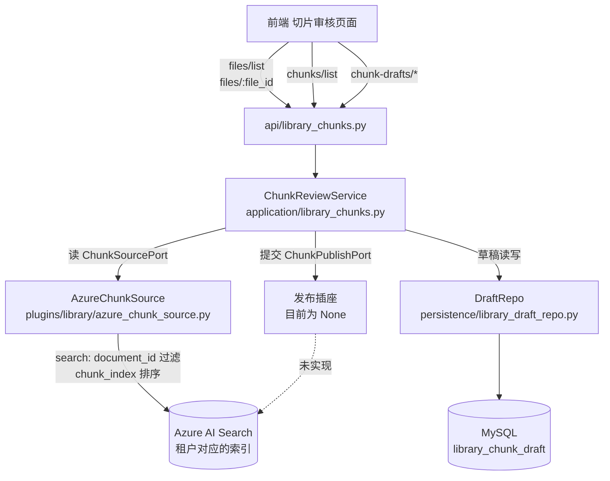
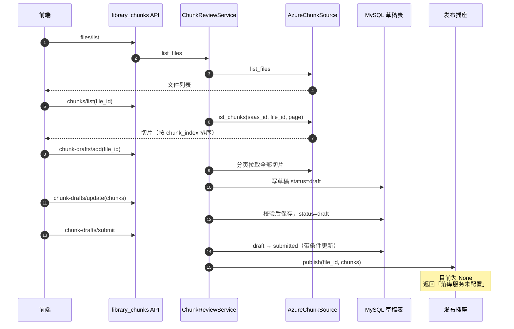
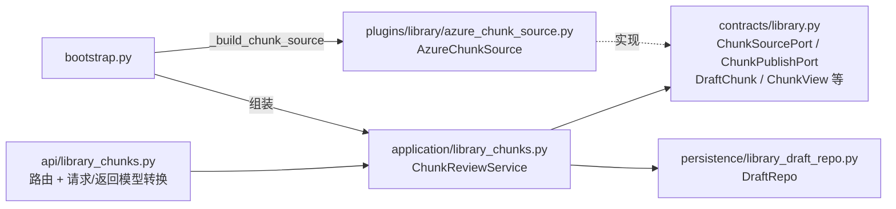
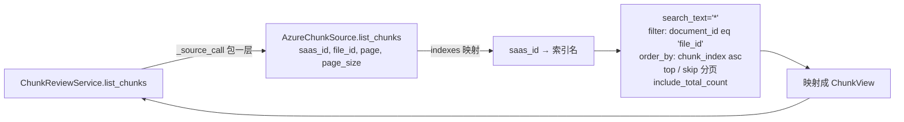
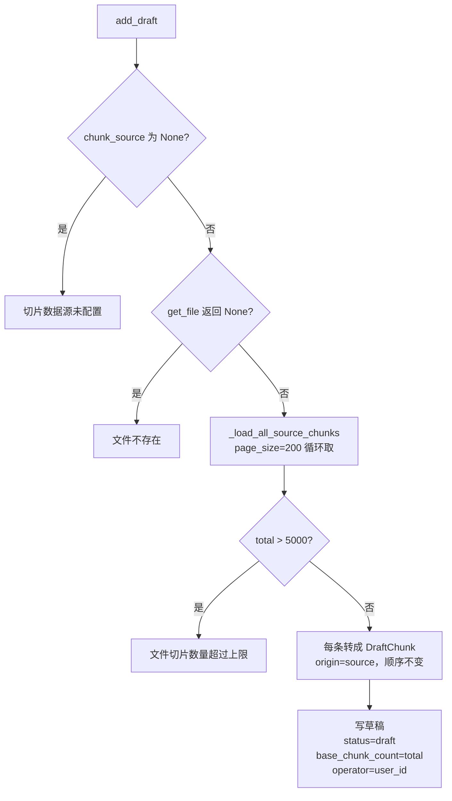
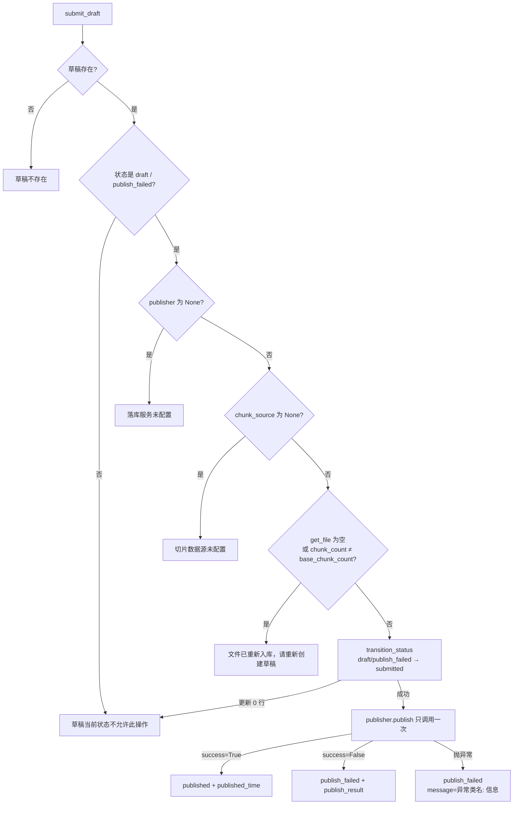
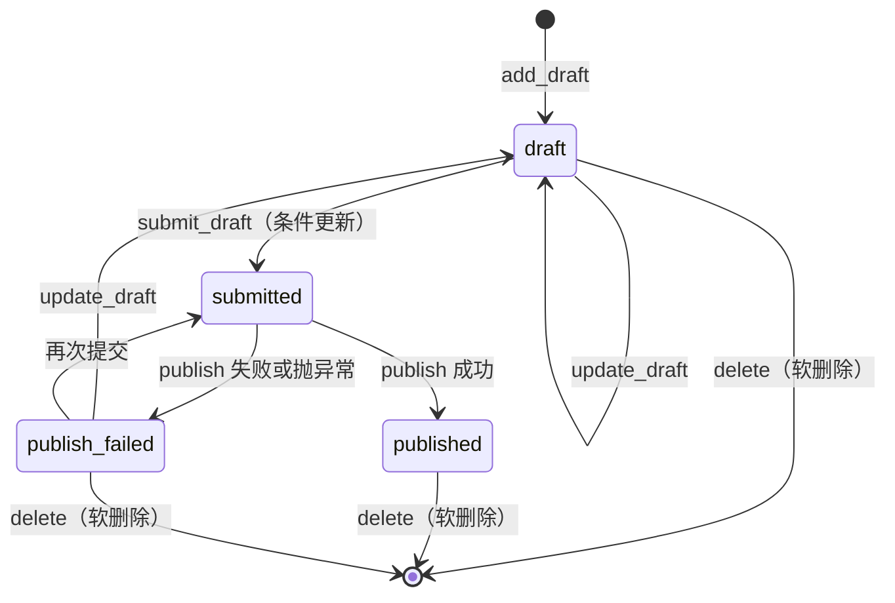

# 切片审核导览

> 适用仓库：`tap-ai-backend`（分支 `feature/tap-10366` 及其后续）
> 描述口径：**按当前代码的真实状态描述**，并标出与设计不一致、尚未完成、尚待核对的地方。
> 依据：《Library 设计总纲》、P1–P4 任务书、各轮只读排查与验收报告、git 记录。
> 读者：团队内的后端、前端、测试同学。

**标记说明**

| 标记 | 含义 |
| --- | --- |
| ✅ | 已确认：有代码原文、行号或测试作为证据 |
| 📐 | 按设计：设计总纲或任务书这样规定，但还没有看到对应的代码原文 |
| ⚠️ | 存在的问题：已确认有问题，还没有修 |
| 🔍 | 待核对：不同报告之间互相矛盾，或修复之后没有再验证 |
| ⛔ | 缺口：功能还没打通 |

---

## 目录

- [0. 一页看懂](#0-一页看懂)
- [1. 总体介绍](#1-总体介绍)
- [2. 快速使用](#2-快速使用)
- [3. 总体架构与分层](#3-总体架构与分层)
- [4. 接口层：接口一览](#4-接口层接口一览)
- [5. 读取切片：AzureChunkSource](#5-读取切片azurechunksource)
- [6. 草稿：新建、修改、删除](#6-草稿新建修改删除)
- [7. 提交落库](#7-提交落库)
- [8. 插座契约（contracts）](#8-插座契约contracts)
- [9. 数据表](#9-数据表)
- [10. 状态机](#10-状态机)
- [11. 配置项](#11-配置项)
- [12. 错误信息与返回约定](#12-错误信息与返回约定)
- [13. 从旧 POC 迁移过来的对照](#13-从旧-poc-迁移过来的对照)
- [14. 测试与验收](#14-测试与验收)
- [15. 现状总表](#15-现状总表)
- [16. 存在的问题与缺口](#16-存在的问题与缺口)
- [17. 待核对清单与核对命令](#17-待核对清单与核对命令)
- [18. 后续计划](#18-后续计划)
- [附录 A：文件 / 函数速查表](#附录-a文件--函数速查表)
- [附录 B：术语表](#附录-b术语表)

---

## 0. 一页看懂

| 问题 | 一句话回答 |
| --- | --- |
| 它是什么 | Library 的「切片审核」模块：查看某个文件已经入库的切片，复制成一份草稿，人工修改，再提交写回索引。 |
| 入口在哪 | HTTP 路由前缀 `/tap/ai/library`，代码在 `src/tap_ai/api/library_chunks.py`。 |
| 业务在哪 | `src/tap_ai/application/library_chunks.py` 的 `ChunkReviewService`。 |
| 切片从哪来 | 从 Azure AI Search 索引读取，由插件 `plugins/library/azure_chunk_source.py` 的 `AzureChunkSource` 完成。**不读 Neo4j，不读本地文件。** |
| 草稿存哪 | MySQL 表 `library_chunk_draft`，仓储在 `persistence/library_draft_repo.py`。 |
| 提交写到哪 | 通过「发布插座」`ChunkPublishPort` 写回索引。**目前插座为空，提交走不通。** |
| 不做什么 | 不解析、不 OCR、不重新切片、不算向量。这些属于入库流程（知识库管理模块）。 |
| 现在能用到哪一步 | 看文件、看切片、建草稿、改草稿、删草稿：代码已接通；**提交落库：不可用**。 |

---

## 1. 总体介绍

### 1.1 模块定位

Library 共 4 个模块，切片审核是第 ② 个：

| 编号 | 模块 | 和切片审核的关系 |
| --- | --- | --- |
| ① | 知识库管理 | 上游。它把文件解析、切片后写进 Azure 索引，切片审核读的就是这些切片 |
| ② | **切片审核（本文）** | 查看切片 → 草稿 → 人工修改 → 提交 |
| ③ | RAG 评估 | 平级。两者没有代码依赖；评估结果中「切片截断、内容不全」类的问题，可以回到切片审核里修 |
| ④ | 知识图谱 | 平级。图谱里的 `Chunk.chunk_id` 和 Azure 里切片的主键是同一个值，提交落库后会影响这个对应关系（见 16 节） |

### 1.2 设计目标

1. **只管「审」，不管「切」**：旧 POC 的切片工作台自己解析源文件、跑 OCR，第一次打开要 10–70 秒。新模块只读已经入库的切片，解析和切片完全交给入库流程。
2. **正式数据不被直接改动**：所有修改都发生在草稿上，草稿存 MySQL。只有「提交」这一个动作会写回索引。
3. **写索引的地方只有一处**：提交通过发布插座完成，切片审核本身不持有任何写索引的代码。
4. **防重复提交、防过期提交**：状态切换用带条件的数据库更新；提交前核对文件的切片数有没有变。
5. **不让前端传本地路径**：旧 POC 的 `/artifact?path=` 允许前端传本地路径，新模块不再提供这类接口。

### 1.3 总体流程图



一句话：**从 Azure 读切片，复制成 MySQL 草稿，人工改完，经发布插座写回 Azure（发布这一步还没接上）。**

---

## 2. 快速使用

### 2.1 本地准备

| 步骤 | 做什么 | 说明 |
| --- | --- | --- |
| 1 | 执行建表 `sql/002_create_library_tables.sql` | 包含 `library_chunk_draft`。开发库只需执行一次；各环境由团队执行 |
| 2 | 配好 Azure Search：`TAP_AI_KB_AZURE_SEARCH_ENDPOINT`、`TAP_AI_KB_AZURE_SEARCH_KEY`、`TAP_AI_KB_INDEXES` | `AzureChunkSource` 用这三项构造。`INDEXES` 决定 `saas_id` 对应哪个索引 |
| 3 | 启动后端 | K2a 之后不再需要 `library_enabled` 开关，路由默认挂载 ✅ |
| 4 | 打开 `/docs` | 能看到 `library` 标签下的 9 个接口 |

> 本地连的是团队共用的 Azure 索引。**看切片、建草稿只读 Azure，是安全的；不要对 hk 调用提交接口。**

### 2.2 最小调用示例

**① 文件列表**

```http
POST /tap/ai/library/files/list
{"saas_id": "hk", "keyword": "报销", "page": 1, "page_size": 20}
```

**② 某个文件的切片**

```http
POST /tap/ai/library/chunks/list
{"saas_id": "hk", "file_id": "doc::1a2b3c4d5e6f7a8b", "page": 1, "page_size": 50}
```

返回（字段以 `LibraryChunkData` 为准）：

```json
{
  "items": [
    {"chunk_id": "c2", "file_id": "doc::1a2b3c4d5e6f7a8b", "source_file": "alpha.pdf",
     "page_or_sheet": "p2", "part_index": 2, "content": "A-2", "metadata": {}}
  ],
  "total": 3, "page": 1, "page_size": 50
}
```

**③ 新建草稿**（把这个文件的全部切片复制一份）

```http
POST /tap/ai/library/chunk-drafts/add
{"saas_id": "hk", "user_id": "u001", "file_id": "doc::1a2b3c4d5e6f7a8b"}
```

**④ 保存修改**（整份切片列表一起提交）

```http
POST /tap/ai/library/chunk-drafts/update
{
  "saas_id": "hk", "user_id": "u001", "draft_id": "<32位id>",
  "chunks": [
    {"chunk_id": "c1", "page_or_sheet": "p1", "content": "原文不变", "origin": "source"},
    {"chunk_id": "c2", "page_or_sheet": "p2", "content": "改过的内容", "origin": "edited"},
    {"chunk_id": null, "page_or_sheet": "p2", "content": "新增的一段", "origin": "added"}
  ]
}
```

**⑤ 提交**（目前会返回「落库服务未配置」）

```http
POST /tap/ai/library/chunk-drafts/submit
{"saas_id": "hk", "user_id": "u001", "draft_id": "<32位id>"}
```

### 2.3 一次完整的使用旅程



---

## 3. 总体架构与分层

### 3.1 分层

后端统一采用 **api → application → core → contracts** 四层，外部能力由 **plugins** 实现 contracts 里的插座，由 `bootstrap.build_app` 统一组装。切片审核没有 core 层的纯逻辑，业务都在 application 层。



⚠️ `application/library_chunks.py` 直接 import 了 persistence 层（DraftRepo）。设计上 application 应该只依赖 contracts。验收时已决定**先记下、不改**。

### 3.2 文件分布

| 层 | 文件 | 作用 |
| --- | --- | --- |
| 接口 | `src/tap_ai/api/library_chunks.py` | 9 个路由；`_service(request)` 从 `app.state.library_chunk_service` 取服务 |
| 请求模型 | `src/tap_ai/contracts/library.py` | `LibraryFileListRequest`（:128）、`LibraryChunkListRequest`（:140）、`ChunkDraftAddRequest`、`ChunkDraftListRequest`、`ChunkDraftUpdateRequest`、`ChunkDraftIdRequest` |
| 插座和数据 | `src/tap_ai/contracts/library.py` | `ChunkSourcePort`、`ChunkPublishPort`、`FileSummary`、`FileDetail`、`ChunkView`、`DraftChunk`、`PublishResult` |
| 返回模型 | `src/tap_ai/api/dto.py` | `LibraryFileData`（:89）、`LibraryFileDetailData`（:100）、`LibraryFileListData`（:108）、`LibraryChunkData`（:120）、`LibraryChunkListData`（:134）、`ChunkDraftData`（:146）、`ChunkDraftBriefData`（:165）、`ChunkDraftListData`（:183） |
| 业务 | `src/tap_ai/application/library_chunks.py` | `ChunkReviewService` |
| 仓储 | `src/tap_ai/persistence/library_draft_repo.py` | `DraftRepo` |
| ORM | `src/tap_ai/persistence/models.py` | `LibraryChunkDraft` |
| 读取插件 | `src/tap_ai/plugins/library/azure_chunk_source.py` | `AzureChunkSource`，实现 `ChunkSourcePort` |
| 建表 | `sql/002_create_library_tables.sql` | `library_chunk_draft` |
| 组装 | `src/tap_ai/bootstrap.py` | 构造服务、挂到 `app.state`、挂载路由 |

### 3.3 组装（bootstrap）

✅ 服务构造（K2a 删除开关之前的原文，K2a 只去掉了外层的 `if`）：

```python
from tap_ai.application.library_chunks import ChunkReviewService
from tap_ai.persistence.library_draft_repo import DraftRepo

library_chunk_service = ChunkReviewService(
    settings=app_settings,
    draft_repo=DraftRepo(session_factory),
    chunk_source=None,      # 后来改为 _build_chunk_source() 的返回值
    publisher=None,         # 仍为 None
)
app.state.library_chunk_service = library_chunk_service
```

✅ 读取插件的构造：

```python
def _build_chunk_source() -> Any:
    from tap_ai.plugins.library.azure_chunk_source import AzureChunkSource
    ...
    return AzureChunkSource(
        endpoint=kb.azure_search_endpoint,
        key=kb.azure_search_key.get_secret_value(),
        indexes=kb.indexes,
    )
```

✅ 路由挂载：`app.include_router(library_chunks_router, tags=["library"])`；同时 `app.state.chunk_source_port`、`app.state.chunk_publish_port` 两个插座位。

🔍 `chunk_source=` 和 `publisher=` 现在分别传的是什么，需要用 17 节的命令再确认一次原文。

---

## 4. 接口层：接口一览

前缀 `/tap/ai/library`，只用 GET 和 POST，写法照抄 `api/conversations.py`。

| # | 方法 | 路径 | 请求 | 返回 | 证据 |
| --- | --- | --- | --- | --- | --- |
| 1 | POST | `/files/list` | `LibraryFileListRequest` | `LibraryFileListData` | 📐（请求、返回模型 ✅） |
| 2 | GET | `/files/{file_id}` | 路径参数 | `LibraryFileDetailData` | 📐 |
| 3 | POST | `/chunks/list` | `LibraryChunkListRequest` | `LibraryChunkListData` | 📐（请求、返回模型 ✅） |
| 4 | POST | `/chunk-drafts/add` | `ChunkDraftAddRequest` | `ChunkDraftData` | ✅ `library_chunks.py:82` |
| 5 | POST | `/chunk-drafts/list` | `ChunkDraftListRequest` | `ChunkDraftListData` | ✅ `:90` |
| 6 | GET | `/chunk-drafts/{draft_id}` | 路径参数 | `ChunkDraftData` | ✅ `:104` |
| 7 | POST | `/chunk-drafts/update` | `ChunkDraftUpdateRequest` | `ChunkDraftData` | ✅ `:110` |
| 8 | POST | `/chunk-drafts/delete` | `ChunkDraftIdRequest` | 同会话删除接口 | 📐 |
| 9 | POST | `/chunk-drafts/submit` | `ChunkDraftIdRequest` | `ChunkDraftData` | ✅ `:126` |

### 4.1 接口内部的统一写法

✅ 每个路由都只做转发和模型转换（`library_chunks.py:82-113` 原文摘录）：

```python
@router.post("/chunk-drafts/add", response_model=ChunkDraftData)
async def ...(body: ChunkDraftAddRequest, request: Request) -> ChunkDraftData:
    return ChunkDraftData.model_validate(await _service(request).add_draft(body))

@router.post("/chunk-drafts/list", response_model=ChunkDraftListData)
async def ...(body: ChunkDraftListRequest, request: Request) -> ChunkDraftListData:
    ...
    return ChunkDraftListData(
        items=[ChunkDraftBriefData.model_validate(item) for item in items], ...
    )

@router.get("/chunk-drafts/{draft_id}", response_model=ChunkDraftData)
async def chunk_draft_get(draft_id: str, request: Request) -> ChunkDraftData:
    return ChunkDraftData.model_validate(await _service(request).get_draft(draft_id))
```

- 列表接口返回 `ChunkDraftBriefData`，**不带 chunks**；详情接口返回 `ChunkDraftData`，带全部 chunks。
- `file_id` 形如 `doc::xxxx`，含冒号。接口 2 要能正确接收这种路径参数（P4 规定要有测试）。

### 4.2 请求里的通用字段

- **租户字段**：与会话新增接口完全相同的一组（`saas_id`、`workspace_id`、`project_id`、`user_id`）。
- **分页字段**：与会话列表请求相同的 `page`、`page_size`。
- 草稿的 `operator` 取请求里的 `user_id`。

---

## 5. 读取切片：AzureChunkSource

### 5.1 设计思路

切片的正式数据只有一份，在 Azure 索引里。切片审核不复制、不缓存，每次都从 Azure 读。Neo4j 里只存切片编号和 200 字摘要，不作为切片审核的数据来源。

### 5.2 读取流程



✅ 核心代码（`azure_chunk_source.py:107-127`）：

```python
async def list_chunks(
    self, *, saas_id: str, file_id: str, page: int, page_size: int
) -> tuple[list[ChunkView], int]:
    results = await self._search(
        client,
        search_text="*",
        filter_expression=_document_filter(file_id),
        select=_CHUNK_SELECT,
        order_by=["chunk_index asc"],
        top=page_size,
        skip=(page - 1) * page_size,
        include_total_count=True,
    )

_CHUNK_SELECT = ("chunk_id", "document_id", "source_file", "page_or_sheet", "content", "chunk_index")
```

### 5.3 字段对应

| Azure 字段 | ChunkView 字段 | 说明 |
| --- | --- | --- |
| `chunk_id` | `chunk_id` | 索引主键，也是 Neo4j 中 `Chunk.chunk_id` 的值 |
| `document_id` | `file_id` | 形如 `doc::xxxx`，切片审核里统一叫 `file_id` |
| `source_file` | `source_file` | 原始文件名 |
| `page_or_sheet` | `page_or_sheet` | 页码、sheet 名或 slide |
| `chunk_index` | `part_index` | 文件内的顺序号，也是排序依据 |
| `content` | `content` | 切片正文 |
| `content_vector` | — | **不读取**，测试断言它不在 select 里 |

✅ 单元测试 `tests/unit/test_library_chunk_source.py` 的断言：

```python
assert call["filter_expression"] == "document_id eq 'doc::a'"
assert call["order_by"] == ["chunk_index asc"]
assert "content_vector" not in call["select"]
```

### 5.4 和设计的差异

- ✅ 实际签名多了 `saas_id` 参数（设计总纲 D 节没有），因为要按租户找到对应的索引。以代码为准。
- 🔍 `list_files`、`get_file` 在 `AzureChunkSource` 里怎么实现（文件列表怎样从索引里汇总出来、`chunk_count` 怎么算），没有看到原文。

---

## 6. 草稿：新建、修改、删除

### 6.1 新建草稿 add_draft



✅ 拉取全部切片的写法：

```python
rows, total = await self._source_call(
    source.list_chunks(saas_id=saas_id, file_id=file_id, page=page, page_size=page_size)
)
...
DraftChunk(
    chunk_id=row.chunk_id,
    page_or_sheet=row.page_or_sheet,
    content=row.content,
    origin="source",
)
```

`base_chunk_count` 记下建草稿时的切片总数，提交前用它判断文件有没有被重新入库。

### 6.2 修改草稿 update_draft

前端每次把**整份切片列表**发上来，后端整体替换。旧 POC 里的 split / merge / move_boundary 三种操作不在后端实现，拆分、合并在前端完成后，以结果列表的形式提交。

📐 校验规则（任意一条不满足就返回「草稿内容不合法」）：

| 规则 | 说明 |
| --- | --- |
| `origin` 为 `source` 或 `edited` 时，`chunk_id` 不能为空 | 原有切片必须保留编号 |
| `origin` 为 `added` 时，`chunk_id` 必须为 `None` | 新增的切片没有编号 |
| `content` 去掉首尾空白后不能为空 | — |
| 同一个 `chunk_id` 不能出现两次 | — |
| 条数 0–5000 | 写在请求模型 `ChunkDraftUpdateRequest` 上 |

只有 `draft`、`publish_failed` 状态可以修改，保存后回到 `draft`。

### 6.3 查询与删除

- ✅ 列表查询（`library_draft_repo.py:70-94`）：固定过滤 `deleted=False`，可选过滤租户四字段、`file_id`、`status`，按 `create_time` 倒序，另算总数。
- 📐 删除：`submitted` 状态不能删，其余状态软删除（`deleted=1` + `delete_time`）。

---

## 7. 提交落库

### 7.1 检查顺序



✅ 提交函数开头（K2a 之前的原文）：

```python
async def submit_draft(self, req: ChunkDraftIdRequest) -> Any:
    """提交草稿落库。"""
    draft = await self._get_required_draft(req.draft_id)
    self._ensure_editable_status(draft.status)
    if not self.settings.library_chunk_publish_enabled:
        raise BusinessError(code="CCB001", message="落库功能未启用")
```

K2a 删除了 `library_chunk_publish_enabled`，这一段判断也随之删除。🔍 删除后的函数全文没有再看过。

### 7.2 防重复提交

✅ 状态切换用带条件的更新（`library_draft_repo.py:153-164`），只有当前状态在允许列表里才会改：

```python
update(LibraryChunkDraft).where(
    LibraryChunkDraft.id == draft_id,
    LibraryChunkDraft.status.in_(from_statuses),
    LibraryChunkDraft.deleted.is_(False),
)
```

两个请求同时提交同一份草稿，只有一个能把状态改成 `submitted`，另一个更新 0 行，返回「草稿当前状态不允许此操作」。发布插座最多被调用一次。

### 7.3 发布插座现状

⛔ `publisher` 注入的是 `None`，所以提交一定停在「落库服务未配置」。发布插座的语义是：**用草稿里的切片，整体替换这个文件在索引中的全部切片**。实现时要解决的问题见 16 节。

---

## 8. 插座契约（contracts）

✅ `contracts/library.py`（设计总纲 D 节原样采用）：

```python
class FileSummary(BaseModel):
    file_id: str            # 文档 id，格式如 doc::1a2b3c4d5e6f7a8b
    source_file: str
    doc_type: str | None = None
    chunk_count: int

class FileDetail(FileSummary):
    locators: list[str] = Field(default_factory=list)   # 该文件的 sheet 名或 slide 列表

class ChunkView(BaseModel):
    chunk_id: str
    file_id: str
    source_file: str
    page_or_sheet: str | None = None
    part_index: int | None = None
    content: str
    metadata: dict[str, Any] = Field(default_factory=dict)

class ChunkSourcePort(Protocol):
    async def list_files(self, *, keyword, page, page_size) -> tuple[list[FileSummary], int]: ...
    async def get_file(self, *, file_id) -> FileDetail | None: ...
    async def list_chunks(self, *, file_id, page, page_size) -> tuple[list[ChunkView], int]: ...
    # 实际实现多了 saas_id 参数，见 5.4

DraftChunkOrigin = Literal["source", "edited", "added"]

class DraftChunk(BaseModel):
    chunk_id: str | None = None      # 新增的切片为 None
    page_or_sheet: str | None = None
    content: str
    origin: DraftChunkOrigin

class PublishResult(BaseModel):
    success: bool
    published_chunk_count: int = 0
    message: str | None = None

class ChunkPublishPort(Protocol):
    async def publish(self, *, file_id: str, chunks: list[DraftChunk], operator: str | None) -> PublishResult: ...
    # 语义：用 chunks 整体替换该文件在索引中的全部切片
```

---

## 9. 数据表

### 9.1 library_chunk_draft

建表文件 `sql/002_create_library_tables.sql`，通用列照抄 001 中 conversation 表。

| 列 | 类型 | 说明 |
| --- | --- | --- |
| `id` | VARCHAR(32) | 32 位 UUID 主键 |
| `saas_id` / `workspace_id` / `project_id` / `user_id` | — | 租户四字段 |
| `file_id` | VARCHAR(128) | 文档 id（`doc::xxxx`），有索引 |
| `source_file` | VARCHAR(512) | 原始文件名 |
| `status` | VARCHAR(32) | 见 10 节 |
| `chunks` | JSON | `DraftChunk` 列表 |
| `base_chunk_count` | INT | 建草稿时文件的切片数，用于过期检查 |
| `publish_result` | JSON NULL | `PublishResult` 的内容 |
| `operator` | VARCHAR(64) NULL | 操作人（请求里的 `user_id`） |
| `submitted_time` / `published_time` | BIGINT NULL | 毫秒时间戳 |
| `create_time` / `update_time` | BIGINT | 毫秒时间戳 |
| `deleted` / `delete_time` | — | 软删除 |

✅ ORM 模型 `LibraryChunkDraft` 在 `persistence/models.py`。曾因缩进被嵌套进上一个类，导致整个 `tap_ai.application` 导入失败，已手动修复并提交（`fix(library): ORM 模型移到模块顶层`）。

### 9.2 草稿 JSON 示例

```json
[
  {"chunk_id": "c1", "page_or_sheet": "p1", "content": "……", "origin": "source"},
  {"chunk_id": "c2", "page_or_sheet": "p2", "content": "……", "origin": "edited"},
  {"chunk_id": null, "page_or_sheet": "p2", "content": "……", "origin": "added"}
]
```

---

## 10. 状态机



| 状态 | 含义 | 可修改 | 可提交 | 可删除 |
| --- | --- | --- | --- | --- |
| `draft` | 草稿 | ✓ | ✓ | ✓ |
| `submitted` | 落库中 | ✗ | ✗ | ✗ |
| `published` | 已落库 | ✗ | ✗ | ✓ |
| `publish_failed` | 落库失败 | ✓（改后回到 draft） | ✓ | ✓ |

---

## 11. 配置项

| 配置 | 现状 | 说明 |
| --- | --- | --- |
| `library_enabled` | **已删除**（K2a） | 原总开关，关闭时不挂路由。删除后默认挂载 |
| `library_chunk_publish_enabled` | **已删除**（K2a） | 原落库开关。删除后是否能落库只取决于发布插座有没有接上 |
| `TAP_AI_KB_AZURE_SEARCH_ENDPOINT` / `KEY` / `INDEXES` | 在用 | 构造 `AzureChunkSource`，属于知识库插件的配置 |

切片审核本身没有专属配置项。草稿上限 5000 条、分页 200 条是代码里的常量。

---

## 12. 错误信息与返回约定

所有业务错误都是 **HTTP 200 + `{"code": "CCB001", "message": "..."}`**；请求参数校验失败由框架返回 422（与后端其他接口一致）。

| message | 什么时候出现 |
| --- | --- |
| 切片数据源未配置 | `chunk_source` 为 None |
| 文件不存在 | `get_file` 返回 None |
| 文件切片数量超过上限 | 建草稿时总数超过 5000 |
| 草稿不存在 | 按 `draft_id` 查不到 |
| 草稿当前状态不允许此操作 | 状态不对；或并发提交时没抢到 |
| 草稿内容不合法 | 6.2 的校验未通过 |
| 落库服务未配置 | `publisher` 为 None（**现在提交都会停在这里**） |
| 文件已重新入库，请重新创建草稿 | 切片数和 `base_chunk_count` 对不上 |
| 落库功能未启用 | 已随开关一起删除，不应再出现 |

---

## 13. 从旧 POC 迁移过来的对照

旧 POC 位置：`jap-cycle-poc/kb_chunk_studio/`，运行在自写的 `ThreadingHTTPServer`（8031 端口）上，`/api/chunk-studio/*` 下共 12 个端点。

| 旧 | 新 | 处理方式 |
| --- | --- | --- |
| `kb_chunk_studio/api.py` | `api/library_chunks.py` | 改写成 FastAPI 路由 |
| `service.py` 的 `list_files` / `get_file_detail` | `ChunkReviewService` + `AzureChunkSource` | 数据源从 `data/kb_admin/jsonl/file-*.jsonl` 改为 Azure 索引 |
| `service.py` 的 `create_draft` | `add_draft` | 旧版用「预览重切」的结果做初始内容；新版直接复制已入库切片 |
| `service.py` 的 `save_draft_detail` | `update_draft` | 整体保存 |
| `service.py` 的 `edit_draft_chunks` / `_apply_split` / `_apply_merge` / `_apply_boundary_shift` | — | 不在后端实现，由前端完成后整体提交 |
| `draft_store.py`（`data/chunk_studio/drafts/*.json`） | `DraftRepo` + `library_chunk_draft` | 改存 MySQL |
| `segment_cache.py`、`_load_or_create_snapshot`、`_build_ocr_engine`、`preview_file_detail` | — | 不迁移。解析和 OCR 属于入库流程 |
| `get_artifact_detail`（`/artifact?path=`） | — | 不迁移。不允许前端传本地路径 |
| `_estimate_tokens` / `_judge_quality` / `_build_summary`（质量评级 good/warn/bad） | — | 本期未迁移 |
| `/api/chunk-studio/eval-runs`、`eval-reports` | 归入 RAG 评估模块 | — |
| 旧前端 `ui/chunk_studio/*` | — | 不迁移，给前端做参考 |
| 旧版没有的 | 提交落库、过期检查、防重复提交 | 新增 |

---

## 14. 测试与验收

### 14.1 测试文件

| 测试 | 覆盖 |
| --- | --- |
| `tests/unit/test_library_chunks.py` | 服务层：草稿全流程、分页拉取、校验、提交检查、防重复提交、架构检查（不 import api、os、pathlib、shutil，不调用 open） |
| `tests/unit/test_library_chunks_api.py` | 接口层：分页结构、错误格式（整改时允许移到 `tests/api/`） |
| `tests/unit/test_library_chunk_source.py` | `AzureChunkSource.list_chunks` 的过滤、排序、字段映射、不读向量 |
| `tests/unit/test_library_skeleton.py` | 骨架：路由存在、契约模型能序列化 |

全部用手写假对象（`FakeDraftRepo`、`FakeChunkSource`、`FakePublisher`），不连数据库和 Azure。

### 14.2 常用命令

```powershell
Set-Location C:\Users\234393\Desktop\tap-ai-backend
$py = ".\.venv\Scripts\python.exe"
& $py -m pytest -q tests/unit/test_library_chunks.py tests/unit/test_library_chunks_api.py tests/unit/test_library_chunk_source.py
& $py -m ruff check src/tap_ai/application/library_chunks.py src/tap_ai/api/library_chunks.py
& $py -c "import tap_ai.application; print('ok')"
```

最后一条几秒钟就能跑完，能马上发现「导入断了、整个服务起不来」的问题。

### 14.3 dit 自测用例

| 编号 | 场景 | 步骤 | 预期 |
| --- | --- | --- | --- |
| CH-01 | 切片草稿列表 | 打开切片页面 | 列表返回 200 并正常显示 |
| CH-02 | 新增、编辑、提交草稿 | 新增一条草稿 → 编辑并保存 → 提交 | 新增、编辑返回 200，刷新后数据仍在；提交目前预期返回「落库服务未配置」 |

---

## 15. 现状总表

| 环节 | 状态 | 依据 |
| --- | --- | --- |
| 路由挂载 | ✅ 默认挂载 | K2a 删除开关；`53ca2fb` 修复了「所有接口 404」 |
| 文件列表、文件详情 | ✅ 已接 Azure；🔍 实现原文未看 | `_build_chunk_source()` |
| 切片列表 | ✅ 已接 Azure，有单元测试 | `azure_chunk_source.py:107` |
| 新建、修改、删除、查询草稿 | ✅ 代码已写；🔍 修复后的测试结果未再验证 | P4 + 整改 |
| 提交落库 | ⛔ 不可用 | `publisher=None` |
| 建表 | 📐 SQL 已写，各环境由团队执行 | `sql/002` |
| dit 联调 | 🔍 未验证 | — |

---

## 16. 存在的问题与缺口

| # | 类型 | 问题 | 影响 | 建议 |
| --- | --- | --- | --- | --- |
| 1 | ⛔ | 发布插座没有实现 | 提交一定失败，草稿改了也写不回索引 | 由知识库管理侧实现「按文件整体替换切片」；实现时要考虑下面 2–5 条 |
| 2 | ⛔ | 新增切片（`origin=added`）没有编号 | 写回 Azure 需要主键 | 发布时按入库的规则生成 `chunk_id`，并写回草稿 |
| 3 | ⛔ | 提交后不会同步向量和图谱 | 改过的切片向量还是旧的；Neo4j 里的 `Chunk` 和实体关联对不上 | 发布时重新算向量；图谱同步写进已知限制，后续按文件重新处理 |
| 4 | ⛔ | 提交没有禁写名单检查 | 理论上可以把草稿写进只读的 jp-poc | 发布实现里复用 `library_kb_write_forbidden_indexes` 的检查 |
| 5 | ⚠️ | 草稿只对比切片数量做过期检查 | 文件重新入库但数量没变时，旧草稿仍可提交，覆盖新内容 | 改成同时对比文件的版本号或内容指纹 |
| 6 | ⚠️ | application 直接 import persistence | 违反分层 | 已决定先不改，记录在案 |
| 7 | ⚠️ | `application/__init__.py` 导入副作用重 | 导入一个服务会带起整个包，曾导致整个后端起不来 | 结构风险，后续拆分 |
| 8 | ⚠️ | 旧版的切片质量评级（good/warn/bad、token 估算）没有迁移 | 审核时看不到哪些切片过长、过短 | 下一期作为纯函数放进 core |
| 9 | ⚠️ | 切片预览（改参数重切）、原始版面查看没有迁移 | 不能在审核页面试不同切片参数 | 下一期；需要入库流程提供解析结果 |

---

## 17. 待核对清单与核对命令

| # | 待核对 | 为什么不确定 |
| --- | --- | --- |
| 1 | `submit_draft` 删除开关后的检查顺序 | 只看过 K2a 之前的原文 |
| 2 | bootstrap 里 `chunk_source=`、`publisher=` 现在传的是什么 | 最近一次排查只看到 `_build_chunk_source()`，没看到构造服务那一段 |
| 3 | 9 个接口的真实路径 | 接口 1、2、3、8 只在设计里出现过 |
| 4 | 整改后测试是否全部通过 | 曾有 `'dict' object has no attribute 'chunk_id'`、`too many values to unpack` 等失败；整改核对（Z0）的结果没有回来 |
| 5 | 测试里是否还写死了本机路径 | `test_library_chunks.py:676` 曾写死 `C:/Users/234393/...`，CI 上会失败 |
| 6 | `AzureChunkSource.list_files` / `get_file` 的实现 | 没看到原文 |

以下命令都是只读，在后端目录里运行：

```powershell
git grep -n "@router\." -- src/tap_ai/api/library_chunks.py
git grep -n "async def submit_draft" -A 30 -- src/tap_ai/application/library_chunks.py
git grep -n -E "ChunkReviewService\(|chunk_source=|publisher=" -- src/tap_ai/bootstrap.py
git grep -n -E "async def (list_files|get_file|list_chunks)" -A 20 -- src/tap_ai/plugins/library/azure_chunk_source.py
git grep -n -E "C:/|234393" -- tests
& .\.venv\Scripts\python.exe -m pytest -q tests/unit/test_library_chunks.py tests/unit/test_library_chunks_api.py tests/unit/test_library_chunk_source.py 2>&1 | Select-Object -Last 20
```

---

## 18. 后续计划

1. 跑完 17 节的核对命令，把本导览中的 📐 和 🔍 更新成 ✅ 或问题项。
2. 实现发布插座：按文件整体替换切片，处理新增切片编号、重新向量化、禁写名单检查。
3. 过期检查改用版本号或内容指纹。
4. 提交成功后，触发该文件的图谱重新同步（或者在页面上提示「图谱需要重新处理」）。
5. 下一期：切片质量评级、预览重切、原始版面查看。

---

## 附录 A：文件 / 函数速查表

| 想找 | 去哪 |
| --- | --- |
| 9 个路由 | `api/library_chunks.py`（add :82、list :90、`chunk_draft_get` :104、update :110、submit :126） |
| 请求模型 | `contracts/library.py`（`LibraryFileListRequest` :128、`LibraryChunkListRequest` :140、`ChunkDraft*Request`） |
| 返回模型 | `api/dto.py` :89–186 |
| 插座定义 | `contracts/library.py`：`ChunkSourcePort`、`ChunkPublishPort` |
| 业务入口 | `application/library_chunks.py`：`ChunkReviewService` 的 `list_files`、`get_file`、`list_chunks`、`add_draft`、`list_drafts`、`get_draft`、`update_draft`、`delete_draft`、`submit_draft` |
| 拉取全部切片 | `application/library_chunks.py`：`_load_all_source_chunks`、`_source_call` |
| 状态校验 | `application/library_chunks.py`：`_get_required_draft`、`_ensure_editable_status` |
| 草稿仓储 | `persistence/library_draft_repo.py`：创建 :30、`get` :52、列表 :70、`transition_status` :153 |
| ORM | `persistence/models.py`：`LibraryChunkDraft` |
| Azure 读取 | `plugins/library/azure_chunk_source.py`：`AzureChunkSource.list_chunks` :107、`_CHUNK_SELECT`、`_document_filter` |
| 组装 | `bootstrap.py`：`_build_chunk_source`、`app.state.library_chunk_service`、`_mount_routers` |
| 建表 | `sql/002_create_library_tables.sql` |

## 附录 B：术语表

| 术语 | 含义 |
| --- | --- |
| 切片（chunk） | 文件被切成的一小段文字，检索和问答的最小单位 |
| `file_id` / `document_id` | 文档编号，形如 `doc::xxxx`。切片审核里叫 `file_id`，Azure 和 Neo4j 里叫 `document_id` |
| `chunk_id` | 切片编号，是 Azure 索引的主键，也是 Neo4j 中 `Chunk` 节点的编号 |
| 草稿（draft） | 从索引复制出来、可以修改的一份切片列表，存 MySQL |
| `origin` | 草稿里每条切片的来源：`source` 原样、`edited` 改过、`added` 新增 |
| `base_chunk_count` | 建草稿时文件的切片数，用于判断草稿是否过期 |
| 插座（Port） | contracts 里定义的接口，由插件实现，bootstrap 注入 |
| 发布（publish） | 把草稿整体写回索引 |
| 软删除 | 只把 `deleted` 设为 1，不真正删除数据 |
