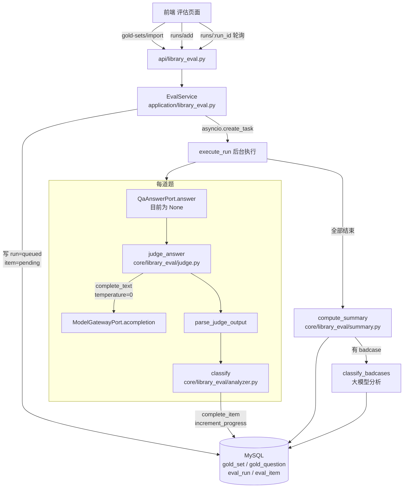
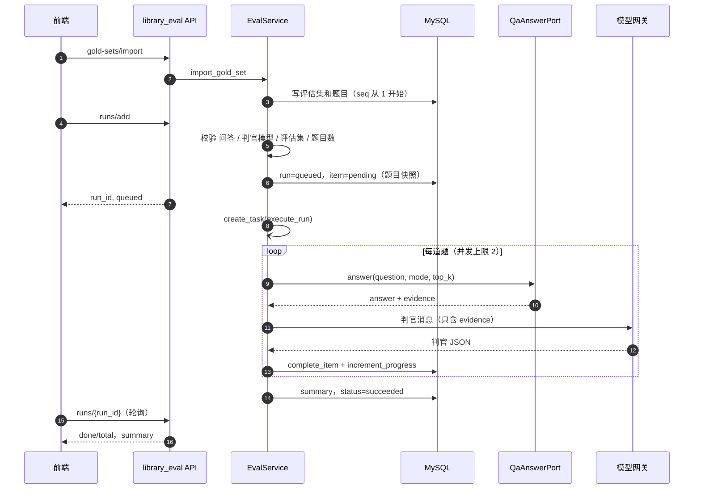
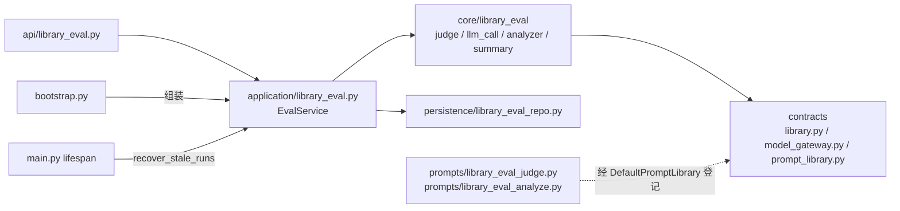
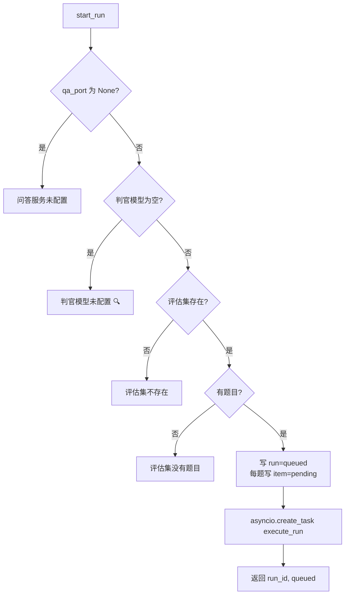
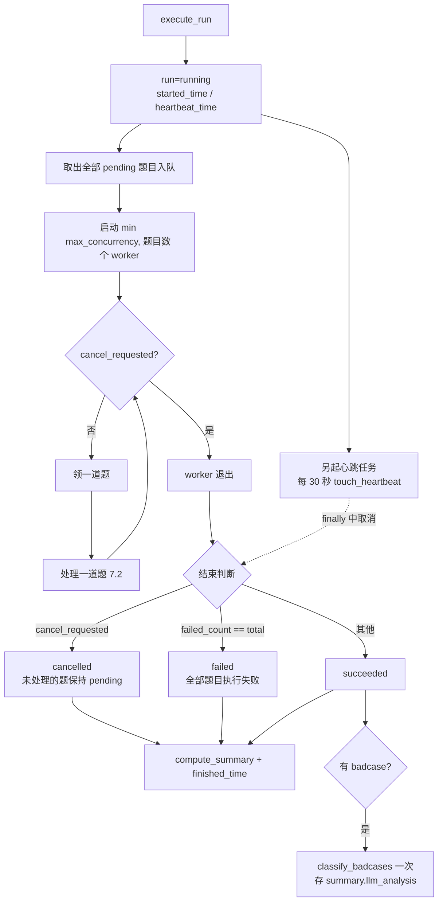
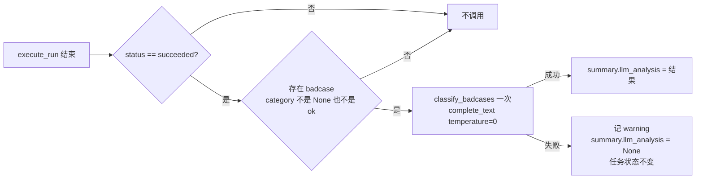
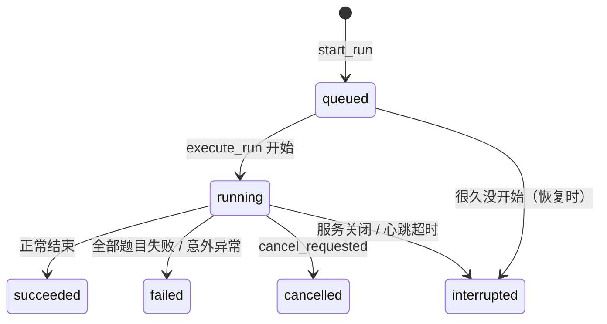

# RAG 评估导览

> 适用仓库：`tap-ai-backend`（分支 `feature/tap-10366` 及其后续）
> 描述口径：**按当前代码的真实状态描述**，并标出与设计不一致、尚未完成、尚待核对的地方。
> 依据：《Library 设计总纲》、P0–P3 任务书、整改任务书、各轮只读排查与验收报告、git 记录。
> 读者：团队内的后端、前端、测试同学。

**标记说明**

| 标记 | 含义 |
| --- | --- |
| ✅ | 已确认：有代码原文、行号或测试作为证据 |
| 📐 | 按设计：设计总纲或任务书这样规定，但还没有看到对应的代码原文 |
| ⚠️ | 存在的问题：已确认有问题，还没有修 |
| 🔍 | 待核对：不同报告之间互相矛盾，或修复之后没有再验证 |
| ⛔ | 缺口：功能还没打通 |

---

## 目录

- [0. 一页看懂](#0-一页看懂)
- [1. 总体介绍](#1-总体介绍)
- [2. 快速使用](#2-快速使用)
- [3. 总体架构与分层](#3-总体架构与分层)
- [4. 接口层：接口一览](#4-接口层接口一览)
- [5. 评估集导入](#5-评估集导入)
- [6. 发起评估](#6-发起评估)
- [7. 后台执行](#7-后台执行)
- [8. 判官：提示词、调模型、解析](#8-判官提示词调模型解析)
- [9. 问题分类与汇总](#9-问题分类与汇总)
- [10. 大模型 badcase 分析](#10-大模型-badcase-分析)
- [11. 取消、中断恢复与关闭](#11-取消中断恢复与关闭)
- [12. 插座契约：QaAnswerPort](#12-插座契约qaanswerport)
- [13. 数据表](#13-数据表)
- [14. 状态机](#14-状态机)
- [15. 配置项](#15-配置项)
- [16. 错误信息与返回约定](#16-错误信息与返回约定)
- [17. 从旧 POC 迁移过来的对照](#17-从旧-poc-迁移过来的对照)
- [18. 测试与验收](#18-测试与验收)
- [19. 现状总表](#19-现状总表)
- [20. 存在的问题与缺口](#20-存在的问题与缺口)
- [21. 待核对清单与核对命令](#21-待核对清单与核对命令)
- [22. 后续计划](#22-后续计划)
- [附录 A：文件 / 函数速查表](#附录-a文件--函数速查表)
- [附录 B：术语表](#附录-b术语表)

---

## 0. 一页看懂

| 问题 | 一句话回答 |
| --- | --- |
| 它是什么 | Library 的「RAG 评估」模块：导入一组标准问答（评估集），让问答系统逐题作答，由大模型判官按 4 个维度打分，再做问题分类和改进建议。 |
| 入口在哪 | HTTP 路由前缀 `/tap/ai/library/eval`，代码在 `src/tap_ai/api/library_eval.py`。 |
| 业务在哪 | `src/tap_ai/application/library_eval.py` 的 `EvalService`；纯逻辑在 `src/tap_ai/core/library_eval/`。 |
| 怎么跑 | 发起后立刻返回 `run_id`，后台逐题执行；前端轮询进度。不用 SSE。 |
| 判官看什么 | **只看问答返回的「答案 + 答案实际用到的证据」**，不另外检索。这是相对旧 POC 修掉的核心问题。 |
| 数据存哪 | MySQL 4 张表：评估集、题目、评估任务、每题结果。报告不存文件，每次从明细现算。 |
| 现在能用到哪一步 | 导入评估集、查询：可用；**发起评估：不可用**，问答插座为空，直接返回「问答服务未配置」。 |
| 判官版本 | `v2.1`。判官的输入和旧 POC 不同，新旧分数不能直接比较。 |

---

## 1. 总体介绍

### 1.1 模块定位

| 编号 | 模块 | 和评估的关系 |
| --- | --- | --- |
| ① | 知识库管理 | 上游。评估问的问题，答案来自它写进索引和图谱的内容 |
| ② | 切片审核 | 平级。评估发现「内容不全、切片截断」类问题后，可以到切片审核里修 |
| ③ | **RAG 评估（本文）** | 评估集 → 逐题作答 → 判官打分 → 分类汇总 → 大模型分析 |
| ④ | 知识图谱 | 间接。问答用到的图谱事实会作为「推断证据」交给判官 |
| — | 问答（`/tap/ai/conversations/chat` 及知识插件） | **评估的被测对象**，通过 `QaAnswerPort` 插座接入 |

### 1.2 设计目标

1. **判官和答案看同一份证据**：旧 POC 里判官看的切片，和生成答案用的切片不是同一份，「推断证据」还被写死成空字符串。新模块规定判官只看 `QaResult.evidence`。
2. **长任务不怕断**：评估一次十几分钟。任务表加后台执行加前端轮询；每做完一题写一次进度和心跳；服务重启后把心跳超时的任务标成「中断」。
3. **一题出错不影响整体**：单题失败或超时只标记这一题，其余继续。
4. **提示词不写在业务代码里**：判官和分析的提示词都放在 `prompts/` 目录，通过提示词库（PromptLibrary）取用。
5. **调模型统一走模型网关**：`ModelGatewayPort.acompletion`，调用会被 Langfuse 记录。
6. **不依赖问答的具体实现**：问答通过插座接入，测试用假实现。

### 1.3 总体流程图



一句话：**发起时建任务和题目快照，后台逐题「问答 → 判官 → 分类」，结束后汇总并做一次大模型分析，前端轮询看结果。**

---

## 2. 快速使用

### 2.1 本地准备

| 步骤 | 做什么 | 说明 |
| --- | --- | --- |
| 1 | 执行建表 `sql/002_create_library_tables.sql` | 包含评估的 4 张表 |
| 2 | 配好模型网关（`TAP_AI_LITELLM_BASE_URL` 等后端原有配置） | 判官和大模型分析都走网关 |
| 3 | 可选：`TAP_AI_LIBRARY_EVAL_JUDGE_MODEL` | 判官模型名。为空时的行为见 21 节 🔍 |
| 4 | 启动后端 | K2a 之后路由默认挂载 ✅ |

### 2.2 最小调用示例

**① 导入评估集**

```http
POST /tap/ai/library/eval/gold-sets/import
{
  "saas_id": "jp", "user_id": "u001",
  "name": "jp-poc 基础集", "version": "v1",
  "items": [
    {"question": "QlikSense是什么类型的工具？", "ideal_answer": "……", "expected_source": "#18_QlikSense.pptx / slide-3"},
    {"question": "……", "ideal_answer": "……", "key_points": ["要点1", "要点2"]}
  ]
}
```

**② 发起评估**（目前会返回「问答服务未配置」）

```http
POST /tap/ai/library/eval/runs/add
{"saas_id": "jp", "user_id": "u001", "gold_set_id": "<32位id>", "answer_mode": "agent", "top_k": 5}
```

```json
{"run_id": "9f3c...", "status": "queued"}
```

**③ 轮询进度**（每 3–5 秒一次，状态到了 succeeded / failed / cancelled / interrupted 就停）

```http
GET /tap/ai/library/eval/runs/{run_id}
```

```json
{"id": "9f3c...", "status": "running", "total": 40, "done": 17, "failed_count": 1, "parse_error_count": 0,
 "judge_version": "v2.1", "answer_mode": "agent",
 "summary": null, "cancel_requested": false}
```

**④ 看每道题的结果、看分析**

```http
POST /tap/ai/library/eval/items/list
{"saas_id": "jp", "run_id": "9f3c...", "category": "retrieval_miss", "page": 1, "page_size": 20}

GET /tap/ai/library/eval/items/{item_id}
GET /tap/ai/library/eval/runs/{run_id}/analysis
```

### 2.3 一次完整的使用旅程



---

## 3. 总体架构与分层

### 3.1 分层



- core 只依赖 contracts，不 import prompts、persistence、plugins、api（有 ast 架构测试）。
- ⚠️ `application/library_eval.py` 直接 import 了 persistence 层，验收时只确认「存在」，还没决定要不要改。

### 3.2 文件分布

| 层 | 文件 | 作用 |
| --- | --- | --- |
| 接口 | `src/tap_ai/api/library_eval.py` | 10 个路由，前缀 `/tap/ai/library/eval`，标签 `library-eval` |
| 请求模型 | `src/tap_ai/contracts/library.py` | `GoldQuestionIn`、`GoldSetImportRequest`、`GoldSetListRequest`、`GoldQuestionListRequest`、`EvalRunAddRequest`、`EvalRunListRequest`、`EvalRunCancelRequest`、`EvalItemListRequest` |
| 插座和数据 | `src/tap_ai/contracts/library.py` | `QaAnswerPort`、`QaResult`、`EvidenceItem`、`AnswerMode`、`EvidenceKind` |
| 返回模型 | `src/tap_ai/api/dto.py` | `GoldSetData`、`GoldQuestionData`、`EvalRunStartData`、`EvalRunData`、`EvalItemData`、`EvalItemBriefData`、`EvalAnalysisData` 及各自的 ListData |
| 业务 | `src/tap_ai/application/library_eval.py` | `EvalService` |
| 判官 | `src/tap_ai/core/library_eval/judge.py` | 拼消息、调模型、解析、`JUDGE_VERSION` |
| 调模型 | `src/tap_ai/core/library_eval/llm_call.py` | `complete_text` |
| 分类 | `src/tap_ai/core/library_eval/analyzer.py` | `classify`、`classify_badcases`、`_dim_means`、`_weakest_dim`、`_extract_score` |
| 汇总 | `src/tap_ai/core/library_eval/summary.py` | `compute_summary`、`build_analysis` |
| 提示词 | `src/tap_ai/prompts/library_eval_judge.py` | `JUDGE_V2_SYSTEM_PROMPT`（:9）、`JUDGE_V2_USER_PROMPT_TEMPLATE`（:13）、`build_judge_v2_user_prompt`（:55） |
| 提示词 | `src/tap_ai/prompts/library_eval_analyze.py` | badcase 分析提示词（整改时从 analyzer 中移出） |
| 提示词登记 | `contracts/prompt_library.py`（:53-64）、`prompts/library.py`（:81-102） | `library_eval_judge_v2_system`、`library_eval_judge_v2_user` |
| 仓储 | `src/tap_ai/persistence/library_eval_repo.py` | 4 张表的读写 |
| ORM | `src/tap_ai/persistence/models.py` | `LibraryEvalGoldSet`、`LibraryEvalGoldQuestion`、`LibraryEvalRun`、`LibraryEvalItem` |
| 启动恢复 | `src/tap_ai/main.py`（:118-124） | lifespan 里调用 `recover_stale_runs` |
| 组装 | `src/tap_ai/bootstrap.py` | 构造 `EvalService`、登记关闭回调、挂载路由 |

### 3.3 组装（bootstrap）

✅ 原文（K2a 只去掉了外层的 `if library_enabled`）：

```python
from tap_ai.application.library_eval import EvalService

model_gateway = container.model_registry.get("model_gateway")
library_eval_service = EvalService(
    settings=app_settings,
    session_factory=session_factory,
    prompt_library=default_prompt_library,
    model_gateway=model_gateway,
    qa_port=None,
)
app.state.library_eval_service = library_eval_service
lifecycle.callback(library_eval_service.shutdown)
```

- 构造参数实际是 `session_factory`，不是 P3 任务书写的 `eval_repo`，仓储在服务内部创建。以代码为准。
- `qa_port=None`，所以发起评估走不通。
- 不加入 `_REACT_REQUIRED`，评估组件出错不会拖垮整个服务。

✅ 启动恢复（`main.py:118-124`）：

```python
if app_state is not None:
    library_eval_service = getattr(app_state, "library_eval_service", None)
    if library_eval_service is not None:
        try:
            await library_eval_service.recover_stale_runs()
        except Exception:
            _tap_logger.warning("Library 评估中断恢复失败", exc_info=True)
```

---

## 4. 接口层：接口一览

前缀 `/tap/ai/library/eval`，只用 GET 和 POST。

| # | 方法 | 路径 | 请求 | 返回 | 证据 |
| --- | --- | --- | --- | --- | --- |
| 10 | POST | `/gold-sets/import` | `GoldSetImportRequest` | `GoldSetData` | 📐 |
| 11 | POST | `/gold-sets/list` | `GoldSetListRequest` | `GoldSetListData` | 📐 |
| 12 | POST | `/gold-sets/questions/list` | `GoldQuestionListRequest` | `GoldQuestionListData` | 📐 |
| 13 | POST | `/runs/add` | `EvalRunAddRequest` | `EvalRunStartData` | ✅ 有接口测试 |
| 14 | POST | `/runs/list` | `EvalRunListRequest` | `EvalRunListData` | 📐 |
| 15 | GET | `/runs/{run_id}` | 路径参数 | `EvalRunData` | ✅ 有接口测试 |
| 16 | POST | `/runs/cancel` | `EvalRunCancelRequest` | `EvalRunData` | 📐 |
| 17 | GET | `/runs/{run_id}/analysis` | 路径参数 | `EvalAnalysisData` | 📐 |
| 18 | POST | `/items/list` | `EvalItemListRequest` | `EvalItemListData` | ✅ 有接口测试 |
| 19 | GET | `/items/{item_id}` | 路径参数 | `EvalItemData` | 📐 |

### 4.1 列表与详情的区别

- `items/list` 返回 `EvalItemBriefData`，**不带 `evidence` 和 `judge_raw`**，避免列表过大。
- `items/{item_id}` 返回 `EvalItemData`，带全部证据和判官原文。
- ⚠️ 曾有 mypy 报错：`api/library_eval.py:131` 的 `items/list` 返回了 `EvalItemData`，类型不对。整改任务书已要求修，🔍 修复结果未再验证。

### 4.2 主要返回字段

| 模型 | 字段 |
| --- | --- |
| `EvalRunData` | id, gold_set_id, answer_mode, top_k, judge_model, judge_version, status, total, done, failed_count, parse_error_count, summary, cancel_requested, started_time, finished_time, error, create_time, update_time |
| `EvalItemData` | id, run_id, seq, question, ideal_answer, expected_source, answer, evidence, scores, category, parse_error, judge_raw, latency_ms, token_usage, error, status |
| `EvalAnalysisData` | summary, category_counts, category_examples（每类最多 5 个 item id）, suggestions |

---

## 5. 评估集导入

📐 `import_gold_set(req)`：

- 一次导入 1–1000 题，评估集名 1–128 字。
- 每题字段：`question`（非空）、`ideal_answer`（非空）、`expected_source`（可空）、`key_points`（可空，字符串列表）。
- `seq` 按导入顺序从 1 开始编号；`question_count` 等于题目数。

✅ 仓储写法（`library_eval_repo.py:35-51`）：先建 `LibraryEvalGoldSet`，再逐条建 `LibraryEvalGoldQuestion`。

**旧评估集怎么导进来**：旧 POC 的 `evals/rag_gold_set.jsonl`（30 条日文真实问答）和 `rag_gold_set_ja.jsonl`（12 题），字段是 `question / ideal_answer / expected_source`，没有 `key_points`。按上面的 JSON 格式转换后调用导入接口即可。

---

## 6. 发起评估

### 6.1 校验顺序



### 6.2 写入内容

- `top_k` 没传时用 `library_eval_default_top_k`（默认 5）。
- run：`status=queued`、`total=题目数`、`done=0`、`failed_count=0`、`parse_error_count=0`、`judge_model`、`judge_version=v2.1`。
- item：同一事务里每题一条，`status=pending`，并**复制** `question`、`ideal_answer`、`expected_source` 作为快照。以后评估集变了也不影响这次的结果。

### 6.3 后台任务的引用

✅ `application/library_eval.py:196-199`：

```python
task = asyncio.create_task(self.execute_run(run_id))
self._tasks.add(task)
task.add_done_callback(self._tasks.discard)
```

任务对象存进集合，防止被垃圾回收；完成后自动移除。服务关闭时用这个集合取消所有任务。

---

## 7. 后台执行

### 7.1 主流程



### 7.2 处理一道题

1. 记录开始时间。
2. `qa = await asyncio.wait_for(qa_port.answer(question, mode=run.answer_mode, top_k=run.top_k), timeout=library_eval_item_timeout_sec)`。
3. 取该题的 `key_points`。
4. `judge_result, usage = await judge_answer(...)`，**判官看到的证据就是 `qa.evidence`**。
5. `category = classify(...)`。
6. `complete_item`：写 answer、evidence、scores（解析失败时为 None）、category、parse_error、judge_raw、latency_ms、token_usage，`status=done`。
7. `increment_progress(done_delta=1, parse_error_delta=0/1, heartbeat_time=now)`：**原子加法**，不是先读再写。
8. 任何 `Exception`（包括超时）：`fail_item(error="异常类名: 信息")`（最多 2000 字），`increment_progress(done_delta=1, failed_delta=1)`，然后继续下一题。
9. `asyncio.CancelledError` **不能被吞掉**，必须继续往外抛。

### 7.3 计数口径

- `done` = 已结束的题目数，成功和出错都算。
- `failed_count` = 出错的题目数。
- `parse_error_count` = 判官输出解析失败的题目数（不计入平均分）。

### 7.4 捕获所有异常的地方

✅ 设计上有 3 处必须捕获所有异常（单题出错不能停、落库失败要记录、意外错误要标失败），ruff 会报 BLE001：`application/library_eval.py` 第 331 行、第 440 行，`application/library_chunks.py` 第 175 行。仓库已有的写法是：

```python
except Exception as exc:  # noqa: BLE001 - 线程内异常要透传回主协程统一处理
```

整改任务书要求照抄这种写法并写明原因。🔍 修改结果未再验证。

---

## 8. 判官：提示词、调模型、解析

### 8.1 提示词的位置和取用

✅ 提示词原文放在 `prompts/library_eval_judge.py`，通过提示词库登记：

```python
# prompts/library.py:81-102（DefaultPromptLibrary）
def library_eval_judge_v2_system(self) -> str:
    return library_eval_judge_mod.JUDGE_V2_SYSTEM_PROMPT

def library_eval_judge_v2_user(self, *, question, expected_answer, key_points,
                               original_evidence, derived_evidence, actual_output) -> str:
    return library_eval_judge_mod.build_judge_v2_user_prompt(...)
```

✅ judge.py 取用（:148-156）：

```python
system_msg = prompt_library.library_eval_judge_v2_system()
user_msg = prompt_library.library_eval_judge_v2_user(
    question=question,
    expected_answer=ideal_answer or "(未提供)",
    key_points=kp_text,
    original_evidence=original_evidence,
    derived_evidence=derived_evidence,
    actual_output=answer or "(生成失败)",
)
```

✅ 提示词库的解析：`judge.py:346` 调用 `resolve_prompt_library(prompt_library)`；它优先用注入的实例，否则用 bootstrap 登记的默认实现，都没有就报错（`contracts/prompt_library.py:88-101`）。

### 8.2 占位符和数据来源

| 模板占位符 | 新数据来源 |
| --- | --- |
| `{question}` | 题目 `question` |
| `{expected_answer}` | `ideal_answer`（旧模板里叫 expected_answer），为空时填 `(未提供)` |
| `{key_points}` | `key_points` 逐条编号；为空时沿用旧代码的占位文字 |
| `{original_evidence}` | `evidence` 中 `kind == "chunk"` 的条目 |
| `{derived_evidence}` | `evidence` 中 `kind` 为 `kg_fact` 或 `derived` 的条目 |
| `{actual_output}` | `QaResult.answer`，为空时填 `(生成失败)` |

📐 证据格式：原文证据每条第一行是 `[序号] 来源：{source_file} / {page_or_sheet} / chunk_id={chunk_id}`；推断证据第一行是 `[序号] 类型：图谱事实` 或 `[序号] 类型：推断`。两栏各自编号；没有时填「（无）」，**不能填空字符串**；单条超过 4000 字截断。

### 8.3 调模型：complete_text

✅ 调用方式（`judge.py:357-362`）：

```python
raw, usage = await complete_text(
    gateway,
    model=model,
    messages=messages,
    temperature=0.0,
)
```

✅ 内部写法与 `core/intent_extractor.py` 一致：`gateway.acompletion(...)` → `async for` 逐段拼接 → `finally` 中关闭流 → 返回 `(去掉首尾空白的完整文本, usage)`。

🔍 有一份较新的排查报告把 `complete_text` 写成 `(*, gateway, model, system, user) -> str`，与上面的调用方式不一致。以 21 节的命令核对。

### 8.4 解析：parse_judge_output

📐 规则：

- 兼容纯 JSON、被 ```` ```json ```` 包裹、JSON 前后有其他文字三种情况。逐字符配对大括号，取第一个完整的 JSON 对象（正确跳过字符串里的括号，不用贪婪正则）。
- 四个维度的分数必须是 1–5 的整数：`4` 可以，`"4"` 可以转换；`4.5`、`0`、`6`、`"四"`、`null` 都算失败。`reason` 必须是字符串。
- 任何一项不满足：`parse_error=True`、`scores=None`、`raw` 保留原文。**绝不抛异常。**

### 8.5 评分维度

| 统一名称 | 中文 | 存储格式 |
| --- | --- | --- |
| `faithfulness` | 忠实度 | `{"score": 1-5, "reason": "..."}` |
| `answer_relevance` | 答案相关性 | 同上 |
| `completeness` | 完整性 | 同上 |
| `correctness` | 正确性 | 同上 |

`JUDGE_VERSION = "v2.1"`。

---

## 9. 问题分类与汇总

### 9.1 规则分类 classify

✅ 函数存在于 `core/library_eval/analyzer.py`。注意：**旧 POC 没有 `analyzer.py`，也没有规则分类函数**，旧版只有大模型分析。规则分类是新模块新写的。

📐 整改任务书规定的规则（按顺序，命中第一条就返回）：

| # | 条件 | 类别 |
| --- | --- | --- |
| 1 | `status == "error"` | `None`（不分类） |
| 2 | `parse_error` 为真，或 `scores` 为空 | `judge_parse_error` |
| 3 | `correctness ≥ 3` | `ok` |
| 4 | `kind == "chunk"` 的证据为 0 条 | `empty_retrieval` |
| 5 | `expected_source` 不为空，且所有切片证据的 `source_file` 都不匹配 | `retrieval_miss` |
| 6 | `completeness ≤ 2` | `context_fragment` |
| 7 | `faithfulness ≤ 2` | `generation_issue` |
| 8 | 其他 | `other` |

规则 5 的匹配方式：取 `expected_source` 中第一个 ` / ` 之前的部分作为文件名，两边去首尾空白、转小写后完全相等才算匹配。

📐 每类的改进建议 `SUGGESTIONS`：

| 类别 | 建议 |
| --- | --- |
| `judge_parse_error` | 检查判官模型的输出格式，必要时重跑该题 |
| `empty_retrieval` | 检查该问题能否检索到切片，确认相关文档已入库、检索参数是否过严 |
| `retrieval_miss` | 检索到了切片但不是期望的文件，检查查询改写、关键词和向量召回 |
| `context_fragment` | 找到了正确的文件但内容不全，考虑命中后回填相邻内容或调整切片粒度 |
| `generation_issue` | 答案包含证据不支持的内容，检查生成提示词和推断证据的使用 |
| `other` | 需要人工查看 |

🔍 整改前的 `classify` 用的是另一套类别，整改后是否已改成上表，整改核对的结果没有回来。

### 9.2 汇总 compute_summary / build_analysis

✅ `summary.py` 已从旧版的「跨批次报告」改成「单次评估」视角：单次 items 的 summary、category_examples、suggestions。

📐 口径：

- 四个维度各自的平均分：只统计 `status=done` 且 `parse_error=False` 且 `scores` 不为空的题目，保留 2 位小数；没有可统计的题目时为 `None`。
- 计数：total、done、failed、parse_error，以及各类别的数量。
- `build_analysis`：summary、category_counts、category_examples（每类最多 5 个 item id，按 seq 排序）、suggestions（只含出现过的类别）。

⚠️ 曾有 mypy 报错：`summary.py:45` 的 `min(..., key=字典.get)` 类型不对，整改要求改成 `key=lambda k: 字典[k]`；`application/library_eval.py:535` 调用 `build_analysis` 时参数个数不对。🔍 修复结果未再验证。

---

## 10. 大模型 badcase 分析

### 10.1 和旧版的关系

✅ 旧 POC `runtime.py` 里有 `_ANALYZE_SYSTEM_PROMPT`、`_ANALYZE_FEW_SHOT` 和 `analyze_results()`，让大模型对 `correctness < 3` 的题目做根因分析，类别不固定、由模型灵活推断。新模块里对应 `analyzer.py` 的 `classify_badcases`。

### 10.2 调用时机



- 其他任何地方都不调用 `classify_badcases`。`get_analysis` 只读取 `summary["llm_analysis"]` 原样返回，不调模型。
- ✅ 入口函数是 `application/library_eval.py` 的 `_build_llm_analysis`（:575 附近）。原来第一行是开关判断 `library_eval_llm_analysis_enabled`，K2a 删除了这个开关，现在有 badcase 就分析。

### 10.3 提示词位置

✅ 整改前，`analyzer.py:22-31` 直接写着提示词原文，文件头注释却说「通过 PromptLibrary 获取」，两者不一致。整改要求把原文移到 `prompts/library_eval_analyze.py`，并像判官提示词一样登记进提示词库。✅ `prompts/library_eval_analyze.py` 已经存在（+42 行），`contracts/prompt_library.py` 增加了 4 行、`prompts/library.py` 增加了 7 行。🔍 `analyzer.py` 里是否已经没有提示词原文，没有再看过。

---

## 11. 取消、中断恢复与关闭

| 操作 | 做什么 | 结果 |
| --- | --- | --- |
| 取消 `runs/cancel` | 只把 `cancel_requested` 设为真；已结束的任务返回「评估任务已结束，无法取消」 | worker 领下一题前检查到就退出；正在做的那题会做完；状态变成 `cancelled`，剩下的题保持 `pending` |
| 中断恢复 `recover_stale_runs` | 服务启动时找出心跳超过 `library_eval_heartbeat_timeout_sec`（默认 600 秒）的任务 | 标成 `interrupted`，error「服务重启或实例中断」。心跳还新鲜的不动，它可能正在别的实例上运行 |
| 关闭 `shutdown` | 由 `lifecycle.callback` 在服务关闭时调用：取消 `_tasks` 里所有任务并等待结束 | 正在跑的任务收到 `CancelledError`，标成 `interrupted`，error「服务关闭」 |

✅ 仓储里有 `find_stale_runs`；状态更新用 `rowcount` 判断是否成功（`library_eval_repo.py:282、324、432`）。⚠️ 这三处曾有 mypy 类型报错，整改要求改成 `cast(CursorResult[Any], ...)`。🔍 修复结果未再验证。

---

## 12. 插座契约：QaAnswerPort

✅ `contracts/library.py`：

```python
AnswerMode = Literal["llm", "agent"]                    # llm：检索 + 一次生成；agent：智能体
EvidenceKind = Literal["chunk", "kg_fact", "derived"]   # 原文切片 / 图谱事实 / 推断内容

class EvidenceItem(BaseModel):
    kind: EvidenceKind
    content: str
    chunk_id: str | None = None
    source_file: str | None = None
    page_or_sheet: str | None = None
    score: float | None = None

class QaResult(BaseModel):
    answer: str
    evidence: list[EvidenceItem] = Field(default_factory=list)  # 生成答案时实际用到的全部证据
    trace_id: str | None = None

class QaAnswerPort(Protocol):
    async def answer(self, *, question: str, mode: AnswerMode, top_k: int) -> QaResult: ...
```

**对实现方的要求**：`evidence` 必须是**生成答案时真正用到的那一份**，不能为了评估另外再检索一次，否则又回到旧 POC 的问题。每条证据要标明类型，切片证据要带 `chunk_id`、`source_file`、`page_or_sheet`。

⛔ 目前 bootstrap 注入的是 `None`。问答（`plugins/extensions/knowledge/` 加上 ReAct 主链路）需要一个适配器，把一次问答的答案和用到的切片、图谱事实整理成 `QaResult`。

---

## 13. 数据表

建表文件 `sql/002_create_library_tables.sql`。通用列（id、租户四字段、create_time、update_time、deleted、delete_time）照抄 001 中 conversation 表。

### 13.1 library_eval_gold_set（评估集）

| 列 | 类型 | 说明 |
| --- | --- | --- |
| `name` | VARCHAR(128) | 评估集名 |
| `version` | VARCHAR(32) NULL | 版本 |
| `description` | VARCHAR(512) NULL | 说明 |
| `question_count` | INT | 题目数 |

### 13.2 library_eval_gold_question（题目）

| 列 | 类型 | 说明 |
| --- | --- | --- |
| `set_id` | VARCHAR(32) | 所属评估集 |
| `seq` | INT | 题号，从 1 开始；索引 `(set_id, seq)` |
| `question` / `ideal_answer` | TEXT | 题目和标准答案 |
| `expected_source` | VARCHAR(512) NULL | 期望来源，形如 `文件名 / slide-3` |
| `key_points` | JSON NULL | 要点列表 |

### 13.3 library_eval_run（评估任务）

| 列 | 类型 | 说明 |
| --- | --- | --- |
| `gold_set_id` | VARCHAR(32) | 用哪个评估集 |
| `answer_mode` | VARCHAR(16) | `llm` / `agent` |
| `top_k` | INT | 检索条数 |
| `judge_model` / `judge_version` | VARCHAR | 判官模型和版本 |
| `status` | VARCHAR(16) | 见 14 节；有索引 |
| `total` / `done` / `failed_count` / `parse_error_count` | INT | 进度计数 |
| `summary` | JSON NULL | 汇总结果，含 `llm_analysis` |
| `cancel_requested` | TINYINT | 取消标记 |
| `heartbeat_time` / `started_time` / `finished_time` | BIGINT NULL | 毫秒时间戳 |
| `error` | TEXT NULL | 失败原因 |

### 13.4 library_eval_item（每题结果）

| 列 | 类型 | 说明 |
| --- | --- | --- |
| `run_id` / `question_id` / `seq` | — | 索引 `(run_id, seq)`、`(run_id, category)` |
| `question` / `ideal_answer` / `expected_source` | — | 发起时复制的题目快照 |
| `answer` | MEDIUMTEXT NULL | 问答的答案 |
| `evidence` | JSON NULL | 问答返回的证据（判官看到的就是它） |
| `scores` | JSON NULL | 四个维度的分数和理由 |
| `category` | VARCHAR(32) NULL | 规则分类结果 |
| `parse_error` | TINYINT | 判官输出是否解析失败 |
| `judge_raw` | MEDIUMTEXT NULL | 判官原始输出 |
| `latency_ms` / `token_usage` | — | 耗时和用量 |
| `error` / `status` | — | 出错信息；`pending` / `done` / `error` |

✅ 4 个 ORM 类在 `persistence/models.py`，曾因缩进被嵌套进上一个类，导致整个后端导入失败，已手动修复并提交。

---

## 14. 状态机

### 14.1 评估任务



### 14.2 每道题

`pending`（待处理）→ `done`（完成，含判官解析失败）或 `error`（问答出错、超时）。取消时没处理的题保持 `pending`。

---

## 15. 配置项

环境变量统一带 `TAP_AI_` 前缀，定义在 `config/settings.py`。

| 配置 | 默认 | 范围 | 说明 |
| --- | --- | --- | --- |
| `library_eval_judge_model` | `""` | — | 判官模型名。后端默认模型 `DEFAULT_MODEL = "openai/GPT-5.4"`（`settings.py:23`） |
| `library_eval_max_concurrency` | 2 | 1–8 | 同时评估的题目数上限 |
| `library_eval_default_top_k` | 5 | 1–50 | 没传 `top_k` 时用它 |
| `library_eval_item_timeout_sec` | 300 | 1–3600 | 单题问答超时 |
| `library_eval_heartbeat_timeout_sec` | 600 | 60–86400 | 心跳超过这个秒数判定中断 |
| `library_enabled` | **已删除**（K2a） | — | 原总开关 |
| `library_eval_llm_analysis_enabled` | **已删除**（K2a） | — | 原大模型分析开关；现在有 badcase 就分析 |

---

## 16. 错误信息与返回约定

所有业务错误都是 **HTTP 200 + `{"code": "CCB001", "message": "..."}`**；请求参数校验失败由框架返回 422。

| message | 什么时候出现 |
| --- | --- |
| 问答服务未配置 | `qa_port` 为 None（**现在发起评估都会停在这里**） |
| 判官模型未配置 | `library_eval_judge_model` 为空（🔍 是否已改成用默认模型） |
| 评估集不存在 | 按 id 查不到 |
| 评估集没有题目 | 题目数为 0 |
| 评估任务不存在 | 按 run_id 查不到 |
| 评估题目不存在 | 按 item_id 查不到 |
| 评估任务已结束，无法取消 | 状态是 succeeded / failed / cancelled / interrupted |

---

## 17. 从旧 POC 迁移过来的对照

旧 POC 位置：`jap-cycle-poc/kb_poc/skills/rag_eval/runtime.py` 的 `RagEvalSkillRuntime`，作为 skill 同步运行，报告写成 Markdown 文件。

| 旧 | 新 | 处理方式 |
| --- | --- | --- |
| `run_rag_eval` 主流程 | `EvalService.start_run` + `execute_run` | 改成任务表加后台执行加轮询 |
| `_load_dataset` / `_load_jsonl`（`evals/rag_gold_set.jsonl`） | `import_gold_set` + 两张表 | 评估集存数据库 |
| `_search` + `_generate_answer`（`LocalAnswerer` 又重新检索一次） | `QaAnswerPort.answer` | **修掉了**：判官只看问答返回的证据 |
| `derived_evidence = ""` 写死 | 推断证据栏填 `kg_fact` / `derived` | **修掉了** |
| `_judge_v2` + `JUDGE_V2_*` 提示词 | `judge.py` + `prompts/library_eval_judge.py` | 提示词逐字复制，通过提示词库取用 |
| `_judge_v1` | — | 不迁移（旧版也没调用） |
| `OpenAICompatibleClient`（`COPILOT_MODEL`） | `ModelGatewayPort.acompletion` | 统一走模型网关 |
| `analyze_results` + `_ANALYZE_*` | `classify_badcases` + `prompts/library_eval_analyze.py` | 只在任务成功且有 badcase 时调用一次 |
| （旧版没有） | `classify` 规则分类 | 新增 |
| `_summarize` / `_summarize_dimensions`（跨批次） | `compute_summary` / `build_analysis`（单次） | 口径改为单次评估 |
| `_render_report` / `_write_report`（`eval_reports/*.md`） | `runs/{run_id}/analysis` 现算 | 不存文件 |
| `_eval_registry.json`、`scan_eval_reports` | `runs/list` | 用数据库代替 |
| `_expand_table_context`（写了但没调用） | — | 不迁移 |
| `answerer.retriever.store._search_client` 私有访问 | — | 删除 |
| `use_advanced_qa` 临时开关 | `answer_mode: llm / agent` | 改成请求参数 |
| `manifest.json`、skill 注册 | — | 不迁移，后端用接口提供功能 |

---

## 18. 测试与验收

### 18.1 测试文件

| 测试 | 覆盖 |
| --- | --- |
| `tests/unit/test_library_eval_core.py` | `complete_text` 拼接和关闭流、证据格式化、推断证据栏不为空、key_points 三种情况、提示词逐字一致、`parse_judge_output` 至少 10 个用例、分类、汇总、core 架构检查 |
| `tests/unit/test_library_eval_service.py` | 导入、发起的 4 种校验、正常跑完、**判官收到的证据就是问答返回的证据**、单题异常、单题超时、全部失败、解析失败、取消、并发上限、中断恢复、关闭（+1244 行） |
| `tests/api/test_library_eval_api.py` | `runs/add` 返回 queued、不存在的 run 返回 CCB001、`items/list` 分页结构、问答未配置 |

全部用手写假对象：`FakeEvalRepo`、`FakeQa`、`FakeGateway`（实现流式 `acompletion`，记录收到的 messages）、`FakePromptLibrary`。

### 18.2 曾经出现过的失败（整改前）

| 失败 | 原因 |
| --- | --- |
| 7 个 `SimpleNamespace() got multiple values for keyword argument ...` | 测试本身写错，同一个配置项传了两次 |
| `test_list_items_existing_run_returns_repo_result`：`assert [] == [...]` | `list_items` 没把仓储结果传出来 |
| `test_runs_add_returns_run_id_and_queued`、`test_items_list_returns_items_total_page_and_page_size` | 返回模型校验失败（`EvalRunStartData`、`EvalItemData`） |
| `tests/unit/test_library_eval_service.py:27` F401 | 导入了 `JudgeResult` 但没用 |

🔍 整改后是否全部通过，没有再验证。

### 18.3 常用命令

```powershell
Set-Location C:\Users\234393\Desktop\tap-ai-backend
$py = ".\.venv\Scripts\python.exe"
& $py -m pytest -q tests/unit/test_library_eval_core.py tests/unit/test_library_eval_service.py tests/api/test_library_eval_api.py
& $py -m mypy src/tap_ai/core/library_eval src/tap_ai/application/library_eval.py src/tap_ai/persistence/library_eval_repo.py
& $py -c "import tap_ai.application; print('ok')"
```

### 18.4 dit 自测用例

| 编号 | 场景 | 步骤 | 预期 |
| --- | --- | --- | --- |
| EV-01 | 评估列表 | 打开评估页面 | 列表返回 200 并正常显示 |
| EV-02 | 发起一次评估 | 发起评估 → 等待完成 | 问答插座接上之前，预期返回「问答服务未配置」；接上之后显示分数和分析结果 |

### 18.5 接上问答以后的第一次验收

1. 导入旧 POC 的 30 题评估集。
2. 分别用 `llm` 和 `agent` 各跑一次，作为 `v2.1` 的新基线。
3. 抽查 3 道题的详情：判官原文里的原文证据、推断证据，和 `evidence` 字段逐条一致。
4. 不要和旧 POC 的分数直接比较。

---

## 19. 现状总表

| 环节 | 状态 | 依据 |
| --- | --- | --- |
| 路由挂载 | ✅ 默认挂载 | K2a；`53ca2fb` 修复了「所有接口 404」 |
| 导入评估集、查询评估集和题目 | ✅ 代码已写，📐 接口原文未看 | P3 |
| 发起评估 | ⛔ 不可用 | `qa_port=None` |
| 后台执行、取消、恢复、关闭 | ✅ 代码已写；🔍 整改后测试未再验证 | `library_eval.py:196-199`、`main.py:118-124` |
| 判官 | ✅ 提示词已入库、调用 temperature=0 | `judge.py:148-156、357-362` |
| 规则分类 | ✅ 函数存在；🔍 规则是否已改成 9.1 的版本 | 整改核对未回 |
| 大模型分析 | ✅ 开关已删；🔍 提示词是否已全部移出 analyzer | K2a |
| 建表 | 📐 SQL 已写，各环境由团队执行 | `sql/002` |
| dit 联调 | 🔍 未验证 | — |

---

## 20. 存在的问题与缺口

| # | 类型 | 问题 | 影响 | 建议 |
| --- | --- | --- | --- | --- |
| 1 | ⛔ | 问答插座没有实现 | 评估跑不起来 | 写一个问答适配器，返回答案和**实际用到的**切片、图谱事实 |
| 2 | ⛔ | 问答链路目前没有现成的「把用到的证据一起返回」的出口 | 适配器拿不到真实证据 | 需要从 ReAct 的工具调用记录或知识插件的检索结果里整理；`llm` 和 `agent` 两种模式分别处理 |
| 3 | ⚠️ | 评估集没有 `key_points` | 完整性维度只能用占位文字，判官不知道要点 | 给评估集补要点，重新导入 |
| 4 | ⚠️ | application 直接 import persistence | 违反分层 | 未决定是否整改 |
| 5 | ⚠️ | `application/__init__.py` 导入副作用重 | 曾导致整个后端起不来 | 结构风险，后续拆分 |
| 6 | ⚠️ | 后台任务跑在接到请求的那个实例里 | 实例被重启时，任务只能标成中断，不会自动续跑 | 需要续跑时再引入任务队列 |
| 7 | ⚠️ | 来源可追溯检查（attribution）没有做 | 不能判断答案里每句话出自哪条证据 | 下一期 |
| 8 | ⚠️ | 判官改为 `v2.1` | 新旧分数不能直接比较 | 接上问答后重新跑基线 |

---

## 21. 待核对清单与核对命令

| # | 待核对 | 为什么不确定 |
| --- | --- | --- |
| 1 | `complete_text` 的签名和返回值 | 验收报告是 `(gateway, *, model, messages, temperature) -> (raw, usage)`；另一份排查报告写成 `(*, gateway, model, system, user) -> str` |
| 2 | 判官模型为空时报错，还是用默认模型 | 曾建议改成用默认模型，没有看到改动 |
| 3 | `classify` 是否已按 9.1 的 8 条规则实现 | 整改核对的结果没有回来 |
| 4 | `analyzer.py` 中是否已没有提示词原文 | 同上 |
| 5 | 整改后测试、ruff、mypy 是否全部通过 | 同上 |
| 6 | 10 个接口的真实路径 | 部分接口只在设计里出现过 |
| 7 | bootstrap 中 `qa_port=` 现在传的是什么 | 最近没有看过原文 |

以下命令都是只读，在后端目录里运行：

```powershell
git grep -n "@router\." -- src/tap_ai/api/library_eval.py
git grep -n "async def complete_text" -A 12 -- src/tap_ai/core/library_eval/llm_call.py
git grep -n "library_eval_judge_model" -- src
git grep -n "def classify" -A 40 -- src/tap_ai/core/library_eval/analyzer.py
git grep -n -E "SUGGESTIONS|_ANALYZE_SYSTEM_PROMPT|_ANALYZE_FEW_SHOT" -- src/tap_ai
git grep -n -E "EvalService\(|qa_port=" -- src/tap_ai/bootstrap.py
& .\.venv\Scripts\python.exe -m pytest -q tests/unit/test_library_eval_core.py tests/unit/test_library_eval_service.py tests/api/test_library_eval_api.py 2>&1 | Select-Object -Last 20
& .\.venv\Scripts\python.exe -m mypy src/tap_ai/core/library_eval src/tap_ai/application/library_eval.py src/tap_ai/persistence/library_eval_repo.py src/tap_ai/api/library_eval.py
```

---

## 22. 后续计划

1. 跑完 21 节的核对命令，把本导览中的 📐 和 🔍 更新成 ✅ 或问题项。
2. 实现问答适配器（`QaAnswerPort`），重点保证证据是真实用到的那一份。
3. 接上后导入旧评估集，`llm` 和 `agent` 各跑一次，建立 `v2.1` 基线。
4. 给评估集补 `key_points`。
5. 下一期：来源可追溯检查；需要时引入任务队列支持续跑。

---

## 附录 A：文件 / 函数速查表

| 想找 | 去哪 |
| --- | --- |
| 10 个路由 | `api/library_eval.py` |
| 请求模型、插座 | `contracts/library.py` |
| 返回模型 | `api/dto.py`（`GoldSet*`、`GoldQuestion*`、`EvalRun*`、`EvalItem*`、`EvalAnalysisData`） |
| 发起、执行、取消 | `application/library_eval.py`：`start_run`、`execute_run`、`cancel_run`；后台任务 :196-199 |
| 恢复、关闭 | `application/library_eval.py`：`recover_stale_runs`、`shutdown`；`main.py:118-124` |
| 大模型分析入口 | `application/library_eval.py`：`_build_llm_analysis`（:575 附近） |
| 判官 | `core/library_eval/judge.py`：`build_judge_messages`、`parse_judge_output`、`judge_answer`、`JUDGE_VERSION`；取提示词 :148-156，调模型 :357-362 |
| 调模型 | `core/library_eval/llm_call.py`：`complete_text` |
| 分类 | `core/library_eval/analyzer.py`：`classify`、`classify_badcases`、`_dim_means`、`_weakest_dim`、`_extract_score` |
| 汇总 | `core/library_eval/summary.py`：`compute_summary`、`build_analysis` |
| 判官提示词 | `prompts/library_eval_judge.py` :9 / :13 / :55 |
| 分析提示词 | `prompts/library_eval_analyze.py` |
| 提示词登记 | `contracts/prompt_library.py` :53-64、:88-101；`prompts/library.py` :81-102 |
| 仓储 | `persistence/library_eval_repo.py`：建评估集 :35、`get_gold_set` :72、评估集列表 :88、`list_all_questions`、`get_run`、任务列表 :232、`list_pending_items`、`list_items_for_run` :398、`get_item`、更新题目 :425、`find_stale_runs` |
| ORM | `persistence/models.py`：`LibraryEvalGoldSet`、`LibraryEvalGoldQuestion`、`LibraryEvalRun`、`LibraryEvalItem` |
| 组装 | `bootstrap.py`：`EvalService(...)`、`lifecycle.callback(library_eval_service.shutdown)` |
| 建表 | `sql/002_create_library_tables.sql` |

## 附录 B：术语表

| 术语 | 含义 |
| --- | --- |
| 评估集（gold set） | 一组标准问答：题目、标准答案、期望来源、要点 |
| 判官（judge） | 用大模型按 4 个维度给答案打分 |
| 证据（evidence） | 问答生成答案时实际用到的内容；`chunk` 原文切片、`kg_fact` 图谱事实、`derived` 推断内容 |
| 原文证据 / 推断证据 | 判官提示词里的两栏：前者是切片，后者是图谱事实和推断 |
| badcase | 规则分类结果不是 `ok` 也不是 `None` 的题目 |
| `answer_mode` | `llm`：检索后生成一次；`agent`：智能体 |
| 心跳 | 执行中每 30 秒更新一次 `heartbeat_time`，用来判断任务是否还活着 |
| 中断恢复 | 服务启动时把心跳超时的任务标成 `interrupted` |
| `v2.1` | 当前判官版本；与旧 POC 的 v2 输入不同，分数不能直接比 |
| 插座（Port） | contracts 里定义的接口，由插件实现，bootstrap 注入 |
